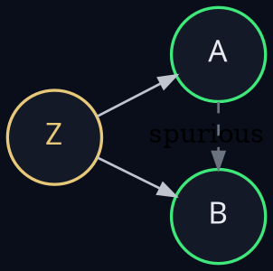
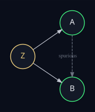

A short example. Two strategies, A and B, each driven in part by a common
factor Z (think: broad market). With no causal relationship between A and
B, their returns will still co-move because of the shared driver — a
textbook case of confounding.

## Setup

``` python
import numpy as np
import pandas as pd
from matplotlib.colors import LinearSegmentedColormap
import _oos_style

rng = np.random.default_rng(13)
N = 60  # months

Z  = rng.normal(0.008, 0.04, N)    # common factor (market-ish)
eA = rng.normal(0, 0.02, N)        # A's idiosyncratic noise
eB = rng.normal(0, 0.02, N)        # B's idiosyncratic noise

A = 0.7 * Z + eA
B = 0.5 * Z + eB

df = pd.DataFrame({"Z": Z, "A": A, "B": B})
df.describe().round(4)
```

|       |       Z |       A |       B |
|:------|--------:|--------:|--------:|
| count | 60      | 60      | 60      |
| mean  |  0.0181 |  0.0107 |  0.0125 |
| std   |  0.0394 |  0.0324 |  0.0324 |
| min   | -0.1151 | -0.0684 | -0.0659 |
| 25%   | -0.0063 | -0.0059 | -0.0094 |
| 50%   |  0.0218 |  0.0111 |  0.0154 |
| 75%   |  0.0443 |  0.0317 |  0.0338 |
| max   |  0.0858 |  0.0703 |  0.0802 |

## A helper for OOS-styled correlation tables

``` python
OOS = _oos_style.OOS

cmap = LinearSegmentedColormap.from_list(
    "oos_diverging",
    [(0.0, OOS["red"]), (0.5, OOS["rule"]), (1.0, OOS["accent"])],
)

def text_color(v):
    """Flip text dark on bright cells, light on dark cells."""
    return f"color: {OOS['bg'] if abs(v) > 0.55 else OOS['ink']}"

def styled_corr(corr):
    return (
        corr.style
            .background_gradient(cmap=cmap, vmin=-1, vmax=1)
            .map(text_color)
            .format("{:+.2f}")
            .set_properties(**{
                "font-family": "IBM Plex Mono, monospace",
                "font-size": "12.5px",
                "text-align": "center",
                "padding": "10px 18px",
                "border": f"1px solid {OOS['bg']}",
            })
            .set_table_styles([
                {"selector": "th", "props": [
                    ("color", OOS["ink"]),
                    ("background-color", OOS["bg"]),
                    ("font-weight", "600"),
                    ("text-align", "center"),
                    ("padding", "8px 18px"),
                    ("border-bottom", f"1px solid {OOS['rule']}"),
                ]},
                {"selector": "table", "props": [
                    ("border-collapse", "collapse"),
                    ("margin", "20px auto"),
                ]},
            ])
    )
```

## Marginal correlation

``` python
styled_corr(df.corr())
```

<style type="text/css">
#T_042ef th {
  color: #e8eaf0;
  background-color: #0a0e1a;
  font-weight: 600;
  text-align: center;
  padding: 8px 18px;
  border-bottom: 1px solid #2a3344;
}
#T_042ef table {
  border-collapse: collapse;
  margin: 20px auto;
}
#T_042ef_row0_col0, #T_042ef_row1_col1, #T_042ef_row2_col2 {
  background-color: #3ee87a;
  color: #000000;
  color: #0a0e1a;
  font-family: IBM Plex Mono, monospace;
  font-size: 12.5px;
  text-align: center;
  padding: 10px 18px;
  border: 1px solid #0a0e1a;
}
#T_042ef_row0_col1, #T_042ef_row1_col0 {
  background-color: #3ac36f;
  color: #000000;
  color: #0a0e1a;
  font-family: IBM Plex Mono, monospace;
  font-size: 12.5px;
  text-align: center;
  padding: 10px 18px;
  border: 1px solid #0a0e1a;
}
#T_042ef_row0_col2, #T_042ef_row2_col0 {
  background-color: #38b26a;
  color: #f1f1f1;
  color: #0a0e1a;
  font-family: IBM Plex Mono, monospace;
  font-size: 12.5px;
  text-align: center;
  padding: 10px 18px;
  border: 1px solid #0a0e1a;
}
#T_042ef_row1_col2, #T_042ef_row2_col1 {
  background-color: #349160;
  color: #f1f1f1;
  color: #e8eaf0;
  font-family: IBM Plex Mono, monospace;
  font-size: 12.5px;
  text-align: center;
  padding: 10px 18px;
  border: 1px solid #0a0e1a;
}
</style>
<table id="T_042ef">
  <thead>
    <tr>
      <th class="blank level0" >&nbsp;</th>
      <th id="T_042ef_level0_col0" class="col_heading level0 col0" >Z</th>
      <th id="T_042ef_level0_col1" class="col_heading level0 col1" >A</th>
      <th id="T_042ef_level0_col2" class="col_heading level0 col2" >B</th>
    </tr>
  </thead>
  <tbody>
    <tr>
      <th id="T_042ef_level0_row0" class="row_heading level0 row0" >Z</th>
      <td id="T_042ef_row0_col0" class="data row0 col0" >+1.00</td>
      <td id="T_042ef_row0_col1" class="data row0 col1" >+0.79</td>
      <td id="T_042ef_row0_col2" class="data row0 col2" >+0.70</td>
    </tr>
    <tr>
      <th id="T_042ef_level0_row1" class="row_heading level0 row1" >A</th>
      <td id="T_042ef_row1_col0" class="data row1 col0" >+0.79</td>
      <td id="T_042ef_row1_col1" class="data row1 col1" >+1.00</td>
      <td id="T_042ef_row1_col2" class="data row1 col2" >+0.52</td>
    </tr>
    <tr>
      <th id="T_042ef_level0_row2" class="row_heading level0 row2" >B</th>
      <td id="T_042ef_row2_col0" class="data row2 col0" >+0.70</td>
      <td id="T_042ef_row2_col1" class="data row2 col1" >+0.52</td>
      <td id="T_042ef_row2_col2" class="data row2 col2" >+1.00</td>
    </tr>
  </tbody>
</table>


A and B come out at $\rho \approx 0.5$ — high enough to look like signal.
But it's all driven by Z.

## Conditional correlation

If we residualize A and B against Z and recompute the correlation, the
relationship should disappear:

``` python
beta_A = np.cov(df.A, df.Z, ddof=0)[0, 1] / np.var(df.Z)
beta_B = np.cov(df.B, df.Z, ddof=0)[0, 1] / np.var(df.Z)

resid = pd.DataFrame({
    "A | Z": df.A - beta_A * df.Z,
    "B | Z": df.B - beta_B * df.Z,
})

styled_corr(resid.corr())
```

<style type="text/css">
#T_0cc54 th {
  color: #e8eaf0;
  background-color: #0a0e1a;
  font-weight: 600;
  text-align: center;
  padding: 8px 18px;
  border-bottom: 1px solid #2a3344;
}
#T_0cc54 table {
  border-collapse: collapse;
  margin: 20px auto;
}
#T_0cc54_row0_col0, #T_0cc54_row1_col1 {
  background-color: #3ee87a;
  color: #000000;
  color: #0a0e1a;
  font-family: IBM Plex Mono, monospace;
  font-size: 12.5px;
  text-align: center;
  padding: 10px 18px;
  border: 1px solid #0a0e1a;
}
#T_0cc54_row0_col1, #T_0cc54_row1_col0 {
  background-color: #3c3748;
  color: #f1f1f1;
  color: #e8eaf0;
  font-family: IBM Plex Mono, monospace;
  font-size: 12.5px;
  text-align: center;
  padding: 10px 18px;
  border: 1px solid #0a0e1a;
}
</style>
<table id="T_0cc54">
  <thead>
    <tr>
      <th class="blank level0" >&nbsp;</th>
      <th id="T_0cc54_level0_col0" class="col_heading level0 col0" >A | Z</th>
      <th id="T_0cc54_level0_col1" class="col_heading level0 col1" >B | Z</th>
    </tr>
  </thead>
  <tbody>
    <tr>
      <th id="T_0cc54_level0_row0" class="row_heading level0 row0" >A | Z</th>
      <td id="T_0cc54_row0_col0" class="data row0 col0" >+1.00</td>
      <td id="T_0cc54_row0_col1" class="data row0 col1" >-0.09</td>
    </tr>
    <tr>
      <th id="T_0cc54_level0_row1" class="row_heading level0 row1" >B | Z</th>
      <td id="T_0cc54_row1_col0" class="data row1 col0" >-0.09</td>
      <td id="T_0cc54_row1_col1" class="data row1 col1" >+1.00</td>
    </tr>
  </tbody>
</table>


The remaining correlation between $A \mid Z$ and $B \mid Z$ is small and
not distinguishable from sampling noise — exactly what you'd expect when
the apparent association ran through Z all along.

## The DAG





Z (in amber) is the confounder. The solid arrows from Z to both A and B
account for the apparent association; the dashed arrow between A and B is
the *spurious* relationship we'd see if we never measured Z. The applied
lesson is older than ML and still ignored about half the time: if you
can imagine a Z that would generate the pattern you see, you have to
either measure Z and condition on it, or accept that your estimate is
biased.
