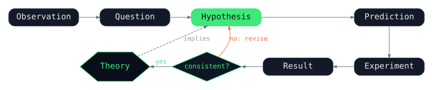
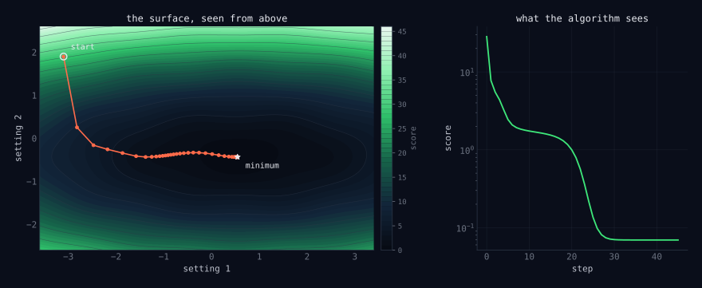
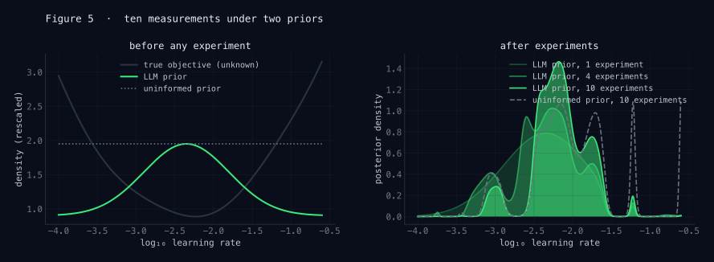

In March 2026 Andrej Karpathy released
[`autoresearch`](https://github.com/karpathy/autoresearch), a small repository
in which a language model tries to improve a training script on its own. It
edits the code, runs a five-minute experiment, checks the score, keeps the change
if the score improved, and starts again. Left alone overnight, it runs about a
hundred experiments.

The training script is incidental. What autoresearch shows is that one step of
the scientific method, deciding what to try next, can now be handed to a model,
and that this works on any problem where you can write down a number that means
"better." I think this is the beginning of a new way to do research. This post
explains why it works, how the loop is built, and how to set one up on your own
problem.

## Science is a loop

<figure class="diagram" id="science">
  
  <figcaption>The scientific method.</figcaption>
</figure>

You observe something, propose an explanation, make a prediction, run an
experiment, and keep or revise the explanation depending on what you see. Then
you go around again.

Of these steps, the proposal has always been the slow one. Running an experiment
can be automated, but deciding which experiment is worth running has needed a
person who knows the field. Because experiments were expensive, scientists spent
most of their effort choosing carefully and ran relatively few. A whole career
might involve hundreds of experiments.

## When there is a slope

There is one kind of problem where computers have long done the proposing
themselves. If the thing you are adjusting is a list of numbers, and the score
changes smoothly as you adjust them, then the score has a slope, and the slope
tells you which way to go. That is gradient descent. It is the reason machine
learning works at all: a model with billions of parameters gets trained by
taking small steps downhill, over and over.

<figure class="wide" id="descent">
  
</figure>

The left panel is a score surface seen from above, with the path gradient
descent takes to the bottom. The right panel is the score falling at each step.
Nobody has to think about where to go next.

## "There is no slope."

<figure class="wide" id="spoon" style="width: min(480px, calc(100vw - 32px));">
  
  <figcaption>Neo (Keanu Reeves) in <em>The Matrix</em> (1999). Still: Warner Bros., via Looper.</figcaption>
</figure>

Most of science does not look like that. A hypothesis is usually a protocol, a
piece of analysis code, a set of features, a molecule. You cannot nudge a
protocol a little bit in some direction, so there is no slope to follow. Even
Karpathy's training script is like this. The agent changes the depth of the
network, swaps the optimizer, rewrites blocks of code. Those are edits to a
program, and a program has no gradient.

Without a slope, the options used to be poor. You could try things at random,
try a grid of settings, or mutate candidates and keep the best. These methods
know nothing about the problem, so they need an enormous number of tries. Or a
person could propose the next attempt, which is informed but slow.

A language model is a third option. It has read a large share of the world's
code, papers and lab notes, so its guesses are informed. It knows that a learning
rate of 0.1 will probably blow up a training run. It has a sense of what a
sensible next experiment looks like even in fields it has only read about. And it
can make a new guess every few minutes, all night.

<figure class="wide" id="bayes">
  
</figure>

The figure is a toy version of that difference. On the left is the true score
for a single setting, and two starting beliefs about where the best value is: a
flat one that knows nothing, and a narrow one centred near the right answer. On
the right is how belief sharpens as experiments come in. Starting from the
informed guess, four experiments get closer to the truth than ten starting from
nothing. When each experiment costs five minutes, or five hours, that difference
decides whether a search is practical.

DeepMind's FunSearch and AlphaEvolve had already shown that a model proposing
programs against an automatic test can find new results, but those systems ran
on large internal infrastructure. Autoresearch is a few files, one GPU and git,
which puts the same idea within reach of anyone who has a problem and a score.

## How autoresearch works

Three files matter.

- `train.py` is the only file the agent may edit. It holds the model, the
  optimizer and the training loop.
- `prepare.py` holds the test, which reports `val_bpb`, a validation loss where
  lower is better. The agent is not allowed to touch it.
- `program.md` holds the instructions, written by a person, that tell the agent
  how to run the loop.

The agent reads the code, decides on a change, edits `train.py` and commits. It
runs training for exactly five minutes and reads off the score. If the score
improved, the commit stays. If not, git resets to the previous best. Either way
the agent adds a line to a log describing what it tried and what happened, and
then it starts again.

<figure class="diagram" id="loop">
  
  <figcaption>The autoresearch loop.</figcaption>
</figure>

Three design choices make it work. Every run gets the same five minutes, so a
big architectural change and a small change to a constant are judged on equal
terms. The test is fixed and out of the agent's reach, so it cannot raise its
score by changing how the score is computed. And git keeps the best version so
far safe, so a bad idea costs one reset.

In the first reported overnight session, the agent ran 125 experiments over
about ten and a half hours and brought `val_bpb` from 0.9979 down to 0.9697. Its
biggest single win was halving the batch size so that more training steps fit
in the five minutes. It is the kind of change a good researcher might try. Here
it turned up as one of 125 attempts while nobody was watching.

## It works on anything with a score

Nothing in the loop is specific to neural networks. It needs three things:
something the agent can edit, a test that turns it into a number, and a trial
short enough to run many times. Here is what that looks like in other places.

| what the agent edits | how it is scored | one trial |
|---|---|---|
| a training script | validation loss | five minutes on a GPU |
| a template engine | speed and memory, with all tests passing | the benchmark suite |
| features for a materials model | prediction error on held-out compounds | one model fit |
| a candidate drug molecule | a docking score | one calculation |
| a trading signal | out-of-sample returns after costs | one backtest |
| a prompt or a set of instructions | accuracy on held-out examples | a batch of model calls |

Some of these have already been done. Tobi Lütke ran the loop on
[Liquid](https://github.com/Shopify/liquid/pull/2056), the template language he
wrote for Shopify twenty years ago. About 120 experiments produced 93 kept
commits, which together cut parse and render time by 53% and memory allocations
by 61%, with all 974 tests still passing. Cobelli and Sanvito used it in
materials science, letting an agent design the input features for models that
predict band gaps and Curie temperatures. The agent's features beat the standard
hand-built ones, and chemists could read and make sense of them. Anthropic's
`skill-creator` runs the same loop on plain text: it rewrites a skill's
description, measures how reliably the skill triggers on held-out test queries,
and keeps the best version.

The common thread is that the agent does not need to understand the domain
deeply. It needs to make reasonable guesses, and the test does the rest.

## How to try it on your own problem

Start with a problem you already care about, where a number can tell you
whether one attempt is better than another. Then:

1. **Choose what the agent may edit.** Ideally a single file. The data, the test
   and everything else stay outside it. Keep it small enough that you can read
   every change the agent makes.
2. **Write the test first.** It takes the edited file and returns one number.
   Run it several times on the same file and see how much the number moves on its
   own. That spread is your noise, and an improvement smaller than it doesn't
   count.
3. **Give every trial the same budget.** A fixed time limit, enforced by the
   script that runs the trial rather than by the agent, keeps comparisons fair.
   Keep it short. Two to five minutes gets you a hundred trials a night.
4. **Let git hold the search.** One commit per attempt. Keep it if the score
   beats the current best by more than the noise, and reset it otherwise. The
   branch is always the best version so far.
5. **Write the instructions.** Put the rules in a short file, start a coding
   agent in that directory, and tell it to read the file and begin.

The instructions can be this short:

```markdown
Artifact: pipeline.py — the only file you may edit
Frozen:   eval.py, data/ — do not modify, do not install packages
Trial:    python run.py, hard cap 120 s
Metric:   prints "score: <float>", lower is better
Loop:     edit, commit, run, read the score, keep if better else reset
Log:      append commit, score, status, description to results.tsv
Rules:    never stop, never ask, simplest change that improves wins
```

Then go to bed, and read the log in the morning.

## What can go wrong

The loop optimizes exactly the number you give it, and most problems come from
that.

Often the quick score stands in for something slower that you actually care
about. A docking score is cheap, but what matters is whether the molecule binds
in a real assay, which takes weeks. A backtest is cheap, but what matters is how
the strategy does in the market. Run long enough, the loop will find candidates
that score well and fail in reality, because the gap between the two is the
easiest place to find improvements. Treat what it finds as strong hypotheses to
check in the lab or on unseen data. In trading that means freezing the data
before you start, holding back a period the agent never sees, and charging for
costs.

Noise is the second problem. If the score jumps around by as much as the
improvement you are hoping for, "keep it if the score went down" will keep lucky
runs. Measuring the noise first, and only keeping improvements bigger than it,
is the fix.

The model's knowledge also cuts both ways. Its guesses are sensible, which is
why it beats random search, but it rarely tries anything strange. If it believes
something is necessary it will seldom try removing it. Running several agents,
or explicitly asking for bolder changes, helps.

And it won't work at all if you can't reduce "better" to a single number, or if
each trial takes days.

## What the scientist does now

The loop does the searching. It does not decide what is worth searching for. A
person still chooses the question, writes the test, and decides what the agent
may touch and how much noise to tolerate. In autoresearch all of that lives in
`program.md`. The person no longer edits the training script; they edit the
instructions for the agent that does.

This is close to how a research lab already works. The principal investigator
picks the problem, sets the standard of evidence, and reads the lab notebook.
Students propose experiments, run them, and write down what happened. The agent
is a student that never gets tired and has no favourite idea. Unlike a real
student, it doesn't get wiser over the years or ask whether the problem is the
right one. That part is still yours.

What changes is the number of experiments. Someone who used to run ten careful
experiments on an idea can now run a thousand overnight, and spend their own
time on picking the question and building a test that measures it honestly.
Any field with a number that means "better" can be searched this way, and most
of them haven't started.

---

**References**

- [karpathy/autoresearch](https://github.com/karpathy/autoresearch), including `program.md`.
- Shopify/liquid [#2056](https://github.com/Shopify/liquid/pull/2056), the Liquid result, with the benchmark table and methodology.
- Cobelli and Sanvito, [Agentic Design of Compositional Descriptors via Autoresearch for Materials Science Applications](https://arxiv.org/abs/2605.14671), *Digital Discovery*, 2026.
- Anthropic, [`skill-creator`](https://github.com/anthropics/skills/blob/main/skills/skill-creator/SKILL.md), including `scripts/run_loop`.
- Romera-Paredes et al., [Mathematical discoveries from program search with large language models](https://www.nature.com/articles/s41586-023-06924-6), *Nature*, 2024.
- [AlphaEvolve](https://deepmind.google/discover/blog/alphaevolve-a-gemini-powered-coding-agent-for-designing-advanced-algorithms/), DeepMind, 2025.
