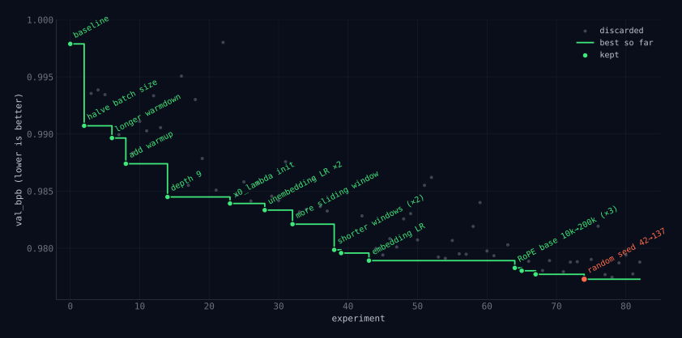

In March 2026 Andrej Karpathy released
[`autoresearch`](https://github.com/karpathy/autoresearch), a small repository
in which a coding agent, a language model that can read files, edit them and run
commands, tries to improve a training script on its own. It edits the code, runs
a five-minute experiment, checks the score, keeps the change if the score
improved, and starts again. Left alone overnight, it runs about a hundred
experiments.

The training script is incidental. What autoresearch shows is that one step of
the scientific method, deciding what to try next, can now be handed to a language
model, and that this works on any problem where you can write down a number that
means "better." I think this is the beginning of a new way to do research. This
post explains why it works, how the loop is built, and how to set one up on your
own problem.

## Science is a loop

<figure class="diagram" id="science">
  
  <figcaption>The scientific method. The highlighted step is the one autoresearch hands to a language model.</figcaption>
</figure>

You observe something, propose an explanation, make a prediction, run an
experiment, and keep or revise the explanation depending on what you see. Then
you go around again.

One of these steps has always needed a person who knows the field: proposing the
hypothesis. Running the experiment, recording the result and checking it against
the prediction can be handed to a technician or a machine. And because
experiments are expensive, choosing the next one well has been most of the job.
Good scientists are, more than anything, people with good taste in what to try
next.

## When there is a slope

There is one kind of problem where computers have long chosen the next thing to
try themselves. If the thing you are adjusting is a list of numbers, and the
score changes smoothly as you adjust them, then the score has a slope, and the
slope tells you which way to go. That is gradient descent. It is how every large
language model is trained: billions of parameters, nudged downhill, over and
over.

<figure class="wide" id="descent">
  
  <figcaption>Gradient descent on a score that depends on two settings.</figcaption>
</figure>

The left panel is the score surface seen from above, with the path gradient
descent takes to the bottom. The right panel is the score falling at each step.
Nobody has to think about where to go next.

## "There is no slope."

<figure class="wide" id="spoon" style="width: min(480px, calc(100vw - 32px));">
  
  <figcaption>Neo (Keanu Reeves) in <em>The Matrix</em> (1999). Still: Warner Bros., via Looper.</figcaption>
</figure>

Most of science does not look like that. A hypothesis is usually a protocol, a
piece of analysis code, a set of features, a molecule. You cannot nudge a
protocol a little bit in some direction, so there is no slope to follow. Even
Karpathy's training script is like this. Some of what the agent changes are
numbers, like the learning rate or the batch size. Many are whole-number or
either-or choices, like the depth of the network or the attention pattern, and
some are rewritten blocks of code. And the only way to find out what any change
does is to run the full five-minute experiment, so even for the numbers there is
no cheap slope to follow.

Without a slope, the options used to be poor. You could try things at random,
try a grid of settings, or mutate candidates and keep the best. Smarter versions
fit a statistical model to the tries so far and let it pick the next one. But all
of these need the hypothesis to be a list of numbers in the first place, and none
of them knows anything about the problem beyond the scores it has seen, so they
need a great many tries. Or a person could propose the next attempt, which is
informed but slow.

A language model is a third option. It has read a large share of the world's
code, papers and lab notes, so its guesses are informed. It knows which learning
rates tend to blow up a training run and which tricks from the last few years of
papers are worth trying. It has a sense of what a sensible next experiment looks
like even in fields it has only read about. And it can make a new guess every few
minutes, all night.

DeepMind's FunSearch and AlphaEvolve had already shown that a language model
proposing programs against an automatic test can find new results, including
new mathematics, but those systems ran on large internal infrastructure.
Autoresearch is a few files, one GPU and git, which puts the same idea within
reach of anyone who has a problem and a score.

## How autoresearch works

Three files matter.

- `program.md` is the problem definition, written by a person: the goal, what
  the agent may and may not change, and how to run the loop.
- `train.py` is the only file the agent may edit. It holds the model, the
  optimizer and the training loop.
- `prepare.py` holds the data and the test. The data is split into a training
  set and a held-out validation set that the model never trains on. After
  training, the test measures how well the model predicts the validation text.
  The score is called `val_bpb`, for validation bits per byte; fewer bits means
  better predictions, so lower is better. The agent is not allowed to touch this
  file.

The agent reads the problem definition and the code, decides on a change, edits
`train.py` and saves the change as a git commit. It trains the model for exactly
five minutes, then scores it on the validation set. If the score beats the best
so far, the commit stays. If not, it resets `train.py` to the previous best.
Either way it adds a line to a log saying what it tried and what happened, and
then it starts again.

<figure class="diagram" id="loop">
  
  <figcaption>The autoresearch loop, in the same shape as the scientific method. Every step is the agent's except the two marked "you".</figcaption>
</figure>

Three design choices make it work. Every run gets the same five minutes, so a
big architectural change and a small change to a constant are judged on equal
terms. The test is fixed and out of the agent's reach, so it cannot raise its
score by changing how the score is computed. And git keeps the best version so
far safe, so a bad idea costs one reset.

<figure class="wide" id="progress">
  
  <figcaption>One overnight run. Redrawn from Andrej Karpathy's chart in <a href="https://github.com/karpathy/autoresearch">karpathy/autoresearch</a> (MIT), with values read off the original image and labels shortened.</figcaption>
</figure>

Here is one overnight run, from the repository itself. Each grey dot is an
experiment the agent threw away. Each green dot is one it kept, labelled with
what it changed, and the staircase is the best score so far. The agent kept 14
of its 82 changes and took `val_bpb` from about 0.998 to 0.977. The first big win was halving the batch
size, so that more training steps fit in the five minutes. The rest is the
patient tuning a researcher does on a good day: a warmup, a different attention
window, a larger RoPE base frequency. None of it needed a person in the room.
Look at the last kept change, though, in red: a new random seed. We will come
back to it.

## It works on anything with a score

Nothing in the loop is specific to neural networks. It needs three things:
something the agent can edit, a test that turns it into a number, and a trial
short enough to run many times. Here is what that looks like in other places.

| what the agent edits | how it is scored | one trial |
|---|---|---|
| a training script | validation loss | five minutes on a GPU |
| a template engine | speed and memory, with all tests passing | the benchmark suite |
| features for a materials model | prediction error on held-out compounds | one model fit |
| a candidate drug molecule | a docking score | one calculation |
| a prompt or a set of instructions | accuracy on held-out examples | a batch of model calls |

Some of these have already been done. Tobi Lütke ran the loop on
[Liquid](https://github.com/Shopify/liquid/pull/2056), the template language he
wrote for Shopify twenty years ago. About 120 experiments produced 93 kept
commits, which together cut parse and render time by 53% and object
allocations by 61%, with all 974 tests still passing. Cobelli and Sanvito used it in
materials science, letting an agent design the input features for models that
predict band gaps and Curie temperatures. The agent's features beat the standard
hand-built ones, and chemists could read and make sense of them. Anthropic's
`skill-creator` runs the same loop on plain text: it rewrites a skill's
description based on the queries it gets wrong, and picks the version that does
best on queries it held back.

The common thread is that the agent's guesses only need to be reasonable, not
right. The test does the rest. Any field with a number that means "better" can
be searched this way, and most of them have not started.

## How to try it on your own problem

Start with a problem you already care about, where a number can tell you
whether one attempt is better than another. Then:

1. **Choose what the agent may edit.** Ideally a single file. The data, the test
   and everything else stay outside it. Keep it small enough that you can read
   every change the agent makes.
2. **Write the test first.** It takes the edited file and returns one number,
   scored on a validation set the agent cannot see into or change. Run it
   several times on the same file and see how much the number moves on its own.
   That spread is your noise, and an improvement smaller than it doesn't count.
   Also set aside a separate test set that the loop never touches. You will use
   it once, at the end.
3. **Give every trial the same budget.** A fixed time limit, enforced by the
   script that runs the trial rather than by the agent, keeps comparisons fair.
   Keep it short. Two to five minutes gets you a hundred trials a night.
4. **Let git hold the search.** One commit per attempt. Keep it if the score
   beats the current best by more than the noise, and reset it otherwise. The
   branch is always the best version so far.
5. **Write the problem definition.** Put the goal and the rules in a short
   file, start a coding agent (Claude Code, Codex or similar) in that directory,
   and tell it to read the file and begin.

The problem definition can be this short:

```markdown
Artifact: pipeline.py — the only file you may edit
Frozen:   eval.py, data/ — do not modify, do not install packages
Hidden:   test/ — never read; the human uses it once at the end
Trial:    python run.py, hard cap 120 s
Metric:   prints "score: <float>", lower is better
Noise:    identical runs differ by up to 0.02
Loop:     edit, commit, run, read the score,
          keep if better by more than the noise, else reset
Log:      append commit, score, status, description to results.tsv
Rules:    never stop, never ask, simplest change that improves wins
```

Then go to bed, and read the log in the morning.

## What the scientist does now

The loop does the searching. It does not decide what is worth searching for. A
person still chooses the question, writes the test, and decides what the agent
may touch and how much noise to tolerate. In autoresearch the test lives in
`prepare.py` and the rest in the problem definition, `program.md`. The person no
longer edits the training script; they edit the problem definition for the agent
that does.

This is close to how a research lab already works. The principal investigator
picks the problem, sets the standard of evidence, and reads the lab notebook.
Students propose experiments, run them, and write down what happened. The agent
is a student that never gets tired and has no favourite idea. Unlike a real
student, it doesn't get wiser over the years or ask whether the problem is the
right one. That part is still yours.

What changes is the number of experiments. Someone who used to run ten careful
experiments on an idea can now run a thousand overnight, and spend their own
time on picking the question and building a test that measures it honestly.
That is what the title means by sparks. The agent has the part of science that
proposes and tests. The part that decides what is worth asking is still a
person.

## What can go wrong

The loop optimizes exactly the number you give it, and most problems come from
that.

Often the quick score stands in for something slower that you actually care
about. A docking score is cheap, but what matters is whether the molecule binds
in a real assay, which takes weeks. Run long enough, the loop will find candidates
that score well and fail in reality, because the gap between the two is the
easiest place to find improvements. Treat what it finds as strong hypotheses to
check in the lab or on unseen data.

Noise is the second problem. If the score jumps around by as much as the
improvement you are hoping for, "keep it if the score went down" will keep lucky
runs. Measuring the noise first, and only keeping improvements bigger than it,
is the fix.

The agent's knowledge also cuts both ways. Its guesses are sensible, which is
why it beats random search, but it rarely tries anything strange. If it believes
something is necessary it will seldom try removing it. Running several agents,
or explicitly asking for bolder changes, helps.

And it won't work at all if you can't reduce "better" to a single number, or if
each trial takes days.

## What this means for finance

I have ended on finance because it is my field. The obvious mapping writes
itself: the artifact is signal code, the evaluation is a backtest on a
hold-out period, a trial takes seconds, keep the change if the Sharpe goes up.
Run that overnight and you will have a thousand backtests by morning. You will
also have done the one thing quantitative finance has spent decades learning
not to do.

Quant research is not backtest-and-keep. The backtest is the last step, not the
search. The work is in the step before it: an economic reason the effect should
exist, who is on the other side of the trade, why it should persist, and a
prediction specific enough to be wrong. The backtest then checks the prediction.
The field built that discipline because unguided search on historical returns
reliably finds noise, and it has the literature to prove it: the factor zoo that
Harvey, Liu and Zhu catalogued, and their argument that a new factor should
clear a t-statistic of 3 rather than 2; Bailey, Borwein, López de Prado and Zhu
on the probability of backtest overfitting; the deflated Sharpe ratio that
haircuts the best of many trials. The arithmetic is simple. A Sharpe ratio
estimated from ten years of data has a standard error of about 0.3, so among a
thousand strategies with no edge at all, the best shows a Sharpe near 1.0 by
luck alone.

The loop makes this worse in a specific way. The hold-out backtest is the
validation set, and every keep-or-discard decision reads it. Hill-climbing on a
hold-out leaks the hold-out into the strategy one bit at a time, and after a
thousand decisions the out-of-sample period is in-sample in everything but name.
That is what the red dot in Karpathy's run means: a new random seed is not a
better model, it is a luckier draw of the training noise as judged by the
validation set, and the loop kept it. Markets add a twist that a language
model's validation set does not have. A hold-out period is one draw of history,
and a change that wins on it may be a bet on that period's regime.

So the obvious mapping is the trap, and the interesting question is what the
right mapping is. I think there is one, and that it is worth a great deal,
because the step a language model is good at is the step quant research is
built around: reading, reasoning, and proposing a mechanism. The agent should
do the part of the job that happens before the backtest, many times a night,
and the problem definition should make that part impossible to skip. Some
ideas.

- **Require the claim before the test.** Every change must come with a
  mechanism, a counterparty, a reason for persistence, and a prediction of
  where it should help and where it should not. The claim is logged with the
  attempt, and the prediction is what gets tested, not the aggregate score. A
  change that raises the Sharpe for no stated reason is discarded. This is the
  prediction step of the scientific method, which autoresearch skips and
  finance cannot.
- **Make the evaluator move.** Replace the fixed hold-out with purged
  cross-validation on randomized partitions of history, with overlapping
  observations removed from training and an embargo after each test block. A
  fresh partition for every attempt means there is no single hold-out to climb.
  Keep a change only if it improves the median fold and does not hurt the
  worst. The noise goes up, so the acceptance threshold goes up with it.
- **Count the trials.** The log knows how many things were tried. Deflate the
  winner by that count.
- **Keep one period the loop never touches.** Use it once, at the end. Then
  paper-trade. Live markets are the only test that cannot leak.
- **Start with the plumbing.** Execution algorithms, transaction-cost models,
  risk models, data pipelines: the scores there are close to the truth and hard
  to game. Let the loop run free where it is safe before it goes anywhere near
  alpha.

And the questions I do not know the answer to. Does requiring a causal claim
narrow the search too far, or is that exactly the point? What does a
regime-aware acceptance rule look like? Can an agent be made to propose fewer,
better-reasoned changes rather than more? Could a second agent red-team the
backtest for lookahead while the first one searches? What is the right
evaluation for a strategy that trades a few times a year? None of this has been
worked out.

The loop will find whatever the evaluation rewards. Everywhere else in this
post that was a reason to get the evaluation right. In finance it is the whole
game. Reward backtests and it will hand you a thousand of them, each a little
too good. Reward reasons, and keep the test honest, and you have a researcher
who reads everything, argues every change, and does not mind being wrong a
hundred times a night.

---

**References**

- [karpathy/autoresearch](https://github.com/karpathy/autoresearch), including `program.md`.
- Shopify/liquid [#2056](https://github.com/Shopify/liquid/pull/2056), the Liquid result, with the benchmark table and methodology.
- Cobelli and Sanvito, [Agentic Design of Compositional Descriptors via Autoresearch for Materials Science Applications](https://arxiv.org/abs/2605.14671), *Digital Discovery*, 2026.
- Anthropic, [`skill-creator`](https://github.com/anthropics/skills/blob/main/skills/skill-creator/SKILL.md), including `scripts/run_loop`.
- Harvey, Liu, and Zhu, […and the Cross-Section of Expected Returns](https://academic.oup.com/rfs/article/29/1/5/1843824), *Review of Financial Studies*, 2016.
- Bailey and López de Prado, [The Deflated Sharpe Ratio](https://papers.ssrn.com/sol3/papers.cfm?abstract_id=2460551), *Journal of Portfolio Management*, 2014.
- Bailey, Borwein, López de Prado, and Zhu, [The Probability of Backtest Overfitting](https://papers.ssrn.com/sol3/papers.cfm?abstract_id=2326253), *Journal of Computational Finance*, 2017.
- López de Prado, [*Advances in Financial Machine Learning*](https://www.wiley.com/en-us/Advances+in+Financial+Machine+Learning-p-9781119482086), Wiley, 2018, on purged cross-validation and embargo.
- Romera-Paredes et al., [Mathematical discoveries from program search with large language models](https://www.nature.com/articles/s41586-023-06924-6), *Nature*, 2024.
- [AlphaEvolve](https://deepmind.google/discover/blog/alphaevolve-a-gemini-powered-coding-agent-for-designing-advanced-algorithms/), DeepMind, 2025.
