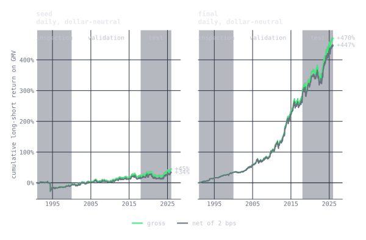
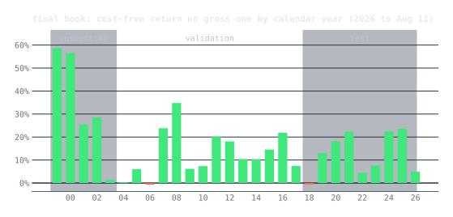
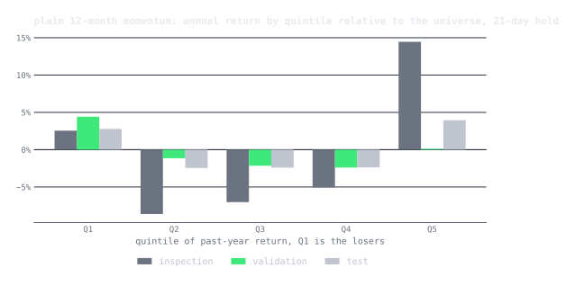
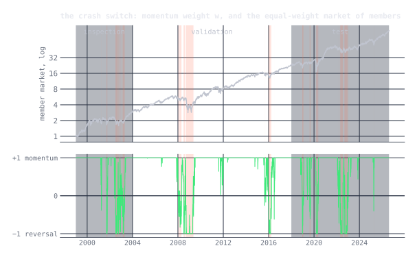

In [autoresearch: sparks of an AI scientist](/posts/ai-scientist/) I argued
that Karpathy's loop, an agent editing one file against a fixed score, would
find noise if you pointed it at a backtest, and I listed what would have to
change for it to find alpha instead: a claim before every test, an evaluator
that moves, a charge for complexity, a count of the trials, a seed of the
firm's own view, and one period the loop never touches. This post is that
list, built and run once.

The seed was textbook momentum, and on 2004 to 2017 it lost money. Sixty
trials later, in 55 minutes and for about twenty dollars of model time, the
agent had a book with a Sharpe of 1.1 on that period, and it held up on the
eight and a half years after it that neither of us had seen: a Sharpe of
0.76, 13.5% a year on gross, against 0.12 for the seed. The most useful thing
in the notebook is not the book. It is the agent's argument, with evidence,
for why the crash defense I gave it was right and the hedge I would have
reached for was not.

The alpha is written in [qex](/posts/qex/), so the agent edits a single
expression. The problem is one I care about: cross-sectional momentum
without the crashes. And the agent is Claude Code, started headless in a
directory with a problem definition and told to begin.

## The lab

Seven files.

| file | role | the agent may |
|---|---|---|
| [`program.md`](lab/program.md) | the problem definition and the firm's beliefs | read |
| [`alpha.qex`](lab/alpha.qex) | one qex expression, the active hypothesis | **edit** |
| [`eval.py`](lab/eval.py) | the frozen evaluator | run, through `trial.sh` |
| [`explore.py`](lab/explore.py) | helpers over the inspection period, 1999 to 2003 | run |
| [`results.tsv`](lab/results.tsv) | the lab notebook, one line per trial | append |
| [`summary.md`](lab/summary.md) | the agent's own account, written at the end | write |
| `data/` | daily prices, universe membership, market cap, sectors | read through `explore.py` |

History is cut three ways, and the loop never mixes them.

| period | dates | who sees it |
|---|---|---|
| inspection | 1999 to 2003 | the agent, freely: the dot-com top, the bear market, the 2003 junk rally |
| validation | 2004 to 2017 | the evaluator only, as a score |
| test | 2018 to 2026-08-11 | nobody, until the end |

The universe is point-in-time. On each day it is the US common stocks with
an as-traded close of at least $2, average dollar volume of at least $5M
and a market cap of at least $300M on that day, from a Sharadar warehouse:
about 1,350 names a day in 1999, 2,000 by 2017, and 8,600 over the whole
history, including every name that was later delisted, went bankrupt or was
bought. A first version of this experiment ran on today's S&P 500 members,
and the loop dutifully learned the survivorship bias of that basket along
with the alpha. Here the losers that fell out of the index on the way down
are in the data, and they are exactly the names a momentum book is short.

## The program

The problem definition is where the firm's view goes. Mine starts with the
goal, then lists twelve beliefs, each with a mechanism, a counterparty, the
paper it comes from, and a prediction specific enough to be wrong.

The goal is momentum without its famous flaw. Every decade or so momentum
loses in a few months what it made in years, and above all in 2009, when
the past year's losers rallied off the March low and a long-short momentum
book lost most of its value. Daniel and Moskowitz showed that these crashes
are not random: they come after the market has fallen, when volatility is
high, in a sharp rebound, and almost entirely on the short side, because
the past losers are by then the highest-beta stocks in the market.

The first four beliefs are the textbook: past-year winners keep winning
relative to their sector, skip the last month, measure the move in units of
the stock's own volatility, hold the book sector-neutral. The rest are about
the crash: residual momentum, leaning away from the crash state, switching
to reversal in it, the frog in the pan, the 52-week high, sizing by risk,
and a note that the edge should be expected to decay. The one I cared most
about is belief 7: in the crash state, do not just shrink the book, flip it,
because a momentum crash is by construction a reversal.

The seed expression is the literal translation of beliefs 1 to 4, 10 and 11,
and nothing else:

```python
let mom   = delay(returns(231), 21),
    vol   = volatility(60),
    score = group_demean(mom / vol, 'sector')
in decay_linear(score / vol, 10)
```

The rules for the agent fit on a card: one change per trial, write the
claim before the run and the outcome after, commit every attempt, never
touch the evaluator or the data, say where an outside idea was published,
be creative, never stop. The full [program](lab/program.md) is a few pages.

## The evaluator: what the essay asked for, built

This is the key to the post, so it gets its own figure and a table. The
essay listed seven changes that would have to be made to Karpathy's loop
before it could be pointed at a backtest. Here is the loop with all seven
in it. Green is the step handed to the model, as before; orange is what
the essay added.

<figure class="diagram" id="loop">
  
  <figcaption>The augmented loop. Same shape as the loop in the last post, with the essay's seven additions in orange. Every orange box is a few lines of <code>eval.py</code> or <code>program.md</code>.</figcaption>
</figure>

Item by item, what the essay said, what was built, and what it did in the
run.

| the essay said | what was built | what it did |
|:---|:---|:---|
| **Require the claim before the test.** Mechanism, counterparty, persistence, and a prediction of where it should help. | A rule in `program.md`: every trial begins with a written claim naming the belief and which regime split should move. `eval.py` prints the splits, by dispersion, by the crash state and by half, so the claim can be checked. | Sixty claims, each committed before its run. Most predictions held. The most useful outcomes are the wrong ones: the soft switch beating the hard one, and the hedge that stopped paying. |
| **Make the evaluator move.** Purged cross-validation on randomized partitions, with an embargo, a fresh partition per attempt; keep only if the median fold improves and the worst does not fall. | Twelve blocks of 2004 to 2017, about fourteen months each, dealt at random into six folds, a 21-day embargo at every block edge, fifty deals per call, median and worst fold averaged over the deals. | There was never a single hold-out to climb. Three times a change won on every whole-period number and lost the median fold, and was reset. More on that below. |
| **Charge for complexity.** Every parameter is a degree of freedom spent on the past. | 0.003 of utility per node of the parsed expression. | The final book has 32 nodes and pays 0.096. It paid for one removal: dropping the beta hedge saved twelve nodes, 0.036 of that trial's 0.10 gain. |
| **Count the trials.** Deflate the winner's Sharpe by the number tried. | `eval.py` reads the notebook, counts the rows, and prints Bailey and López de Prado's deflated Sharpe for the current expression. | Printed every trial, and this time every row of the notebook has its numbers. The final book's deflated-Sharpe probability was 0.974 after 61 rows. |
| **Seed the search.** The firm's own view goes in the problem definition. | Twelve beliefs, each with its mechanism, counterparty, paper and prediction. | The agent tested them in roughly the order written. Four held, one held only for the inputs, three failed, and two it removed outright. |
| **Measure the consensus.** Ask how known an idea already is, and when it was published. | A rule: before testing a belief not on the list, say where and when it was published. | The agent reached outside the list for Nagel's 2012 liquidity-provision reversal, twice, and said "known about 12 years, probably mostly priced". It was reset both times. |
| **Keep one period the loop never touches.** Use it once, at the end. | 2018 to 2026-08-11 is not loaded by `eval.py` at all. A separate script ran it once, after trial sixty. | The table near the end. |

Three things the essay did not list were also needed.

**The book has to be enforced, not requested.** The agent writes an
expression; the evaluator turns it into a book with the standard
simulation of *Finding Alphas*, the same settings WorldQuant's BRAIN
platform uses. The expression is set to nothing for any name that is not
in the universe that day. It is delayed one day, so a weight held from
close *t* to close *t+1* uses data up to close *t−1*. And each day it is
made dollar-neutral, scaled to a gross of exactly one, and clipped so no
name holds more than 5% of the book, repeating until all three hold. An
expression cannot make the book bigger or smaller, only move weight
between names. The first version of this lab let gross vary, and the book
it found ran twice its average size in calm years, a volatility target it
gave itself that flattered its Sharpe. Now that lever does not exist.

**The score has to say what the firm wants.** Per fold,

```
utility = fitness − 0.003 × nodes
fitness = Sharpe × √( |annual return| / max(turnover, 0.125) )
```

Fitness is the book's own measure, from the same source. A Sharpe is
worth more when it comes with real return and little trading: a book at
Sharpe 1.5, 10% a year and 20% daily turnover has fitness 1.06, and the
same Sharpe at 70% turnover has 0.57. A fold scores minus infinity if the
book holds fewer than fifty names or trades outside 1% to 70% a day. And
the whole validation book must be *eligible*: turnover in that band, and
a margin, cost-free P&L per dollar traded, of at least 5 basis points, so
the edge clears trading costs with room to spare. Once the best book is
eligible, nothing that makes it ineligible can be kept.

**The noise has to be measured before the first trial.** I ran the seed
eight times. Call to call, the median fold moved within about 0.02 and the
worst fold within 0.13, so the keep thresholds are: beat the best median by
more than 0.03, and do not lower the worst fold by more than 0.13. That
turned out to be the noise at the seed, not at the top, and the difference
mattered. More on that in the lessons.

### What the loop could have known

One more audit, because the whole post rests on it. Nothing in the loop's
inputs postdates the validation period.

- Every paper cited in the program was published by 2016. The most recent,
  Daniel and Moskowitz (2016), uses a sample ending in 2013.
- The only paper the agent reached for on its own is from 2012.
- No year from 2018 on appears in the twelve beliefs, in the agent's sixty
  claims or outcomes, or in its summary, except the period table and one
  line saying the near misses were "untested on 2018+, like everything else".
- The evaluator never loads a price after 2017-12-31. The test script was
  run once, by me, after the last trial.

What cannot be audited away is the agent itself. It is a language model,
and its training data includes 2018 on: it has read about March 2020. The
data it could touch was blind to the test period; its memory was not. I see
no sign in the notebook that it used that memory, every claim is argued from
the beliefs and the folds, but the possibility is there, it is a form of
leakage no held-out period can close, and it will be true of every loop
built on a model that has read the news.

## The run

<figure class="wide" id="progress">
  
  <figcaption>Sixty trials. Grey dots are discarded, green are kept, the staircase is the best so far. The top panel is the score the agent climbs; the bottom is the number it is not allowed to break.</figcaption>
</figure>

Sixty trials, fourteen kept. The median-fold utility went from −0.09 to
1.47 and the worst fold from −0.96 to +0.40, so by the end no deal of the
blocks, however unlucky, produced a fold of 2004 to 2017 that lost money.
The run took 55 minutes in one session and cost $20.31. What follows is the
[notebook](lab/results.tsv), condensed; the agent's own
[summary](lab/summary.md) is worth reading in full. The Sharpe ratios quoted
in this section are the ones the evaluator printed to the agent during the
run.

**The seed.** Sector-relative, volatility-scaled 12-1 momentum lost money
on 2004 to 2017: a Sharpe of −0.25, and −1.96 on the 137 days the evaluator
flags as the Daniel-Moskowitz crash state. It was not eligible: it lost 8
basis points on every dollar it traded.

**Trial 1, keep: the crash switch.** Belief 7, as a hard flip: where the
equal-weight market of members is down over two years and one-month
volatility is above one-year volatility, the momentum score changes sign.
The agent predicted the worst fold would move most, and it did, from −0.96
to −0.37, while the crash-state Sharpe went from −1.96 to +3.32.

**Trial 2, keep: drop the last 1/vol.** The seed divided by volatility
twice, once to standardize the score and once to size the name, so it
weighted by momentum over variance and piled into quiet names whose
momentum carries little return. One deletion, and the book was eligible.

**Trials 3 to 8.** Novy-Marx's months seven to twelve were worse, because
the flip needs the recent losers. Dropping the sector demean was worse, so
belief 3 held. Then two keeps that set up the rest of the run. Trial 6 added
a sector-relative one-month reversal sleeve outside the decay and the flip,
on an argument about the score rather than the market: fitness does not
charge turnover below 12.5% a day, so a fast sleeve rides free. Trial 8 made
the momentum residual, net of each stock's beta to the member market, and
the agent's prediction, the worst fold up more than the median, was right.
Validation Sharpe passed 1.0.

**Trial 9.** The first outside idea: Nagel's reversal as pay for providing
liquidity, scaled up when the market is turbulent. The regimes moved as
predicted and the median did not, and three more nodes paid for nothing.
Reset, and again in trial 23.

**Trials 14 to 17: concentration.** The agent's own idea, not in the
program. Gross is fixed at one and fitness pays for return, so weight in
the tails should beat weight spread evenly. Squaring the signal raised the
return but pushed turnover past the fitness floor, and trial 14 gained exactly
0.03, where the rule needs more. Trial 16 paired the square with a three-day decay to hold
turnover down, and kept. Trial 17 replaced the square with a cube, one node
cheaper, and gained 0.11.

**Trial 22, keep: the soft switch.** Instead of a hard flip, the momentum
weight becomes ten times the market's past-year return, clipped to ±1,
whenever one-month volatility is above one-year: full reversal after a 10%
fall, nothing on a flat year, full momentum after a 10% rise. Belief 7
predicted the soft version would help less and hurt less. It beat the hard
switch on both the median and the worst fold.

**Trials 24 and 27: the experiment I would not have run.** Trial 24 added a
beta hedge, projecting the book off each name's market beta, on Grundy and
Martin's argument that the crash is a factor event and hedging the factor
keeps the return. It kept, +0.10. Then the agent asked the obvious next
question: in a beta-neutral book of residual momentum, is the crash switch
still needed? It predicted that if removing the switch dropped the worst fold
by more than the noise, belief 7 still earned its keep. Removing it took the
worst fold from +0.02 to −0.51 and the crash-state Sharpe to −1.53. The
agent's line: residual momentum in a beta-neutral book still crashes; the
crash is the stock-specific losers rebounding, not beta.

**Trial 28.** Barroso and Santa-Clara's volatility scaling, the other
famous cure, now computed inside the expression from the momentum sleeve's
own trailing returns. It added nothing to the switch on the median and hurt
the worst fold. The program had warned that belief 6 was the one most
likely to be already in the price.

**Trials 30 and 31, keep: the deep-bear rule, the best idea of the run.**
The switch only acts when one-month volatility is above one-year. But after
a volatility spike, the spike itself inflates the one-year number, so the
switch turns off while the market is still deep in its hole and the losers
are still rallying, which is 2009. Trial 30 tested a depth rule on its own:
in calm markets, shrink momentum below a −10% year and flip it below −20%.
The worst fold jumped to 0.35 and the median fell. Trial 31 combined the
two: the volatility rule earns the median, the depth rule saves the
rebound. +0.17 on the median, and the worst fold went from 0.02 to 0.32.
The 1999 to 2003 inspection data had pointed the other way.

**Trial 33, keep: no volatility scaling at all.** Belief 4, removed. In a
book with a crash switch and a hedge, the volatile names carried return
without the crash risk the belief guards against. Return went from 8% to
13% a year, and the worst fold improved.

**Trial 40.** The cleverest failure. Apply the switch only to the past
losers, so in a bear market the book is long both extremes and short the
middle, long the losers' rebound without giving up the winners. On the
inspection period it added 0.3 of Sharpe. On validation it cost 0.58 of
utility. The 1999 to 2003 bubble rewarded long-both-extremes, and 2004 to
2017 did not.

**Trials 47 and 50: a direct read on the noise.** A 504-day beta instead of
252 kept, +0.06. Three trials later the agent wrote the switch in an
equivalent shorter form, the same book with four fewer nodes, and it scored
0.058 *lower*. Same book, different deals: at this level the noise is about
±0.05, not the ±0.01 measured at the seed.

**Trials 52 to 56: removals.** The agent spent the end of the run taking
things out, which is what the program says to do when out of ideas.
Dropping the reversal sleeve cost 0.45. Going back to raw momentum cost 0.9:
belief 5 is the core of the book. And dropping the beta hedge, the trial 24
keep, *gained* 0.10. The agent had predicted a loss and said so: with the
504-day residual the momentum leg was already nearly free of beta, and the
hedge was only spreading weight across the middle of the book and diluting
the cube. A component that paid at trial 24 had stopped paying since.

**Trials 51, 55 and 58: the near misses.** Three changes improved every
whole-period number, Sharpe, fitness and the worst fold, and lost the median
fold, so the rule reset them. Two were the same idea, winsorizing the signal
before the cube on the argument that takeover jumps and bankrupt names
should not carry the most weight; the third was a residual version of the
reversal sleeve. In each case the best score they had to beat was one the
agent believed was a lucky draw. It flagged all three for me in its summary,
and named trial 55 as the better-behaved book.

## What the agent built

```python
let mr    = returns(1) * field('member'),
    mk    = mr - demean(mr),
    m1    = ts_sum(mk, 252),
    w     = where(ts_std(mk, 21) > ts_std(mk, 252),
                  max(min(10 * m1, 1), -1),
                  max(min(10 * m1 + 1, 1), -1)),
    b     = ts_beta(returns(1), mk, 504),
    rr    = returns(1) - b * mk,
    mom   = delay(ts_sum(rr, 231), 21),
    score = group_demean(mom, 'sector'),
    a     = decay_linear(w * score, 10) - group_demean(returns(21), 'sector')
in decay_linear(power(a, 3), 3)
```

That is the string. Read back into English, the way the firm's beliefs
were written going in, it says this:

<div class="callout">
I believe that a stock which has beaten its sector over the past year,
counting only the part of its return the market did not explain, will keep
beating it, so I own it, and I short the ones that lagged. I skip the last
month, because last month's moves reverse. I watch the market as a whole.
When it is calm and has not fallen far, I hold full momentum. When it has
fallen, I hold less, nothing at a 10% fall and the reverse at 20%, because
the losers are about to rebound. When it is turbulent, I hold full momentum
only if the market is up 10% on the year, nothing if it is flat, and the
reverse if it is down 10%. Separately, I bet that a stock which lagged its
sector last month will bounce. I add the two views and cube the sum, so I
bet most where they agree and almost nothing where they are lukewarm. I hold
no net position and never more than 5% in one name.
</div>

Term by term, the string and the belief:

| In the string | In English |
|:---|:---|
| `mk = mr - demean(mr)` | The market's return each day: the average member, equal weight |
| `m1 = ts_sum(mk, 252)` | The market's past-year return |
| `ts_std(mk, 21) > ts_std(mk, 252)` | The market is turbulent: this month's volatility above the year's |
| `max(min(10 * m1, 1), -1)` | Turbulent: momentum scaled by the market's year, full reversal at −10% |
| `max(min(10 * m1 + 1, 1), -1)` | Calm: full momentum unless the market is down, reversal at −20% |
| `b = ts_beta(returns(1), mk, 504)` | Each stock's two-year beta to the market |
| `rr = returns(1) - b * mk` | The part of its return the market did not explain |
| `delay(ts_sum(rr, 231), 21)` | Eleven months of that, skipping the last month |
| `group_demean(…, 'sector')` | Relative to its sector |
| `decay_linear(w * score, 10)` | The switched momentum view, smoothed over two weeks |
| `- group_demean(returns(21), 'sector')` | Plus last month's sector-relative losers, which bounce |
| `power(a, 3)` | Cubed: most weight where the two views agree |
| `decay_linear(…, 3)` | Smoothed over three days, to hold turnover down |
| from the evaluator | Members only, delay 1, dollar-neutral, gross one, 5% cap |

The economic claim is Jegadeesh and Titman's, with Blitz, Huij and Martens's
correction and a rule about when not to believe it. Who is on the other
side? In the momentum state, the investor who sells winners early and holds
losers too long. In the reversal state, the momentum investor who is short
the losers when they rebound. The book is long momentum in ordinary markets
and short it in the specific state where momentum is known to crash, and it
reads that state from the market alone, with three numbers anyone could
compute in 2004.

Here is the expression as qex sees it, inputs in green, output at the top.
Thirty-two nodes, six inputs, and the market series is computed once and
used four times.

<figure class="diagram" id="signal-dag">
  
  <figcaption>The final book as qex sees it. Thirty-two nodes, one output.</figcaption>
</figure>

Every line maps to a notebook entry, and every piece was tested by
removing it.

## How it performs, and where

One disclosure first. After the run, an audit of the data warehouse found a
bug in its market cap: it multiplied the as-traded price by a share count
that the vendor restates for every later split, so a stock that later split
looked many times bigger than it was. Market cap sets the universe's $300M
floor, so about 3% of member-days changed when it was fixed. The notebook's numbers are as
the agent saw them. Every number below is the same books, unchanged,
re-scored on the corrected data cut at the same date, with today's version
of the evaluator: the same book construction, with cross-sectional
operators now seeing only members. The final book's validation Sharpe went
from 1.27 in the notebook to 1.08, about 0.18 of that from the data. Its
test Sharpe barely moved. The lessons say more.

Every number is on a gross of one, a dollar long against a dollar short,
rebalanced daily, cost-free unless marked.

| | period | Sharpe | return / yr | turnover / day | margin | Sharpe at 10 bps | max drawdown |
|---|---|---:|---:|---:|---:|---:|---:|
| seed | inspection, 1999-2003 | 0.50 | +3.3% | 5% | 24 bps | 0.29 | −20% |
| seed | validation, 2004-2017 | −0.23 | −1.0% | 5% | −8 bps | −0.52 | −27% |
| seed | test, 2018-2026 | 0.12 | +0.9% | 5% | 7 bps | −0.05 | −19% |
| **final** | inspection, 1999-2003 | 1.93 | +34.2% | 15% | 94 bps | 1.72 | −20% |
| **final** | validation, 2004-2017 | 1.08 | +12.9% | 12% | 43 bps | 0.83 | −24% |
| **final** | test, 2018-2026 | 0.76 | +13.5% | 12% | 45 bps | 0.59 | −27% |

The validation row is the one the loop climbed. The inspection row is
the one the agent could look at but was never scored on, and its 1.93 is
mostly 1999 and 2000, when the bubble and its collapse were one long
momentum trade followed by one long reversal. The test row is the one
nothing touched until after trial sixty.

<figure class="wide" id="gross-vs-net">
  
  <figcaption>Cumulative P&L of a book held at gross one, so P&L adds up and a constant slope is a constant return. Shaded bands are the inspection and test periods; the validation period the loop climbed is between them.</figcaption>
</figure>

The line to look for is a slope that changes character at a boundary: smooth
where the book was chosen and ragged after. The slope through the test
period is about the same as through validation, 13.5% a year against 12.9%.
What changed is the volatility around it, 18% a year against 12%, which is
why the Sharpe fell by a third while the return did not.

<figure class="wide" id="by-year">
  
  <figcaption>Cost-free return by calendar year, on gross one. Twenty-six of twenty-eight years positive; the two losing years each lost less than 1%.</figcaption>
</figure>

### Does the signal sort returns?

The [qex post](/posts/qex/)'s first check was whether the alpha sorts
returns at all, by cutting the universe into quintiles of the signal. Here
it is for the final book's signal before the cube, against the next day's
return relative to the average member.

<figure class="wide" id="quintiles">
  
  <figcaption>Quintiles of the signal before the cube, next-day return relative to members, annualized. A line in every period, and the test period's spread is as wide as validation's.</figcaption>
</figure>

It sorts, monotonically, in all three periods, and the test period's spread
between the top and bottom quintile, 13.5% a year, is as wide as the
validation period's, 14.0%. The cube then puts most of the weight in the two
outer quintiles.

### The crash switch, out of the expression

The switch is one number a day, the same for every stock, and it can be
pulled out and plotted. Red bands are the days it held the book in reversal.

<figure class="wide" id="crash-switch">
  
  <figcaption>The momentum weight <code>w</code> through time, against the equal-weight market of members. It sits at +1 about four days in five and goes into reversal about one day in ten.</figcaption>
</figure>

It sits at full momentum about 80% of the time and in reversal about 10%,
and the reversal days are where the textbook says they should be: the end
of the 2000 to 2002 bear market, late 2008 through spring 2009, the
2015-16 sell-off, and, out of sample, late 2018, 2020 and 2022. What each
state earned:

| state, share of days | validation, final | validation, seed | test, final | test, seed |
|---|---:|---:|---:|---:|
| momentum, w = 1, 79-81% | 0.85 / +8.1% | 0.18 / +0.6% | 0.88 / +15.5% | 0.12 / +0.8% |
| shrunk, 0 < w < 1, 9-10% | 2.16 / +27.3% | −0.10 / −0.6% | 0.12 / +1.5% | 1.69 / +16.1% |
| reversal, w ≤ 0, 10-11% | 1.66 / +38.6% | −1.86 / −14.9% | 0.46 / +10.1% | −0.98 / −11.8% |

*Sharpe / annualized return within the state, cost-free.*

In validation the switch did everything belief 7 promised: the seed lost
15% a year in the reversal state and the final book made 39%. Out of sample
it did about a quarter as well, but it still turned the seed's worst state
from a loss of 12% a year into a gain of 10%. The episodes:

| episode | final book | seed | mean w |
|---|---:|---:|---:|
| 2008 crash, Sep 2008 to Feb 2009 | +4.4% | +5.6% | −0.86 |
| 2009 junk rally, Mar to Jun 2009 | +14.6% | −13.6% | −0.31 |
| Q4 2018, Oct 2018 to Jan 2019 | −5.9% | −1.3% | +0.40 |
| COVID, mid-Feb to May 2020 | +2.7% | +10.5% | −0.21 |
| 2022 bear market | +4.5% | +6.3% | −0.22 |

The 2009 line is the one the whole program was written for: the junk rally
that destroyed momentum books cost the seed 14% in four months and earned
the final book 15%. The test episodes are less dramatic, and in two of them
the seed did better, because its momentum leg happened to be positioned
well. The switch's job is not to win every bear market. It is to not be short
the losers when they rebound, and none of the test period's bear markets
cost the final book more than 6%.

### What the book holds

A few numbers from the final book's weights, for the reader who wants to
know what they would be holding.

| | inspection | validation | test |
|---|---:|---:|---:|
| names long, on an average day | 545 | 768 | 627 |
| names short, on an average day | 674 | 924 | 1,429 |
| effective number of names, 1 / Σw² | 98 | 101 | 98 |
| share of gross in the ten largest positions | 26% | 26% | 26% |
| days with a name at the 5% cap | 61% | 69% | 85% |
| holding period, days, from turnover | 7 | 8 | 8 |
| beta to SPY | 0.01 | 0.04 | −0.03 |
| return on days the market rose, per year | +39% | +14% | +2% |
| return on days the market fell, per year | +29% | +11% | +27% |

The book holds 1,200 to 2,000 names a day but behaves like a hundred,
because the cube puts most of the weight in the tails and the 5% cap
binds on most days. That is the fitness score at work: gross is fixed, so
return comes from concentration, and the cap is what stops it. The beta is
zero without any hedge in the expression, which is why removing the hedge
cost nothing. Out of sample, almost all of the return came on days the
market fell.

## The one run on 2018 to 2026

The test period was loaded for the first time after trial sixty, by a script
the agent never saw, run once on three books: the final book, trial 55 (the
near miss the agent flagged), and the seed. The
[output](lab/test-2018-2026.txt) is in the post's folder, re-run on the
corrected data; the original run's numbers are at the end of the agent's
[summary](lab/summary.md).

| 2018 to 2026-08-11 | seed | final book | trial 55 |
|---|---:|---:|---:|
| Sharpe, cost-free | 0.12 | 0.76 | 0.69 |
| return on gross, per year | +0.9% | +13.5% | +11.0% |
| Sharpe at 10 bps | −0.05 | 0.59 | 0.50 |
| net of 10 bps, per year | −0.4% | +10.5% | +8.0% |
| margin | 7 bps | 45 bps | 37 bps |
| max drawdown | −19% | −27% | −24% |
| years positive | 5 of 9 | 8 of 9 | 9 of 9 |

The book kept about 70% of its validation Sharpe, 1.08 to 0.76, and all of
its return. That is ordinary shrinkage for a book chosen on history, and far
better than the record for backtests chosen without discipline, where the
out-of-sample Sharpe is close to uncorrelated with the in-sample one. The
seed earned nothing over the same years, so the loop's gain over the seed is
real in the sense that matters here: the book is better than its starting
point on every line, in a period neither of them saw.

Trial 55 is worth a sentence. It won every whole-period number on validation
and lost the median fold, the agent flagged it, and I ran it beside the
final book to see whether the keep rule had picked wrong. Out of sample the
winsorize made no difference worth having, and the rule's choice was the
slightly better book.

The test period's worst stretch came at its very end, and it is not the
crash the program was written about. From mid-June to late July 2026 the
final book lost 27% of gross in six weeks, and it had not recovered by
August 11. The switch sat at full momentum the whole time, because the
market was calm and up on the year. The loss was on the long side, past-year
winners giving back their gains, 20% of the book against 5% on the shorts,
and a single name at the 5% cap cost 5% by itself. Daniel and Moskowitz's
crash is the losers rebounding after a fall, and the switch is built to see
it. A winners' unwind in a calm market is a different event, and nothing in
this book sees it coming. The cube makes it worse: a book that behaves like
a hundred names, with dozens at the cap, can lose a lot when a handful of
them turn.

I would not trade this as it stands. It is one price-based alpha, it is
concentrated by design, and its last six weeks show what that concentration
costs. A real book is many alphas with position limits set by risk, not by
a flat 5%. As a test of the method it is a clean result: the loop improved
the firm's starting view by a wide margin on the period it could see, most
of the improvement survived the period it could not, and the program's
central belief, the one about the crash, held up both in the notebook and
out of sample. The test period is now spent for these books.

## What I learned

Most of it is about the program, which is the part of the loop a person
writes. The first is about the data, which is the part a person trusts.

**The bug that mattered was in the data, and no held-out period would have
caught it.** The market-cap error moved 3% of the universe, inflated the
validation Sharpe the agent saw by about 0.18, and left the test Sharpe
almost unchanged. It was in every fold of every deal and in the test period
too, so the loop could not see it and the held-out period could not
measure it. It was found by accident, while asking why a later run's book
was neutral to size, and the audit of the warehouse that followed, against
the vendor's own numbers and the SEC's filing dates, is now a suite of
checks that runs after every refresh. A loop like this is only as good as the data
underneath it, and that has to be tested on its own, the way the evaluator
is.

**Measure the noise at the top, not just at the start.** The seed's
utility moved by about 0.02 from call to call, and that set the bar at 0.03. At a utility
of 1.4 the same book scored 0.058 apart on two calls. The noise grows with
the level, so a bar set at the seed lets lucky draws through early and makes
the best score a ratchet late: the agent itself wrote that trial 47's 1.376
and trial 54's 1.473 were "likely favorable draws, which made the 0.03 bar
hard to clear afterward". The fix is cheap: re-measure the noise on the
current best every ten trials, and set the bar from that.

**The keep rule has a blind spot, and it showed up several times.** The
rule accepts a change that raises the median fold and refuses one that lowers
the worst. It has no way to accept a change that raises the worst fold and
leaves the median alone. Trial 30, the deep-bear rule on its own, took the
worst fold from 0.02 to 0.35 and was reset; the agent got it in at trial 31
only by pairing it with something that raised the median. Three later
changes raised the worst fold, the whole-period Sharpe and the fitness, and
were reset too. Out of sample the one I checked did not matter. But a rule
for a problem about crashes should accept a change that makes the worst fold
better by more than its noise and leaves the median alone.

**The inspection period was right about structure and wrong about risk.**
Five years of bubble and bear market were good for catching broken
expressions and turnover. For anything that reshaped risk they pointed the
wrong way: the beta hedge, the deep-bear rule, and above all trial 40, which
added 0.3 of Sharpe on 1999 to 2003 and cost 0.58 on 2004 to 2017. The agent
noticed and stopped trusting it for those changes.

**Removals were some of the best trials.** Trial 2 deleted a 1/vol, trial
33 deleted volatility scaling, trial 54 deleted the hedge, and together they
were worth 0.45 of utility. The agent kept testing what it had built,
including its own earlier keeps, and the hedge it added at trial 24 was
the thing it removed at trial 54. Components that pay at one point in the
search can stop paying after later changes, and only a removal finds that
out.

**The claims were the most valuable output.** The agent predicted most of
its own resets, which is what a claim before the test is for. And it wrote
down why when it was wrong: the soft switch beat the hard one because it
also shrank momentum in high-volatility markets that were up only a little;
the hedge stopped paying because the 504-day residual had already removed
the beta. The notebook is not just a search log. Read carefully, it is a
short course in what this alpha is.

<div class="callout">
Sixty trials, fourteen keeps, one look at the future. The firm's central
belief held, the hedge the firm would have reached for did not, and the bug
that moved the numbers most was in the data the whole loop stood on. The
book is not the point; the notebook is.
</div>

## References

- Asness, C. S., Moskowitz, T. J. and Pedersen, L. H. "Value and Momentum Everywhere." *Journal of Finance* 68(3), 2013.
- Bailey, D. H. and López de Prado, M. "The Deflated Sharpe Ratio." *Journal of Portfolio Management* 40(5), 2014.
- Barroso, P. and Santa-Clara, P. "Momentum Has Its Moments." *Journal of Financial Economics* 116(1), 2015.
- Blitz, D., Huij, J. and Martens, M. "Residual Momentum." *Journal of Empirical Finance* 18(3), 2011.
- Da, Z., Gurun, U. G. and Warachka, M. "Frog in the Pan: Continuous Information and Momentum." *Review of Financial Studies* 27(7), 2014.
- Daniel, K. and Moskowitz, T. J. "Momentum Crashes." *Journal of Financial Economics* 122(2), 2016.
- George, T. J. and Hwang, C.-Y. "The 52-Week High and Momentum Investing." *Journal of Finance* 59(5), 2004.
- Grinblatt, M. and Han, B. "Prospect Theory, Mental Accounting, and Momentum." *Journal of Financial Economics* 78(2), 2005.
- Grundy, B. D. and Martin, J. S. "Understanding the Nature of the Risks and the Source of the Rewards to Momentum Investing." *Review of Financial Studies* 14(1), 2001.
- Hong, H. and Stein, J. C. "A Unified Theory of Underreaction, Momentum Trading, and Overreaction in Asset Markets." *Journal of Finance* 54(6), 1999.
- Jegadeesh, N. "Evidence of Predictable Behavior of Security Returns." *Journal of Finance* 45(3), 1990.
- Jegadeesh, N. and Titman, S. "Returns to Buying Winners and Selling Losers." *Journal of Finance* 48(1), 1993.
- Moskowitz, T. J. and Grinblatt, M. "Do Industries Explain Momentum?" *Journal of Finance* 54(4), 1999.
- Nagel, S. "Evaporating Liquidity." *Review of Financial Studies* 25(7), 2012.
- Novy-Marx, R. "Is Momentum Really Momentum?" *Journal of Financial Economics* 103(3), 2012.
- Tulchinsky, I. et al. *Finding Alphas: A Quantitative Approach to Building Trading Strategies.* Wiley, 2015; 2nd ed. 2019.
- [karpathy/autoresearch](https://github.com/karpathy/autoresearch).
