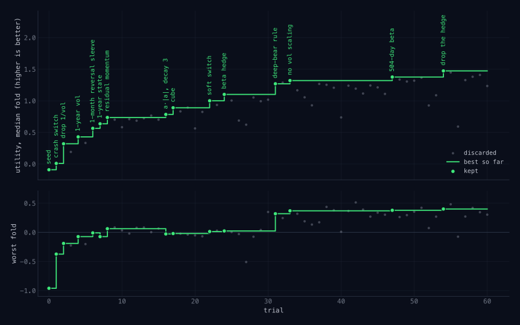
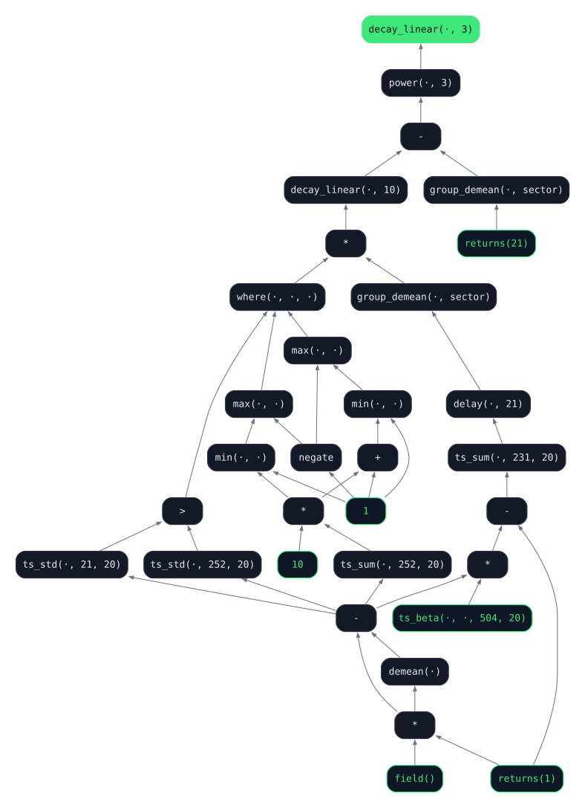
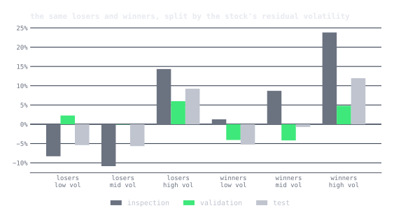
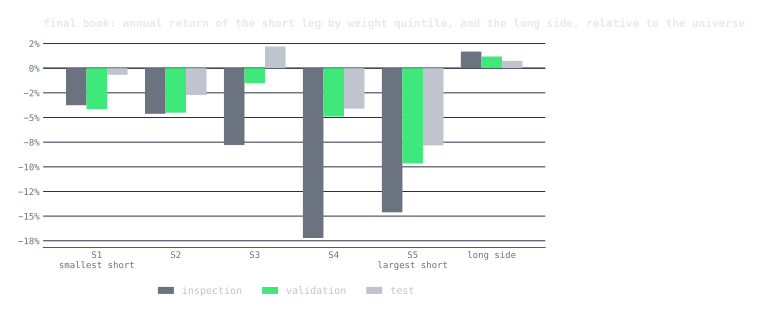

In [autoresearch: sparks of an AI scientist](/posts/ai-scientist/) I argued
that Karpathy's loop, an agent editing one file against a fixed score, would
find noise if you pointed it at a backtest, and I listed what would have to
change for it to find alpha instead: a claim before every test, an evaluator
that moves, a charge for complexity, a count of the trials, a seed of the
firm's own view, and one period the loop never touches. This post is that
list, built and run once. It worked, the book it found survived the
period it never saw, and the most useful thing it found was a flaw in my
data that the held-out period could not have caught.

The alpha is written in [qex](/posts/qex/), so the agent edits a single
expression. The problem is one I care about: cross-sectional momentum
without the crashes. And the agent is Claude Code, started headless in a
directory with a problem definition and told to begin.

## The lab

Six files.

| file | role | the agent may |
|---|---|---|
| `program.md` | the problem definition and the firm's beliefs | read |
| `alpha.qex` | one qex expression, the active hypothesis | **edit** |
| `eval.py` | the frozen evaluator | run |
| `explore.py` | helpers over the inspection period, the 1990s | run |
| `results.tsv` | the lab notebook, one line per trial | append |
| `data/` | adjusted daily OHLCV for current S&P 500 members, 1990 on | read through `explore.py` |

History is cut three ways, and the loop never mixes them.

| period | dates | who sees it |
|---|---|---|
| inspection | 1990 to 1999 | the agent, freely |
| validation | 2000 to 2017 | the evaluator only, as a score |
| test | 2018 to 2025 | nobody, until the end |

The universe is current S&P 500 members with history back to 1990, which
is about 240 names in 1990 growing to about 420 by 2010, with GICS sectors.
Current membership makes it survivorship-biased, and one trial below shows
exactly how.

## The program

The problem definition is where the firm's view goes. Mine starts with the
goal, then lists twelve beliefs, each with a mechanism, a counterparty, the
paper it comes from, and a prediction specific enough to be wrong. The
first four are the textbook: past-year winners keep winning relative to
their sector, skip the last month, measure the move in units of the stock's
own volatility, size by risk. The rest are about the crash. Daniel and
Moskowitz showed that momentum's worst months come after a market fall,
when volatility is high, in a sharp rebound, and almost entirely on the
short side, because the past losers are by then the highest-beta stocks in
the market. So the beliefs include residual momentum, shrinking the book
in the crash state, switching to reversal in it, the frog in the pan, the
52-week high, and a note that the edge should be expected to decay.

The seed expression is the literal translation of the textbook beliefs and
nothing else:

```python
let mom   = delay(returns(231), 21),
    vol   = volatility(60),
    score = group_demean(mom / vol, 'sector')
in decay_linear(score / vol, 10)
```

The rules for the agent fit on a card: one change per trial, write the
claim before the run, log the outcome after, commit every attempt, never
touch the evaluator or the data, be creative, never stop. The full
[program](lab/program.md) is a few pages.

## The evaluator: what the essay asked for, built

This is the key to the post, so it gets its own figure and a table. The
essay listed seven changes that would have to be made to Karpathy's loop
before it could be pointed at a backtest. Here is the loop with all seven
in it. Green is the step handed to the model, as before; orange is what
the essay added.

<figure class="diagram" id="loop">
  
  <figcaption>The augmented loop. Same shape as the loop in the last post, with the essay's seven additions in orange. Every orange box is a few lines of <code>eval.py</code> or <code>program.md</code>.</figcaption>
</figure>

Item by item, what the essay said, what was built, and what it did in
the run.

| the essay said | what was built | what it did |
|:---|:---|:---|
| **Require the claim before the test.** Mechanism, counterparty, persistence, and a prediction of where it should help. | A rule in `program.md`: every trial begins with a written claim naming the belief and which regime split should move. `eval.py` prints the splits so the claim can be checked. | Fifty-nine claims in the notebook. Most resets were predicted. The two most useful lines are explanations of a *wrong* prediction: why residualizing hurt, and why the book's own volatility was the wrong state variable. |
| **Make the evaluator move.** Purged cross-validation on randomized partitions, with an embargo, a fresh partition per attempt; keep only if the median fold improves and the worst does not fall. | Exactly that. Twelve blocks of 2000 to 2017, dealt at random into six folds, 21-day embargo at every block edge, fifty deals per call, median and worst fold averaged over the deals. | There was never a hold-out to climb. Eight changes raised the median and were reset for breaking the worst fold, including two textbook cures, Novy-Marx's window and residual momentum. |
| **Charge for complexity.** Every parameter is a degree of freedom spent on the past. | 0.003 of utility per node of the parsed expression, so a ten-node expression pays 0.03. | Broke ties toward the simpler book twice. Too small to force a removal that cost nothing, which is the first lesson below. |
| **Count the trials.** Deflate the winner's Sharpe by the number tried. | `eval.py` reads the notebook, counts the rows, and prints Bailey and López de Prado's deflated Sharpe ratio for the current expression. | Printed every trial. Undercounted, because the agent hand-filled some rows and left the Sharpe column empty. See the lessons. |
| **Seed the search.** The firm's own view goes in the problem definition. | Twelve beliefs in `program.md`, each with its mechanism, its counterparty, the paper it comes from, and a prediction. | The agent's first fifteen trials tested the beliefs in order. Its best ideas, the loser-only book and the sector-residual sizing, came from reading what the beliefs got wrong. |
| **Measure the consensus.** Ask how known an idea already is, and when it was published. | A rule: before testing a belief not on the list, say where and when it was published. | The agent reached outside the list three times, for papers from 2001, 2004 and 2006, and said so. All three were reset. |
| **Keep one period the loop never touches.** Use it once, at the end. | 2018 to 2025 is not loaded by `eval.py` at all. A separate script ran it once, after trial sixty, on the seed and the final book. | The table below. |

Two things the essay did not list were also needed, and both came from
the first hour.

**The book has to be enforced, not requested.** The agent writes an
expression; the evaluator scores `demean(<alpha> + 0 * close())`. The
`demean` makes every day dollar-neutral whatever the agent wrote, and the
`0 * close()` makes any name without a price NaN. That second term exists
because of a bug found before the run: qex's `where()` turns a NaN
condition into its else branch, so a name with no price got a weight of
zero, and the demean then shifted that zero to a real position. On one
1995 day the ghosts carried 28 dollars of gross against one real dollar.
Gross exposure is normalized to average one dollar over the period but
may vary day to day, so an expression can shrink itself in a state it
does not like; several beliefs needed that.

**The score has to say what the firm wants.** Per fold,

```
utility = net Sharpe + 10 × net annual return on GMV − 0.003 × nodes
```

Sharpe alone would have let the agent win by trading less and less; the
return term is there because two books with the same Sharpe are not the
same book if one makes twice as much on the same gross. A fold on which
the book holds fewer than fifty names scores minus infinity, which is
what caught trial 32's zero-volatility blow-up.

**And the noise has to be measured before the first trial.** I ran the
seed eight times. Call to call, the median moved by 0.05 and the worst
fold by 0.15, so those are the keep thresholds: beat the best median by
more than 0.05, and do not lower the worst fold by more than 0.15.

### What the loop could have known

One more audit, because the whole post rests on it. Nothing in the loop's
inputs postdates the validation period.

- Every paper cited in the program was published between 1990 and 2016.
  The two most recent, Daniel and Moskowitz (2016) and Barroso and
  Santa-Clara (2015), use samples ending in 2013 and 2011.
- No year from 2018 onward appears anywhere in the twelve beliefs, in the
  agent's fifty-nine claims, in its outcomes, or in its summary. The only
  mention of those years is the period table itself.
- The three papers the agent reached for on its own are from 2001, 2004
  and 2006.
- The evaluator never loads a price after 2017-12-31. The test script was
  run once, after the last trial, and its output is in the post's folder.

What cannot be audited away is the agent itself. It is a language model,
and its training data includes 2018 to 2025: it has read about March
2020. The data it could touch was blind to the test period; its memory
was not. I see no sign in the notebook that it used that memory, every
claim is argued from the beliefs and the folds, but the possibility is
there, it is a form of leakage no held-out period can close, and it will
be true of every loop built on a model that has read the news.

## The run

<figure class="wide" id="progress">
  
  <figcaption>Sixty trials. Grey dots are discarded, green are kept, the staircase is the best so far. The top panel is the score the agent climbs; the bottom is the number it is not allowed to break.</figcaption>
</figure>

Sixty trials, eleven kept. The median-fold utility went from 0.40 to 1.74
and the worst fold from -0.59 to +0.48, so by the end no three-year stretch
of 2000 to 2017, however the blocks were dealt, lost money net of costs.
The run took two sessions of a few hours each, because the first one hit
my account's usage limit at trial 25, and cost about twenty dollars in
model time. What follows is the [notebook](lab/results.tsv), condensed; the
agent's own [summary](lab/summary.md) of the second half is worth reading in
full.

**Trial 1, keep.** Divide the whole book by trailing three-month market
volatility. The agent predicted the worst fold would improve more than the
median, and it did.

**Trials 2 and 3.** The agent dropped the loser leg, on the reasoning that
the crash lives there. Utility fell by half and the worst fold got worse.
So it ran the mirror: keep only the losers, short them against an
equal-weight long side. That was the largest keep of the first day, and it
is the shape the book kept to the end. Nothing in the program says
"losers only"; it came from reading a failure.

**Trials 4, 5 and 6.** Novy-Marx's months 7 to 12 raised the median and
broke the worst fold, so it was reset. No skip month lost on both. Residual
momentum, the standard cure for crash exposure, raised the median and broke
the worst fold too. The agent's reading of why is the best line in the
notebook: shorting past losers is a negative-beta position that protects
the book in down markets, and residualizing removes exactly that
protection.

**Trial 7.** The 52-week high lost 4% a year in every regime. The agent
gave two reasons, and the second is survivorship: on a current-members
basket, the names that fell furthest and are still in the index are, by
selection, the ones that recovered.

**Trial 8.** The hard switch to reversal in the crash state, which was my
idea, was reset as the agent predicted: with the loser-only leg and the
volatility scaling, the crash state was already small and profitable, and
flipping it only lost.

**Trials 9 to 18.** A long run of resets that mapped the book. Each
ablation of the seed turned out to be load-bearing. Two ideas, inverse
variance sizing and a cross-sectional z-score, each fell a hair short of
the bar.

**Trial 19, keep.** The agent combined the two near misses, on the
argument that one re-weights across names and the other re-scales across
time, so if both were real they should add. They did.

**Trials 20 to 22, three keeps in a row.** Months 7 to 12 came back at a
smaller dose, counted twice inside the full window. Then the state
variable for sizing changed from market volatility to cross-sectional
dispersion, which took the worst fold to zero. Then the loser leg was
concentrated by squaring the score. The agent's line: the mild losers carry
noise, the deep losers carry the premium.

**Trial 24.** The two-sided book was re-tested under the new structure and
lost badly. The winner leg is harmful on this universe, not merely dead
weight.

**Trials 26 to 34.** The second session began with nine resets. The agent
probed every constant and structural choice it had inherited, the decay
length, the dispersion window and power, the sector structure, the vol
window, and the book held on all of them. One trial scored minus infinity:
a 20-day volatility window hit a name with twenty flat closes, inverse
variance went infinite, and the breadth floor caught it.

**Trial 35, keep.** The 60-day linear decay became an exponential average
with a 20-day half-life, at the same node count. Ten probes of the book
had found nothing; the eleventh found that the shape of the smoothing
mattered.

**Trial 40, keep, the largest gain of the run.** The agent sized the leg
by each stock's sector-residual volatility instead of its total volatility,
on the argument that a sector-relative signal bears sector-relative risk.
Net Sharpe on the validation period went from 0.83 to 1.06. It also noted
the cost: residual-vol sizing lets the high-beta losers back in, and the
crash-state Sharpe fell.

**Trial 43, keep.** The last month's return as a weight on the loser leg,
so a name that just crashed is shorted least. This idea had been tried
twice before, on trials 26 and 37, and both times it improved the worst
fold a lot and the median not at all. On the residual-vol base it improved
both, because that base had just let in the names it was built to guard
against. The agent's claim said so before the run.

**Trial 53.** The agent removed the dispersion sizing from trial 21, and
the simpler book was as good or better on every line, with five fewer
nodes. It was reset, because the median gain was inside the noise and the
rule only accepts gains. More on this below.

**Trial 58, keep.** The trial 19 move again: a vol-scaled version of the
last-month weight that had missed the bar by 0.006, combined with the
removal from trial 53. Together they cleared it. The final book is simpler
than the one before it.

**Trials 59 and 60.** A small long leg of last month's dippers was a tie,
and removing the z-score cost 0.19, so the run ended with every piece of
the book confirmed load-bearing.

## What the agent built

```python
let mom   = delay(returns(231), 21) + delay(returns(126), 126),
    r1    = returns(1),
    vol   = ts_std(group_demean(r1, 'sector'), 60),
    score = zscore(group_demean(mom / vol, 'sector'))
in ewma(min(score, 0) * abs(score) * rank(returns(21) / vol) / vol / vol, 20)
```

That is the string. Read back into English, the way the firm's beliefs
were written going in, it says this:

<div class="callout">
I believe that a stock which has lagged its sector over the past year
will keep lagging it, because the market absorbs bad news slowly and the
people who own a loser are reluctant to sell it. I believe the months
between a year ago and six months ago tell me more than the recent ones,
so I count them twice. I measure the lag in units of how much the stock
usually moves against its own sector, not in percent, because a 20%
shortfall is routine for one name and a shock for another. I believe the
premium is in the deep losers and not in the winners, so I short only the
losers, and I bet more on them the deeper they are. I believe that a loser
which has just crashed this month, by its own standards, is about to
bounce rather than fall further, so I short those least. I size every
name by how much it moves against its sector, so no single name carries
the book's risk. I hold no net position: against my shorts I own
everything else in the market, equal weight. And I average my signal with
a half-life of four weeks, so one day's reading moves the book a little
rather than all at once.
</div>

Term by term, the string and the belief:

| In the string | In English |
|:---|:---|
| `delay(returns(231), 21)` | How the stock did from a year ago to a month ago |
| `+ delay(returns(126), 126)` | The older half of that year counts twice |
| `ts_std(group_demean(r1, 'sector'), 60)` | How much the stock usually moves against its own sector |
| `mom / vol` | The lag in units of that, not in percent |
| `group_demean(…, 'sector')` | Relative to its sector |
| `zscore(…)` | Measured against the whole market that day |
| `min(score, 0) * abs(score)` | Only the losers, and the deeper the more |
| `* rank(returns(21) / vol)` | Least of all when it just crashed this month |
| `/ vol / vol` | Sized so no name dominates the risk |
| `ewma(…, 20)` | Averaged with a four-week half-life |
| `demean(…)`, from the evaluator | No net position: long everything else, equal weight |

The economic claim is Jegadeesh and Titman's, narrowed. The firm went in
believing winners keep winning and losers keep losing. The loop found
that on this basket only the second half is true, and that the losers
worth shorting are the ones that fell slowly over the year, not the ones
that fell last month. Who is on the other side? The holder who will not
sell a stock that has quietly lagged for a year, until it has lagged
some more. The book does not pay for insurance against the crash with a
market-state rule any more; it avoids the crash by refusing to short the
names that just had one, and by sizing the rest small.

Here is the expression as qex sees it, inputs in green, output at the
top. Twenty-two nodes, five inputs, and the residual volatility node is
used three times.

<figure class="diagram" id="signal-dag">
  
  <figcaption>The final book as qex sees it. Twenty-two nodes, five inputs, one output.</figcaption>
</figure>

Every line maps to a notebook entry, and every removal was tested.

## How it performs, and where

The display follows the qex post: the same book conventions, the same
table, the same charts, and now the three periods side by side, because
which period a number comes from is the whole question. Every number is
on gross market value, unlevered, a dollar short against a dollar long,
rebalanced daily, with 2 basis points charged per unit of turnover.

| net of 2 bps | period | turnover / day | gross on GMV | gross Sharpe | net on GMV | net Sharpe | max drawdown |
|---|---|---:|---:|---:|---:|---:|---:|
| seed | inspection, 1991-1999 | 4% | +0.1% | 0.01 | -0.1% | -0.01 | -32% |
| seed | validation, 2000-2017 | 5% | +1.3% | 0.33 | +1.1% | 0.27 | -10% |
| seed | test, 2018-2025 | 5% | +2.6% | 0.39 | +2.4% | 0.35 | -15% |
| **final** | inspection, 1991-1999 | 1% | +3.3% | 1.61 | +3.2% | 1.59 | -4% |
| **final** | validation, 2000-2017 | 3% | +6.0% | 1.25 | +5.9% | 1.22 | -10% |
| **final** | test, 2018-2025 | 3% | +5.0% | 0.83 | +4.8% | 0.81 | -11% |

The validation row is the one the loop climbed. The inspection row is
the one the agent could look at but was never scored on, and the test
row is the one nothing touched until after trial sixty. The seed's
inspection row is worth a second look: a Sharpe of zero and a 32%
drawdown, because the seed sizes by inverse variance with no floor and
the 1990s contain a few names with stretches of flat closes. That is the
same failure the evaluator's breadth floor caught in trial 32, and the
final book does not have it because sector-residual volatility is never
zero.

<figure class="wide" id="gross-vs-net">
  
  <figcaption>Growth of a dollar of GMV, log scale, so a constant slope is a constant rate of return. Final book gross and net, with the seed's net line dashed for comparison. Shaded bands are the inspection and test periods; the validation period the loop climbed is between them.</figcaption>
</figure>

On a log scale a constant slope is a constant rate of return, and the
final book's slope does not change character at either boundary. That
is the thing to look for, and the thing a fitted book usually fails: a
line that is smooth in the period it was chosen on and ragged after.
The slope eases out of sample, from 5.9% to 4.8% a year, and the Sharpe
falls by a third, which is the ordinary exchange rate.

<figure class="wide" id="by-year">
  
  <figcaption>Net return by calendar year at 2 basis points. Thirty-one of thirty-five years positive; seven of the eight test years.</figcaption>
</figure>

### Does the signal sort returns?

The qex post's first check was whether the alpha sorts returns at all,
by cutting the universe into quintiles and holding each as a portfolio.
Here that check turned up the most important thing in this post, and it
was not what I expected.

<figure class="wide" id="quintiles">
  
  <figcaption>Plain twelve-month momentum, the literature's sort, on this basket: equal weight at formation, held 21 days, relative to the universe. A U in every period.</figcaption>
</figure>

Plain momentum does not sort returns on this basket. In all three
periods the loser quintile beats the universe, by about 3% to 4% a year,
and so does the winner quintile, while the middle lags. That is a U, not
a line, and it holds with a monthly hold as well as a daily one, so it
is not a rebalancing artifact. It is the universe. The names are today's
S&P 500 members, and the loser quintile at any date in the past is full
of names that fell hard and are still in the index, which is to say,
names that came back. The next chart is the same two quintiles split
by each stock's volatility, and it says exactly that.

<figure class="wide" id="vol-split">
  
  <figcaption>The same losers and winners, split by the stock's volatility relative to its sector. The volatile third of either group beats the universe in every period; the quieter two thirds lag it in most.</figcaption>
</figure>

Whatever a stock's momentum, the volatile third beats the universe in
every period, by 5% to 24% a year, and the quieter two thirds mostly lag
it. A long-short portfolio of the high-volatility third
against the low-volatility third earns about 10% a year on this basket
in both the validation and the test period, and 25% a year in the 1990s.
In the real market that premium does not exist; if anything it runs the
other way, which is the low-volatility anomaly. On a basket of survivors
it is enormous, because conditional on being in the index today, the
volatile names are the ones whose bets paid off. Every number in this
post is on that basket, and so was every number the loop saw.

So what did the loop find? The book shorts quiet losers against an
equal-weight long side that holds the volatile survivors, which means it
is long that premium. Regressing the book's daily return on the market
and on the high-minus-low volatility factor:

| final book | net return | loading on the vol factor | alpha after it | information ratio of the alpha |
|---|---:|---:|---:|---:|
| inspection, 1991-1999 | +3.2% | 0.09 | +0.8% | 0.2 |
| validation, 2000-2017 | +5.9% | 0.15 | +4.5% | 1.1 |
| test, 2018-2025 | +4.8% | 0.25 | +2.6% | 0.5 |

About a quarter of the in-sample return and about half of the
out-of-sample return is the factor. What is left, 4.5% a year in sample
and 2.6% out of sample, is the part that is not explained by being long
volatility, and the vol-matched check below says where it lives.

<figure class="wide" id="short-leg-quintiles">
  
  <figcaption>The book, not the score: the short leg cut into quintiles by how much of it each name carries, plus the long side. S5 is the fifth of the leg with the largest short weights.</figcaption>
</figure>

Cut the short leg by how hard each name is shorted and the ordering is
nearly monotonic in all three periods: the names the book shorts hardest
lag the universe by 15% a year in the 1990s, 10% in validation and 8%
out of sample. Part of that is the factor, since the hardest-shorted
names are the quietest. But an equal-weight quintile of quiet losers,
compared against quiet names in general rather than against the
universe, does not lag its peers in the validation or test period at
all. The book's residual alpha is not "quiet losers lose". It is the
specific construction the loop arrived at, the deepest losers, squared,
not just crashed, sized by inverse variance, and it is about half the
size the headline suggests.

### What the book holds

A few numbers from the final book's weights, for the reader who wants
to know what they would be holding.

| | inspection | validation | test |
|---|---:|---:|---:|
| beta to the equal-weight market | 0.02 | 0.00 | -0.01 |
| names in the short leg, on an average day | 66 | 95 | 124 |
| share of the short leg in its ten largest positions | 55% | 46% | 37% |
| holding period, days, from turnover | 119 | 35 | 34 |
| correlation with plain long-short momentum, daily | -0.11 | 0.23 | 0.46 |
| net return on days the market rose, annualized | +6.3% | +7.1% | +4.2% |
| net return on days the market fell, annualized | -1.0% | +4.4% | +5.6% |

The beta is zero in every period, so the equal-weight long side and the
inverse-variance short side cancel each other's market exposure
without any hedge in the expression. That is why trial 17's explicit
beta hedge did nothing. The short leg is concentrated: ten names carry
roughly half of it, which is a feature of the squared weight and a risk
any real book would cap. By sector, a quarter of the short leg is
utilities, with financials and industrials next, because sector-residual
volatility is lowest there and inverse variance rewards it, so in plain
terms the book is mostly short the slow-moving laggards of the slow-moving
sectors, against everything else. It makes money on up days and down
days alike in the two later periods. Its correlation with plain momentum
is low, and its loading on the volatility factor is not, which is the
same fact from two sides: the sizing, not the sort, is doing the work,
and some of what the sizing does is ride the basket's bias.

## The one run on 2018 to 2025

The test period was loaded for the first time after trial 60, by a script
the agent never saw, run once on the seed and once on the final book. The
[output](lab/test-2018-2025.txt) is in the post's folder, and the test
rows of the table above come from it.

| 2018 to 2025, net of 2 bps | seed | final book |
|---|---:|---:|
| net Sharpe | 0.35 | 0.81 |
| net return on GMV, per year | +2.0% | +3.9% |
| max drawdown | -12.4% | -9.2% |
| years positive | 5 of 8 | 7 of 8 |
| 2020 | +2.3% | +5.6% |
| worst year | 2021, -4.1% | 2022, -6.5% |

The test script and the analysis script differ slightly in warmup, which
is why the test row in the big table and this one disagree in the second
decimal; both are in the folder.

The book kept about two thirds of its in-sample Sharpe out of sample,
1.22 to 0.81, and about four fifths of its return. That is ordinary
shrinkage for a strategy chosen on history, and it is far better than the
field's record for backtests chosen without discipline, where the
out-of-sample Sharpe is close to uncorrelated with the in-sample one. The
seed, which nobody fitted to anything, kept about the same share of its
Sharpe, which says the loop's gain over the seed is mostly real in the
sense that matters here: the book is better than the seed on every line
in a period neither of them saw.

But read that with the previous section in hand. The test period is
drawn from the same basket of survivors, so it carries the same
volatility premium, and about half of the book's out-of-sample return
is that premium. A held-out period defends against fitting to time. It
cannot defend against fitting to the universe, because the universe is
the one thing the two periods share. The number I would quote for this
book is not the 0.81 but the alpha after the factor, 2.6% a year at an
information ratio of about 0.5, and even that is on a basket whose bias
I can measure but not remove.

The crash defenses had one live test. March 2020 was the fastest market
fall since 1929 and the rebound off it was exactly the state Daniel and
Moskowitz describe, and the book made 5.6% that year against the seed's
2.3%. The seven days the evaluator's crash-state rule flags in the test
period were the book's best, at an annualized 16%, where the seed lost at
an annualized 28%. Seven days is nothing to lean on, but the sign is the
one the program asked for. The bad year was 2022, a slow grind down with
no rebound, which is not the crash the beliefs were written about.

I would not trade this as it stands, and now for two reasons. It is one
price-based alpha, concentrated in a few names, and a real book is many
alphas with position limits. And it was found on a basket whose bias it
partly learned, and the only cure for that is a point-in-time universe,
which Yahoo does not sell. As a test of the method it is still a clean
result, read correctly: the loop improved the firm's starting view by a
wide margin on the period it could see, most of the improvement survived
the period it could not, and the part that did not survive the
volatility check is a lesson about data, not about the loop. The test
period is now spent. If I run this again, the book that comes out cannot
be scored on 2018 to 2025 and mean anything, and the honest next test is
a different universe, and then live.

## What I learned

Most of it is about the program, which is the part of the loop a person
writes. The first one is about the data, which is the part a person
chooses.

**The loop learns the universe's bias as readily as its alpha, and no
held-out period will tell you.** I knew the basket was survivorship-biased
and said so going in, the way everyone does, as a caveat. It took the
quintile chart to see what the bias actually does: it hands volatile
names a 10% a year premium that does not exist in the real market, and
the loop found a book that is long that premium. The agent cannot be
blamed; the premium is in every fold of every deal, and the keep rule
rewards it. The test period cannot catch it; it is in the test period
too. The only defense is the one the essay did not list: the universe
has to be point-in-time, and the evaluator should print the book's
loading on the obvious factors beside its Sharpe, so that a change that
raises the Sharpe by raising a factor loading can be seen for what it
is. That is a cheap addition to `eval.py` and it should have been there.

**The keep rule has a blind spot, and it is the one this problem cares
about.** The rule accepts a change that raises the median and refuses one
that lowers the worst fold. It has no way to accept a change that raises
the worst fold and leaves the median alone. Five trials did exactly that,
and the agent reset every one. Nor does it accept a removal that costs
nothing: trial 53 found five nodes that had become redundant, and the
complexity charge was too small to tip the tie. The agent got both ideas
in anyway, by pairing them with a median gain so the combination cleared
the bar, which is clever, and should not have been necessary. Next time:
a change that improves the worst fold by more than its noise is a keep,
and a removal that leaves both numbers inside the noise is a keep.

**The threshold was a shade tight.** Three changes missed the bar by less
than 0.01, and all three were later confirmed when combined with something
else. A noise bar protects against false keeps at the cost of real ones,
and with sixty trials and a two-sided rule, the cost was higher than the
protection was worth.

**The inspection period was a poor guide for the second half.** The agent
noted it itself: six variants the 1990s ranked higher reset in validation.
The 1990s have no momentum crash and no 2000 to 2002, so anything that
helps in a calm decade and hurts in a rebound looks good there. The
inspection data was right about structure, the kernel, the sizing, the
tilt, and wrong about every fine adjustment. A better inspection period
would contain a crash.

**The agent's creativity showed up where the essay said it would, and
one place it did not.** It did not propose anything strange on its own
initiative. What it did was read failures: the loser-only book came from
trial 2's failure, the last-month weight's third attempt came from trial
40's side effect, and the two biggest keeps of each session were
combinations of near misses. It also reached outside the program for
Cooper, Gutierrez and Hameed, for Ang, Hodrick, Xing and Zhang, and for
Grundy and Martin's hedge, and the evaluator said no to all three, which
is the test working. And it used the language well: a cross-sectional
sum built from `x - demean(x)`, a one-factor beta hedge in six lines, a
group z-score from `group_sum` and `is_valid`. None of that is in the qex
documentation.

**The notebook has to be machine-written.** The agent could not commit
for its first 25 trials, because I had set the permissions wrong, and it
kept an exact record in a side file instead. But it also filled some rows
of the notebook by hand and left the numeric columns empty, with the
numbers in the prose, so the evaluator's trial count was wrong and the
deflated Sharpe it printed was not trustworthy. The counting correction
is only as good as the log, and the log should be written by the
evaluator, not the agent.

**The things I was told, and the things I was not.** The agent predicted
most of its own resets correctly, which is what a claim before the test
is for. It was wrong in both directions a few times, and the two most
useful lines in the notebook are both explanations of a wrong prediction:
why residualizing hurt, and why the book's own volatility was the wrong
state variable. The loop is not just a search. Read carefully, the log is
a short course in what this alpha is.

<div class="callout">
Sixty trials, eleven keeps, one look at the future, and one look at the
universe. The method held against time and taught me what it cannot hold
against. The book it produced is not the point; the notebook is.
</div>

## References

- Ang, A., Hodrick, R. J., Xing, Y. and Zhang, X. "The Cross-Section of Volatility and Expected Returns." *Journal of Finance* 61(1), 2006.
- Bailey, D. H. and López de Prado, M. "The Deflated Sharpe Ratio." *Journal of Portfolio Management* 40(5), 2014.
- Barroso, P. and Santa-Clara, P. "Momentum Has Its Moments." *Journal of Financial Economics* 116(1), 2015.
- Blitz, D., Huij, J. and Martens, M. "Residual Momentum." *Journal of Empirical Finance* 18(3), 2011.
- Cooper, M. J., Gutierrez, R. C. and Hameed, A. "Market States and Momentum." *Journal of Finance* 59(3), 2004.
- Da, Z., Gurun, U. G. and Warachka, M. "Frog in the Pan: Continuous Information and Momentum." *Review of Financial Studies* 27(7), 2014.
- Daniel, K. and Moskowitz, T. J. "Momentum Crashes." *Journal of Financial Economics* 122(2), 2016.
- George, T. J. and Hwang, C.-Y. "The 52-Week High and Momentum Investing." *Journal of Finance* 59(5), 2004.
- Grundy, B. D. and Martin, J. S. "Understanding the Nature of the Risks and the Source of the Rewards to Momentum Investing." *Review of Financial Studies* 14(1), 2001.
- Jegadeesh, N. "Evidence of Predictable Behavior of Security Returns." *Journal of Finance* 45(3), 1990.
- Jegadeesh, N. and Titman, S. "Returns to Buying Winners and Selling Losers." *Journal of Finance* 48(1), 1993.
- Moskowitz, T. J. and Grinblatt, M. "Do Industries Explain Momentum?" *Journal of Finance* 54(4), 1999.
- Novy-Marx, R. "Is Momentum Really Momentum?" *Journal of Financial Economics* 103(3), 2012.
- [karpathy/autoresearch](https://github.com/karpathy/autoresearch).
