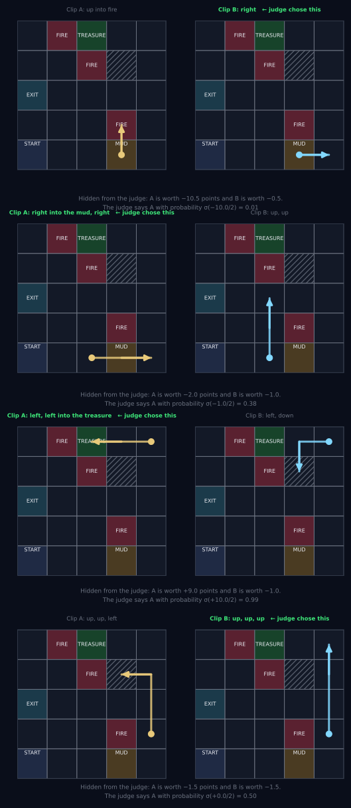
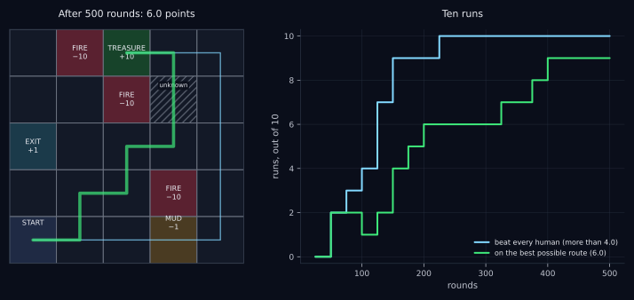
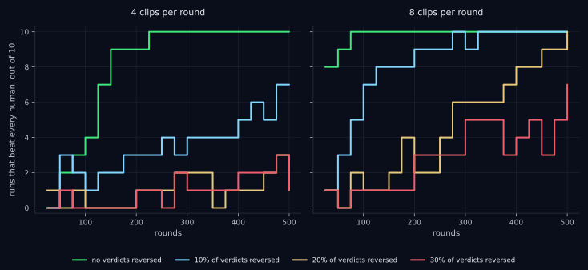

This post builds on [the previous one](https://marketneutral.github.io/posts/exceed-training-data/), and it assumes you have read it. There I built a 5×5 grid, simulated six hundred people crossing it badly, and recorded every step. Then four machines learned from that recording, each a rung higher on a ladder. The best person scored 4.0. The machine on rung 2 read nothing but the log, with the points for every step, and learned to score 5.0. **It beat every person without ever setting foot on the grid.** The machine on rung 3 was allowed to explore: to try moves of its own and have the world score them. It scored 6.0, the best possible. In terms of how frontier language models are built, rung 2 stands for RLHF and rung 3 for RLVR.

<div class="callout">
This post is a thought experiment with an experiment attached: how would you build an equity analyst that is better than every analyst it learned from?
</div>

Here is the core idea, before any of the machinery. **You don’t need to know whether an analyst’s recommendation made money to begin training a better analyst. You need someone who can distinguish better research from worse research more often than not.** The rest of this post is about why that is enough, on a grid where it can be checked, and what it would take in a fund.

## Why not RLVR?

Rung 3 did best, so the obvious move is to use RLVR to build an equity analyst. Let the machine make investment decisions, see how they turn out, and learn from that. No capital needed: just paper trade it.

Unfortunately, RLVR is not realistic here. It needs a great many episodes, each played out to the end, and in investing the end arrives in wall-clock time. An investment thesis takes months to quarters to play out, and the clock cannot be run faster. The outcome is noisy, too: a good decision can lose money while a bad one makes it, and telling an analyst who is right 55% of the time from a coin flip takes about 400 independent calls. And no, you can’t backtest it, because a language model has already read how the past turned out.

## Why RLHF?

What about rung 2? In the first post it beat every human by learning from a log. It never had to touch the real world, so it never had to wait for it. So let’s use RLHF.

## The catch: rung 2 had a perfect reward

The grid made one radical simplification on rung 2. Every row of the log looked like this:

$$
(\text{cell},\ \text{direction},\ \text{points},\ \text{next cell}).
$$

The third entry was a number the world handed over: −0.5 for a step, −1.5 for the mud, +9.5 for the treasure. **Rung 2 had a perfect reward model.** All it had to do was add those numbers up along the best path.

Real RLHF has nothing like that. Nobody hands a language model the points for an essay. What people can give is a preference: this one is better than that one. And people are sometimes wrong. In the first post I conceded that the match between rung 2 and RLHF was loose, and this is why. In this post I tighten it. I take away the perfect reward and run real RLHF on the grid: the machine learns its reward from a fallible judge’s verdicts on short snippets of walks. Then I come back to the fund.

So forget investing for a moment. For now, only the grid.

## The recipe

Here is the whole method in five steps. The sections that follow take them one at a time.

1.  **The machine walks.** It starts as the clone from rung 0, walking the way the people in the log walked, and now and then takes a random step. It is never told a score.
2.  **A judge compares snippets.** Short stretches of those walks are shown to a judge two at a time, and the judge says which one went better. Nothing else.
3.  **Fit a reward model.** The machine turns the pile of verdicts into a number for every cell.
4.  **Q-learning, just like before.** The machine runs rung 2’s rule with the learned reward where the true points used to be.
5.  **Repeat.** The machine walks again from what it learned, and the judge sees new snippets.

## Step 1: the machine walks

The machine walks the grid itself. It sees where each step leads and whether the walk ended. **It never sees points.** Three steps in ten are random, so that it tries things nobody has tried.

This is not RLVR. Rung 3 also walked, but the world told it the points for every step. Here the walking only collects data. Whether any of it was good is for the judge to say, and only about short pieces of it.

Those pieces are **clips**: one, two or three consecutive steps. The walking happens in rounds, and one round goes like this.

- A starting cell is drawn from the log, and a length of one to three steps.
- The machine walks four clips of that length from that cell.
- The judge compares every pair of those clips that differ.

## Step 2: the judge

### Does the judge have to be an expert?

If the judge decides what “better” means, doesn’t the judge have to be an expert, or even infallible? No. **It is easier to tell which of two things is better than to produce the better thing in the first place.**

The cleanest statement of the gap is in computer science. For a huge class of problems a proposed answer can be checked quickly, while finding the answer seems to be far harder. Whether that gap is real is the P versus NP question, and nearly everyone in the field believes it is. Scott Aaronson described the world we would live in without it \[6\]:

> “There would be no special value in ‘creative leaps,’ no fundamental gap between solving a problem and recognizing the solution once it’s found. Everyone who could appreciate a symphony would be Mozart; everyone who could follow a step-by-step argument would be Gauss; everyone who could recognize a good investment strategy would be Warren Buffett.”

We do not live in that world.

Christiano and co-authors trained machines from “(non-expert) human preferences between pairs of trajectory segments,” and taught them “complex novel behaviors with about an hour of human time” \[4\]. One of those behaviors was a backflip by a simulated robot. Nobody wrote down what a good backflip is, and nobody demonstrated one. A person watched pairs of short clips and picked the better one, [about 900 times](https://openai.com/index/learning-from-human-preferences/).

And it has been measured in language. Stiennon and co-authors collected human comparisons between summaries, trained a model on them, and reported that “our models significantly outperform both human reference summaries and much larger models fine-tuned with supervised learning alone” \[7\]. The raters only compared summaries. The model that came out wrote better ones than the people did.

The judge does not need to be able to walk the best route. The judge only needs to recognize the better of two clips, more often than not.

### A judge who makes mistakes

The judge is shown two clips and says which one went better. The two clips in a pair always start from the same cell.

The judge can see what happened in a clip but does not know the scoring rules. What registers is roughly how well it went, and I model that as the clip’s true points. The judge does not know that number. The judge has a feeling that tracks it, and the feeling is **surer when the gap is bigger**. Let $g$ be the gap in true points between clip A and clip B, positive if A was better. The judge says “A” with probability

$$
\Pr(\text{judge says } A) = \sigma\!\left(\frac{g}{\tau}\right), \qquad \sigma(x) = \frac{1}{1 + e^{-x}}.
$$

$\sigma$ squashes any number into the range 0 to 1, with $\sigma(0) = 0.5$ in the middle: no gap, coin flip. $\tau$ sets how many points of gap it takes to make the judge confident. I use $\tau = 2$. This is the realistic part: the judge’s mistakes track how hard the call actually is. Easy pairs are almost always right, and close pairs are close to a coin flip.

Here are four pairs the judge ruled on.

<figure class="diagram">

<figcaption>Four real pairs of clips. In each pair both clips start in the same cell, marked with a dot. The cells carry their names but not their scores, because the judge does not see scores. The line under each pair is for you, not the judge: what the two clips were truly worth, and how likely the judge was to pick A. The second pair is one the judge got wrong, and the fourth is a tie that the judge had to call anyway.</figcaption>
</figure>

*First pair:* one clip steps into fire and the other does not. Nobody needs to be told which is worse. *Second pair:* one clip goes through the mud and the other does not, a gap of one point. The judge should prefer the clean one, and does so about five times in eight. **This time the judge picked the muddy one.** I went looking for a pair like this, because it is what a fallible judge looks like up close. *Third pair:* one clip reaches the treasure. *Fourth pair:* the two clips are worth exactly the same. The judge has to pick one anyway, and the pick means nothing.

So the same judge is very different on easy pairs and hard ones.

| A pair that differs by | Gap in points | Judge picks the better one |
|----|----|----|
| fire against an ordinary step | 10.0 | 99% |
| through the mud against around it | 1.0 | 62% |
| one step more against one step fewer | 0.5 | 56% |

### A few verdicts, one bit each

Each verdict is one bit: A is better than B. No score, no reason, no “by how much.” On the grid there are about 6,900 different pairs of clips that start from the same cell, and over a run of 500 rounds the judge rules on about 1,500 pairs, some of them repeats. On a 25-cell grid that is a sizable share. For a written investment case the number of possible pairs is effectively unlimited, and a PM will only ever see a tiny fraction of them.

No single verdict is reliable. Whatever the machine learns, it has to learn from the pile: over hundreds of pairs, the clean clip beats the muddy one more often than not.

## Step 3: from verdicts to a reward

The machine has a pile of verdicts and wants back what rung 2 had: a number for every move.

Think of how chess gets its ratings. A player’s **Elo rating** \[9\] is a number that goes up after a win and down after a loss, and it moves more when the result was a surprise. Nobody solves an equation. The ratings come from a great many small adjustments, one per game.

Here the players are the 25 cells. Each cell has a rating, and every rating starts at zero. A clip’s score is the sum of the ratings of the cells it entered. A verdict is a game between two clips.

**Before the verdict, predict it.** Let $S_A$ and $S_B$ be the two clips’ scores. The ratings say the judge will pick A with probability

$$
p = \sigma(S_A - S_B),
$$

with the same $\sigma$ as before. Equal scores give $p = 0.5$, and the further A is ahead, the closer $p$ is to 1.

**After the verdict, adjust.** Let $y = 1$ if the judge picked A and $y = 0$ if the judge picked B. Every cell’s rating moves by

$$
K \times (y - p) \times (\text{times A entered the cell} - \text{times B entered the cell}).
$$

Read it one factor at a time.

- $y - p$ is the surprise. If the ratings were sure of A and the judge picked A, it is close to zero and almost nothing moves. If the ratings were sure of A and the judge picked B, it is close to −1 and a lot moves.
- The last factor says which cells get the credit. If the judge picked A, the cells A entered more often go up and the cells B entered more often go down. A cell that both clips entered equally often does not move, because it cannot be what made the difference.
- $K$ is the size of one adjustment. Say $K = 0.1$.

Suppose the first verdict is this one. Both clips start at (2, 0). Clip A steps up into (2, 1), an ordinary cell. Clip B steps right into the mud. Every rating is zero, so both scores are zero and $p = 0.5$. The judge picks A, so $y = 1$.

- The cell A entered: $0 + 0.1 \times (1 - 0.5) \times (1 - 0) = +0.05$.
- The mud: $0 + 0.1 \times (1 - 0.5) \times (0 - 1) = -0.05$.
- Every other cell: no change.

If the same pair came up again, the ratings would give A a probability of $\sigma(0.10) = 0.525$. One verdict moved the prediction from 50% to 52.5%.

**Now keep going until the ratings stop moving.** Go through the whole pile of verdicts, then through it again, and again. The ratings drift, then settle. They have settled when the adjustments over the whole pile cancel out: for every cell, the ups and the downs add to zero. At that point the ratings predict the pile as well as any ratings can.

That settled set of ratings is the machine’s reward. The machine does not actually take the adjustments one at a time. It uses a solver that jumps straight to where they settle. The answer is the same, and there is no $K$ to choose. Statisticians call this the **Bradley–Terry model** \[2\]. The math is not needed for anything that follows. If you want it, I have worked through it on small numbers in [a separate note](https://github.com/marketneutral/marketneutral.github.io/blob/main/notes/bradley-terry.md).

The 25 ratings are the simplest reward model that can be printed and checked. In real RLHF the reward model is a neural network, usually a copy of the language model with its last layer replaced by a single output \[3\]. The verdicts and the goal are the same.

One prior goes in before the fit: **steps are never free.** Every cell where the walk does not end is held at or below a small cost. A noisy judge will sometimes make an ordinary cell look free, and a machine that loses nothing by walking in circles will walk in circles forever. Real RLHF carries the same prior as a length penalty and a penalty for drifting from the starting model \[3\].

Here is the fit, in code.

``` python
from scipy.optimize import minimize

STEP_FLOOR = 0.05   # every cell where the walk goes on is worth at most -0.05

def fit_reward(X, y, ends_walk, start=None, l2=1e-4):
    """Bradley-Terry with a table for the reward: logistic regression, no intercept, solved
    to convergence. Each row of X is one pair: x_i = times clip A entered cell i, minus
    times clip B did. y is 1 if the judge chose A. `start` is the previous fit, if there
    is one. The answer does not depend on it; it only saves time."""
    def loss_and_grad(beta):
        z = X @ beta
        p = 1 / (1 + np.exp(-z))
        loss = np.mean(np.logaddexp(0, z) - y * z) + 0.5 * l2 * beta @ beta
        return loss, X.T @ (p - y) / len(y) + l2 * beta
    ceiling = np.where(ends_walk, np.inf, -STEP_FLOOR)      # steps are never free
    x0 = np.full(N_CELLS, -STEP_FLOOR) if start is None else start.ravel()
    x0 = np.minimum(x0, ceiling)
    res = minimize(loss_and_grad, x0, jac=True, method="L-BFGS-B",
                   bounds=[(None, None if np.isinf(c) else c) for c in ceiling],
                   options={"maxiter": 10000, "gtol": 1e-10})
    return res.x.reshape(N, N)
```

## Step 4: Q-learning, just like before

With the learned reward in hand, the machine does exactly what rung 2 did in the first post: Q-learning, with the learned reward where the true points used to be. It runs it on every move made so far, the log’s and its own.

## Step 5: repeat

From then on the machine walks from the result, and the loop goes around again. Every 25 rounds it refits the reward and re-runs Q-learning. A run is 500 rounds, and I ran it ten times.

## Does it work?

We grade the machine the way we graded every rung: the true score of its best route on the real grid. The machine never sees that grade. Here is where the ten runs stood as the rounds went by.

| rounds | verdicts so far | runs that beat every human | runs on the best possible route |
|----|----|----|----|
| 50 | 167 | 2 | 2 |
| 100 | 316 | 4 | 1 |
| 150 | 468 | 9 | 4 |
| 200 | 618 | 9 | 6 |
| 300 | 915 | 10 | 6 |
| 400 | 1222 | 10 | 9 |
| 500 | 1534 | 10 | 9 |

<figure class="wide">

<figcaption>Left: the machine’s route after 500 rounds in the first run (green), against the route the humans were taught (thin blue). It goes through the cell no human recording ever entered. Right: of ten runs, how many had beaten every human, and how many had found the best possible route, after each refit.</figcaption>
</figure>

**Yes. By 300 rounds every one of the ten runs had beaten every human, and by 400 rounds nine of the ten were on the best possible route, worth 6.0.** The judge picked the truly better clip on 85% of the pairs that had one. On the rest, and on every tie, the verdict was noise.

That is better than rung 2 did in the first post. Rung 2 had perfect points and scored 5.0, and the route worth 6.0 took rung 3. This machine had no points at all, only a judge who is sometimes wrong, and it reached 6.0 in nine runs of ten.

The reason is step 1. The machine walked its own clips, and some of them went through the cell no human recording ever entered. The judge did not object to those clips, so the learned reward treats the unknown cell as an ordinary one, and Q-learning could route through it. Exploration found the cell. The judge, not the world, said it was fine.

That is the difference from rung 3. Both machines explored. Rung 3’s walks were scored by the world, one finished walk at a time. This machine’s were judged by a person, a few steps at a time, and nobody ever had to wait for a walk to finish.

Here is the reward the machine learned in the first run, next to the truth.

| Entering         | True points | True ÷ τ | Learned |
|------------------|-------------|----------|---------|
| an ordinary cell | -0.50       | -0.25    | -0.31   |
| the mud          | -1.50       | -0.75    | -1.11   |
| the exit         | 0.50        | 0.25     | 0.44    |
| a fire cell      | -10.50      | -5.25    | -3.99   |
| the treasure     | 9.50        | 4.75     | 3.83    |
| the unknown cell | -0.50       | -0.25    | -0.56   |

The order is right everywhere: fire far below mud, mud below an ordinary step, the treasure far above everything. The sizes are in the judge’s units, not the world’s. They sit near the true points divided by $\tau$, because a verdict says which clip was better and never by how much. None of that changes the route, since rung 2 only asks which total is bigger.

## How wrong can the judge be?

Take the same judge and reverse some of the verdicts at random: 10%, 20%, 30% of them. That is a careless judge.

<figure class="wide">

<figcaption>The same loop with judges of decreasing reliability. Each line counts, out of ten runs, how many had beaten every human after that many rounds. Left: four clips per round. Right: eight clips per round, which gives the judge about five times as many pairs to rule on. With four clips the four judges are right 85%, 76%, 69% and 62% of the time. With eight they are right 85%, 77%, 70% and 63% of the time.</figcaption>
</figure>

With four clips per round, carelessness hurts quickly. A judge who is right 76% of the time gets seven of ten runs past the humans in 500 rounds. Below 70%, one run in ten makes it.

But the machine is short of verdicts, and clips are free. So have it walk eight clips per round. Eight clips make up to 28 pairs, and the judge rules on about five times as many. Now a judge who is right 77% of the time gets all ten runs past the humans by 400 rounds, and a judge who is right 70% of the time gets all ten there by 500. Even a judge who is right only 63% of the time gets seven of ten there.

**Noise is paid for in verdicts.** A noisier judge needs more of them to say the same thing, and the cost of that is the judge’s time, not the machine’s.

When a run fails, it fails safe. The machine takes the exit, two steps from the start, and scores 0.0. It does not walk into fire.

## What the judge cannot see

Carelessness is random, and random error washes out. A blind spot is not random.

Give the judge full attention but no perception of the mud. To this judge, a clip through the mud is as good as a clip around it. The machine’s learned cost for the mud, over an ordinary step, comes out at +0.13. With the sighted judge it was −0.62, against a target of −0.5. The machine has learned that the mud does not matter.

It shows on the way up. Each run is checked 20 times, so ten runs give 200 checks. With the blind judge, the machine’s best route was the humans’ loop straight through the mud at 20 of them. With the sighted judge that never happened once. In the end the blind judge’s machine still found the 6.0 route in nine runs of ten, the same as the sighted judge’s, but only because that route does not pass the mud. Where the blind spot touched the answer, the answer was wrong.

**What the judge cannot see, the machine will not avoid.** More verdicts do not fix that, and neither do more clips.

## Does it need the log at all?

One more run. Take away the log.

The machine now starts with nothing. It has never seen a human walk, and its first clips are random moves. With no log to supply starting cells, each round starts from a cell the machine has already stood on, which at first is only the start. Everything else is the same: four clips per round, the plain judge, 500 rounds, ten runs.

| rounds | beat every human, with the log | beat every human, without the log | best route, with the log | best route, without the log |
|----|----|----|----|----|
| 50 | 2 | 5 | 2 | 5 |
| 100 | 4 | 8 | 1 | 7 |
| 150 | 9 | 8 | 4 | 7 |
| 200 | 9 | 9 | 6 | 9 |
| 300 | 10 | 10 | 6 | 10 |
| 400 | 10 | 9 | 9 | 9 |
| 500 | 10 | 10 | 9 | 10 |

All ten runs end on the best possible route, and they get there sooner than they did with the log. A machine with no points and no recordings, and nothing but a judge who is wrong some of the time, found the best possible route.

## Back to the analyst

Now the fund. In fundamental investing an analyst’s “walk” is a write-up. It follows the firm’s format, section by section: the recommendation, the business, the thesis points, the valuation, the risks. And it reaches a conclusion: buy, sell or hold. The PM does not write it. The PM judges it. Every fund already has that judge.

Here is what each part of the grid stands for.

| On the grid | In the fund |
|----|----|
| The log of 600 recorded walks | The archive of historical write-ups |
| A cell | A stock at a moment, with the analyst’s notes on it |
| A walk | A write-up, ending in buy, sell or hold |
| A clip | A section of a write-up |
| The machine walking a clip | The LLM writing a version of a section |
| The judge choosing between two clips | The PM choosing between two sections |
| The learned reward table | A reward model of the PM’s taste |
| Q-learning on the learned reward | RLHF on the LLM |
| The machine’s best route | The write-up it would produce |
| The true points | The P&L |

And here is the recipe again, as an experiment a fund could run. Pick a date and call it $t$. **All of the training happens at $t$,** using only what exists on that date. Nothing in it waits for a stock to move. Then the result is tested out of sample, on what comes after $t$.

**At time $t$: train.**

1.  **Fine-tune an LLM on the firm’s historical write-ups,** every one of them written before $t$, so that it writes like the firm’s analysts. Tie each write-up to the information that was available when it was written, so the model never learns from hindsight. On the grid this was the clone from rung 0.
2.  **Have the LLM write lots of new ones.** Take the stocks the firm covers, with the information on each as it stands at $t$. An analyst still does the legwork a machine cannot: talking to management and to the sell side, gathering data points for the mosaic, keeping notes. From that same set of notes, the LLM writes several versions of each section. On the grid this was the machine walking clips.
3.  **The PM rates pairs.** The PM is shown two versions of the same section and says which is better. Nothing else. Nobody knows yet how any of these stocks will turn out, the PM included.
4.  **Train a reward model on the PM’s verdicts.** This is step 3 on the grid: Bradley–Terry, with a neural network in place of the table.
5.  **Train the LLM with RLHF against the reward model,** with a constraint that keeps it grounded in the facts in the notes. Then go back to step 2. The loop goes around as many times as the PM has patience for, and the date is still $t$.

**After time $t$: test out of sample.**

6.  **Evaluate on companies and periods the training never touched.** New information arrives after $t$. The trained LLM writes from it, and so do the firm’s analysts. PMs who did not do the training judgments compare the two, without being told which is which. This takes as long as the reading takes.
7.  **Separately, track investment outcomes,** to see whether better research turns into better decisions. This step is slow, and it is the only one that is.

Why does step 2 write about today’s stocks, when the archive is full of old ones? It is tempting to have the LLM rewrite a 2019 pitch from the 2019 notes, because every write-up in the archive would then supply pairs. But the PM who judges those pairs knows what the stock did after 2019, and so does the LLM. The reward model would learn hindsight, and hindsight is no help on a stock whose outcome is still ahead. So the archive teaches the LLM how to write, in step 1, and the judging is done only on stocks whose future nobody knows.

None of the grid’s numbers is a forecast for equity research. About 1,500 verdicts was enough on 25 cells. A fund may need far more, and how many has to be found by trying.

### One pair, as the PM would see it

To make that concrete, here is one pair. A pitch is built from sections: a recommendation, a business description, numbered thesis points, a valuation, a list of risks. These are two versions of one section, the first point of an investment thesis on Carlisle Companies (NYSE: CSL).

One of them was written by people. It comes from a pitch by three Columbia Business School students, Tuan Nguyen, Erik Listoe and Dimitry Karavaikin, which took first place in the 18th Annual Pershing Square Challenge in 2025 \[8\]. The full pitch is on page 36 of the Spring 2025 issue of [*Graham & Doddsville*](https://business.columbia.edu/sites/default/files-efs/imce-uploads/Graham_Doddsville_Spring_2025_Issue_.pdf#page=36), the school’s investment newsletter. The other was written by an LLM (Claude), which was given that one section of the pitch, charts included, and nothing else. It checked nothing and it adds no fact of its own. This is step 2 of the blueprint only: no PM has judged anything and nothing has been learned.

I am not going to say which is which. Both are set in the same type, and the students’ two charts are left out, so that nothing differs but the writing. Neither version is research, and neither is investment advice.

<figure class="wide">
<div style="display:flex; flex-wrap:wrap; gap:16px; align-items:flex-start;">
<div style="flex:1 1 380px; min-width:300px;">
<div style="font: 600 11px/1.4 ui-monospace, monospace; letter-spacing:.08em; text-transform:uppercase; margin:0 0 6px;">Version A</div>
<div style="background:#fff; color:#111; font-family:'Gill Sans','Gill Sans MT',Calibri,'Trebuchet MS',sans-serif; font-size:13px; line-height:1.38; padding:10px 14px 12px; text-align:left;">
<div style="font-weight:700; text-decoration:underline; color:#111;">Investment Thesis:</div>
<div style="color:#111; font-weight:700;">I. Significant pent-up demand for reroofing and continued increase in insulation content per sqft of roof will drive revenue growth beyond consensus expectations and management guidance</div>
<ul style="margin:8px 0 0; padding-left:18px; color:#111;">
<li style="color:#111; margin:0 0 5px;">Management guides 5%+ organic revenue growth through 2030 while sell-side consensus is modeling 4.5-5% revenue growth with only 2-3% total growth for 2025. After conducting value added-research, attending 3 industry trade shows and speaking to over 80 people across the value chain, we believe CSL will grow organically by at least 6% per year over the next 5 years.</li>
<li style="color:#111; margin:0 0 5px;">The lifespan and warranty of a typical commercial roof is 20-30 years. We conducted a granular analysis of EIA survey microdata and identified a spike in commercial construction spending in the late '90s and 2000s. Buildings constructed during this period comprise ~1/3 of the commercial building stock today and have roofs that are either at or past the end of their useful lives. COVID restrictions (combined with labor and material shortages) resulted in project deferrals and prevented re-roofing. Our analysis suggests pent-up re-roofing demand can add 1-2% volume growth above and beyond base volumes.</li>
<li style="color:#111; margin:0 0 5px;">Increasingly stringent energy codes in the US are expanding requirements for building insulation. Since 2013, insulation content per sqft of installed roof has increased by ~50%, with polyiso insulation volumes growing at 10% per year. This trend is not driven purely by regulation as increased roofing insulation leads to significant energy savings and becomes a positive financial decision for building owners. We estimate insulation accounts for 1/3 of CCM segment revenue and is poised to grow at HSD rates, well ahead of organic growth guidance.</li>
<li style="color:#111; margin:0 0 5px;">Tracking the core over time, on our best historical through-cycle estimate, CSL has grown volumes at ~6% organically, ahead of both guidance and what is priced in, over a period with negative price impact.</li>
</ul>
</div>
</div>
<div style="flex:1 1 380px; min-width:300px;">
<div style="font: 600 11px/1.4 ui-monospace, monospace; letter-spacing:.08em; text-transform:uppercase; margin:0 0 6px;">Version B</div>
<div style="background:#fff; color:#111; font-family:'Gill Sans','Gill Sans MT',Calibri,'Trebuchet MS',sans-serif; font-size:13px; line-height:1.38; padding:10px 14px 12px; text-align:left;">
<div style="font-weight:700; text-decoration:underline; color:#111;">Investment Thesis:</div>
<div style="color:#111; font-weight:700;">I. Old roofs and thicker insulation put revenue growth above consensus and above guidance</div>
<ul style="margin:8px 0 0; padding-left:18px; color:#111;">
<li style="color:#111; margin:0 0 5px;"><b style="color:#111; font-weight:700;">The gap.</b> Management guides to 5%+ organic growth through 2030. The sell side models 4.5-5%, and only 2-3% total growth for 2025. We expect at least 6% a year for the next 5 years.</li>
<li style="color:#111; margin:0 0 5px;"><b style="color:#111; font-weight:700;">Roofs wear out on a schedule.</b> A commercial roof lasts 20-30 years. Construction spending spiked in the late '90s and 2000s, and buildings from those years are ~1/3 of today's commercial stock. Their roofs are at or past the end of their useful lives. Over 90% of reroofing demand is non-discretionary.</li>
<li style="color:#111; margin:0 0 5px;"><b style="color:#111; font-weight:700;">COVID deferred the work. It did not cancel it.</b> Restrictions and shortages of labor and material pushed projects out. We estimate the catch-up adds 1-2% to volume growth above base volumes.</li>
<li style="color:#111; margin:0 0 5px;"><b style="color:#111; font-weight:700;">Each roof carries more insulation.</b> Insulation content per sqft of installed roof is up ~50% since 2013, and polyiso volumes are growing 10% a year. Energy codes are part of it, but the energy savings make it a positive financial decision for the owner, so the trend does not depend on regulation. Insulation is ~1/3 of CCM revenue and should grow at HSD rates.</li>
<li style="color:#111; margin:0 0 5px;"><b style="color:#111; font-weight:700;">The history agrees.</b> Through the cycle, CSL has grown volumes ~6% organically, over a period when price was a headwind. Our 6% is what the business has already done.</li>
<li style="color:#111; margin:0 0 5px;"><b style="color:#111; font-weight:700;">Sources.</b> Three industry trade shows, conversations with over 80 people across the value chain, and EIA survey microdata on the building stock.</li>
</ul>
</div>
</div>
</div>
<figcaption>One pair. One version is from <em>Graham &amp; Doddsville</em>, Spring 2025, page 36, retyped without its two charts. The other was written by an LLM from that section alone.</figcaption>
</figure>

Same stock, same moment, same information, two versions of one section. Which is the better piece of analysis? That one choice is all the blueprint asks of the PM, a few hundred times over.

### We never needed the P&L

Look at the last row of the table. On the grid the machine never saw a single point, and it still found the route worth the most points. In the fund that means the machine never sees a P&L. Nothing is traded, on paper or otherwise, and nobody waits a quarter for a thesis to play out. All the machine needs is the PM’s choice between two sections, and a PM can make hundreds of those in the time one thesis takes to resolve.

### Two meanings of “superhuman”

The last row of the table hides an assumption. On the grid the judge’s feeling tracks the true points by construction, because I built the judge that way. In a fund nothing guarantees that the PM’s preferences track the P&L. So “a superhuman equity analyst” can mean two different things.

1.  **A superhuman research producer:** analysis that is more rigorous, more insightful and better supported than what the firm’s analysts write.
2.  **A superhuman stock picker:** recommendations that earn better risk-adjusted returns.

The blueprint targets the first directly. It may help with the second, but it does not establish it. The first can be tested without waiting for outcomes, which is step 6. The second is step 7, and it takes as long as it takes. Passing step 6 is not demonstrated alpha.

### Why the same stock, and why sections

On the grid both clips in a pair started from the same cell. In the fund that is the same stock at the same moment. A fund has one analyst on a stock at a time, so nothing in the archive can be compared with a given pitch. The comparison has to be manufactured, and the machine can manufacture it for free.

Why short clips and not whole walks? Here I have to be straight about what the grid shows. I ran the loop with whole walks in place of clips, and it worked better: all ten runs beat every human within 100 rounds. But that is because my simulated judge reads a forty-step walk as easily and as reliably as a three-step clip. A person does not. Comparing two whole pitches takes a PM far longer than comparing two paragraphs, and the verdict is still one bit, now spread over a hundred differences. Short sections keep the judge fast and the bit about something. The paper that introduced learning from human preferences showed its raters clips of one to two seconds, to make the most of their time \[4\].

Sections have a weakness, though. Individually strong sections can still add up to an incoherent conclusion, and a judge who only ever sees sections cannot catch that. So the PM should also compare some complete theses: most verdicts on sections, where they are quick, and some on whole write-ups, where the conclusion has to follow from the parts.

And every version rests on the same information, the analyst’s notes. The machine is not asked to find things out. It is asked to do better analysis with what has been found out.

### The analyst’s own section in the pile

The analyst writes a pitch anyway, so it costs nothing to add the analyst’s own section to the pile. I ran that on the grid: in every round a person from the same crowd also walks a clip from the same cell, and the judge compares it with the machine’s four.

| rounds | beat every human, machine clips only | beat every human, plus a person’s clip | best route, machine clips only | best route, plus a person’s clip |
|----|----|----|----|----|
| 50 | 2 | 2 | 2 | 0 |
| 100 | 4 | 5 | 1 | 0 |
| 150 | 9 | 9 | 4 | 2 |
| 200 | 9 | 8 | 6 | 3 |
| 300 | 10 | 9 | 6 | 5 |
| 400 | 10 | 10 | 9 | 4 |
| 500 | 10 | 10 | 9 | 4 |

It did not help. All ten runs still beat every human, a little later, and fewer of them found the best possible route within 500 rounds. The person’s clip never goes through the unknown cell, so it adds verdicts about ground that is already well covered. In this blueprint the human’s value is the information, not the draft.

### What “right 76% of the time” means for a PM

The best equity analysts are right about stocks a little more than half the time. That is a different quantity. It asks whether judgment predicts outcomes. The percentage on the grid asks something smaller: **when the PM makes a quick call about which of two sections is the better piece of analysis, how often does that match the call they would make with unlimited time and care?** It is a measure of consistency, and it can be measured without knowing whether the stock went up.

Show the PM the same pair twice, a few weeks apart, and count how often the two verdicts agree. If the errors are independent from one showing to the next, that agreement rate converts to the percentage on the grid.

| Judge picks the better one | Judge agrees with their own earlier verdict |
|----------------------------|---------------------------------------------|
| 60%                        | 52%                                         |
| 65%                        | 55%                                         |
| 70%                        | 58%                                         |
| 75%                        | 62%                                         |
| 80%                        | 68%                                         |
| 85%                        | 74%                                         |

A judge at 60% is barely distinguishable from a coin on a retest. For reference, in OpenAI’s InstructGPT paper the people who rated model outputs agreed with one another about 73% of the time \[3\]. Under the same arithmetic that puts each of them near 85%, which is where the plain judge on the grid sits. A fund would measure its own number with a pilot of a few hundred pairs before training anything.

The blind judge carries over too. A machine trained this way becomes superhuman at what the PM values, and it inherits everything the PM systematically misses. A careless PM costs verdicts. A PM with a blind spot costs the answer.

The blind spot most worth worrying about is persuasiveness. A PM may consistently prefer the more persuasive write-up, even when the thesis is wrong. Then the reward model learns persuasiveness instead of sound analysis, and the machine gets very good at it. This is reward hacking, and on the grid it is the judge who could not see the mud. The defense is to tell judges what to judge: factual accuracy, valuation logic, whether the write-up identifies a variant perception, the quality of the evidence, the treatment of uncertainty, and the strength of the counterarguments. The planted pairs below check that they do.

### Who judges, and why would they try?

The grid’s judge is tireless and honest. A person is neither, and this is where I think the real obstacle is.

The AI labs use contractors, paid by the hour or by the task. Quality is enforced with a screening test, written guidelines, planted items with a known right answer, several raters on the same item, and removal of raters who fail. Nobody is paid on whether the model turns out better. It is a floor on carelessness.

A fund is in a harder position. Steps 4 and 5 produce two things: a model of the PM’s taste, and the writer trained against it. **The first is a fitted copy of the judge.** A PM who judges carefully is helping to replace the analysts and is also putting their own judgment into a file that belongs to the firm. The incentive to do it well is negative. And the P&L cannot referee: both sections in a pair are about the same stock, so they share one outcome.

So the judge cannot be assumed to be trying. A careless judge clicks through. That is random error, which the grid tolerates up to a point, and which repeated pairs detect. A sandbagging judge deliberately picks the worse section, consistently. That is worse than noise, because it pushes the machine the wrong way, and repeats do not catch it.

Planted pairs catch both: now and then, show a pair in which one section has a known flaw, such as a wrong number or a misread of guidance. If anyone’s pay is cut for bad judging, it should be cut for failing those. It should not be cut for disagreeing with other judges. Paying for agreement rewards conformity, and the model then learns the committee’s shared blind spots.

That leaves the incentive. I see three options: hire outside judges with no stake, as the labs in effect do; give the judges a share of what the model produces; or use insiders, audit hard, and accept losing some signal. The grid cannot choose among these. The method tolerates an imperfect judge. It needs a judge who is trying.

### Making it cheaper

The grid experiment is the plain version: random pairs, one bit per verdict, one judge. A real fund would do better, because the scarce thing is the judge’s time. Four ways to get more out of each minute of it:

1.  **Choose which pairs to show.** Many random pairs are near-duplicates that teach nothing. Show the judge the pairs the taste model is least sure about.
2.  **Ask for a ranking, or for strength.** One ranking of five sections carries about as much as ten pairwise verdicts. “Much better” against “slightly better” says how big the gap is.
3.  **Use several judges, weighted by reliability.** Estimate each judge’s reliability from planted and repeated pairs and weight their verdicts by it.
4.  **Explore on purpose.** The machine on the grid takes a random step three times in ten. Steering those tries toward what the taste model knows least about would find the unknown cell sooner. In a fund: have the machine deliberately write some versions that take an approach no analyst has used.

<div class="note">

**RLHF is not the only way to use pairs.** Direct preference optimization (DPO) trains the writer on the same pairs without a separate reward model \[5\]. It rests on the same Bradley–Terry assumption and is simpler to run. Neither method adds information. Everything either one can learn is in the judge’s verdicts, which is why the four items above matter more than the choice between them.

</div>

## How little human it takes

Go back to the run without the log. That machine was not shown a single thing a human had done. It needed a person only to say which of two clips was better.

Two caveats, and they are large. First, the grid has 25 cells, and random clips cover it quickly. A language model cannot start from random text, because the space is too large for random writing to say anything a judge could rule on. That is what the archive, and pre-training before it, are for. The blueprint still starts with step 1. Second, on the grid there is nothing to find out. In a fund somebody has to go and get the information, and for now that is a person.

So the fund’s version keeps two people: one who gathers, and one who judges. Neither of them has to be able to write the pitch the machine ends up writing.

The scientific question is this: **do imperfect human preferences contain enough information for a machine to find research that consistently beats the people who gave the preferences?** The grid shows that it is possible in a controlled setting. A fund would be testing whether it is still possible in markets that are messy, uncertain and always changing. That test can be run without waiting years for outcomes. Passing it is not the same as demonstrated alpha.

If you take away only one thing from this post, I want it to be the same thing as last time: **what humans know is not the limit of what a machine can learn from them.**

<div class="note">

**What this is.** A thought experiment in a toy world. The people, the judge and the machine are all simulated, and a 25-cell grid is not a stock. The experiment shows that the mechanism works where every piece of it can be printed and checked. It does not show how well it would work in a fund.

</div>

## References

**Source.** The notebook that produced every number and figure in this post is [in the blog’s repository](https://github.com/marketneutral/marketneutral.github.io/blob/main/notebooks/2026-11-12-bootstrapping-an-analyst.qmd). The world, the crowd and rung 2 are rebuilt at the top, identically to the first post, and the comment there records every setting.

1.  Larkin, J. (2026). *How LLM-based AI beats its human teachers.* [/posts/exceed-training-data/](https://marketneutral.github.io/posts/exceed-training-data/)
2.  Bradley, R. A., & Terry, M. E. (1952). *Rank Analysis of Incomplete Block Designs: I. The Method of Paired Comparisons.* Biometrika 39, 324–345.
3.  Ouyang, L., et al. (2022). *Training language models to follow instructions with human feedback.* NeurIPS 2022. <https://arxiv.org/abs/2203.02155>
4.  Christiano, P., Leike, J., Brown, T., Martic, M., Legg, S., & Amodei, D. (2017). *Deep Reinforcement Learning from Human Preferences.* NeurIPS 2017. <https://arxiv.org/abs/1706.03741>
5.  Rafailov, R., Sharma, A., Mitchell, E., Ermon, S., Manning, C. D., & Finn, C. (2023). *Direct Preference Optimization: Your Language Model is Secretly a Reward Model.* NeurIPS 2023. <https://arxiv.org/abs/2305.18290>
6.  Aaronson, S. (2006). *Reasons to believe.* Shtetl-Optimized. <https://scottaaronson.blog/?p=122>
7.  Stiennon, N., Ouyang, L., Wu, J., Ziegler, D. M., Lowe, R., Voss, C., Radford, A., Amodei, D., & Christiano, P. (2020). *Learning to summarize from human feedback.* NeurIPS 2020. <https://arxiv.org/abs/2009.01325>
8.  Nguyen, T., Listoe, E., & Karavaikin, D. (2025). *Carlisle Companies (NYSE: CSL) - Long.* First place, 18th Annual Pershing Square Challenge, Columbia Business School, 2025. Published in *Graham & Doddsville*, Spring 2025, pages 36 and 37. <https://business.columbia.edu/sites/default/files-efs/imce-uploads/Graham_Doddsville_Spring_2025_Issue_.pdf>
9.  Elo, A. E. (1978). *The Rating of Chessplayers, Past and Present.* Arco.
