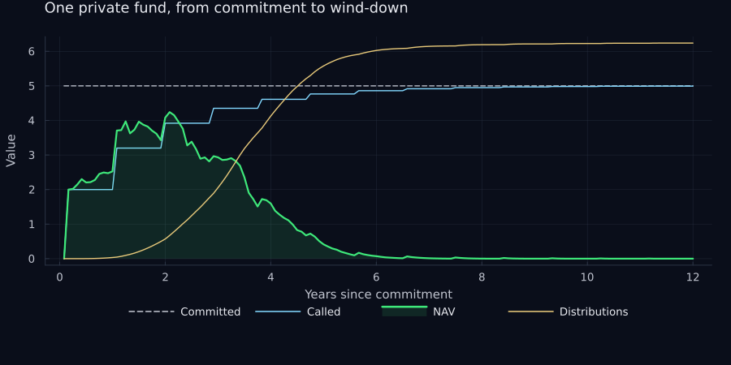
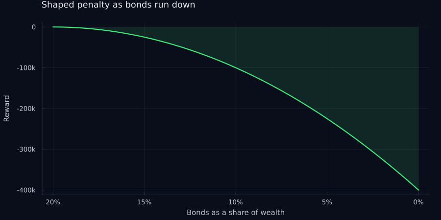
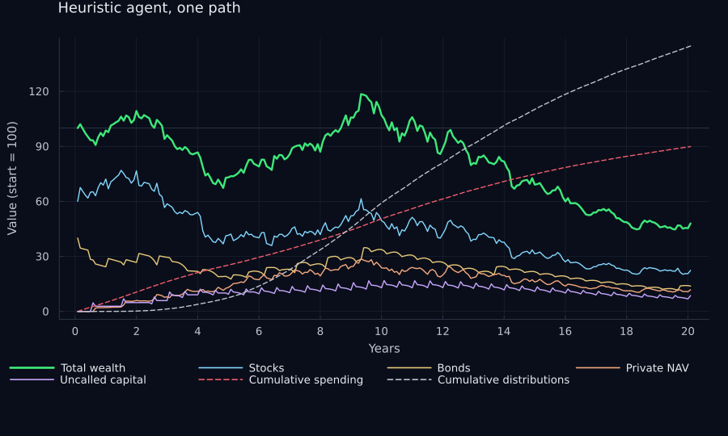
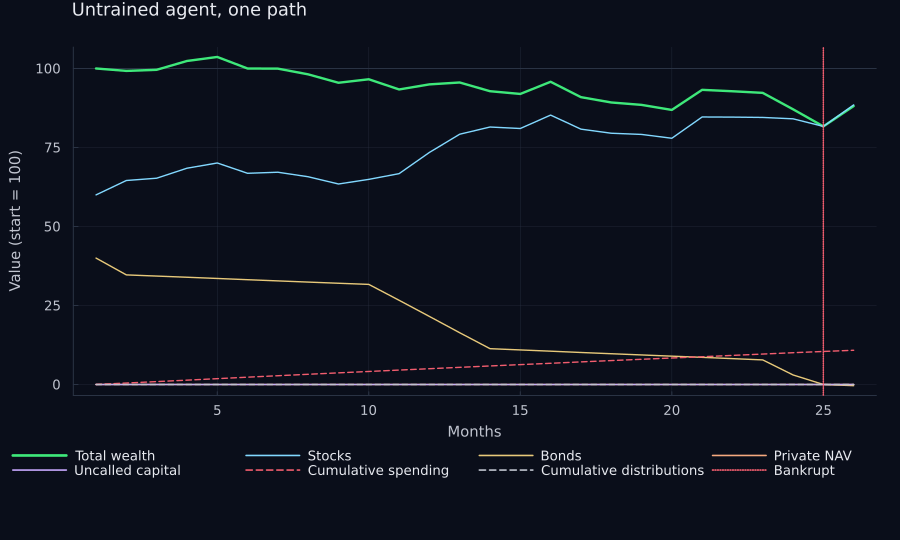
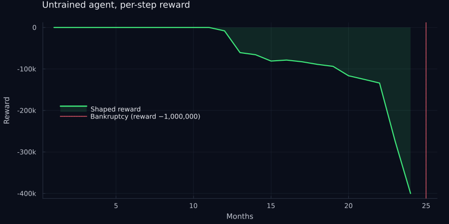
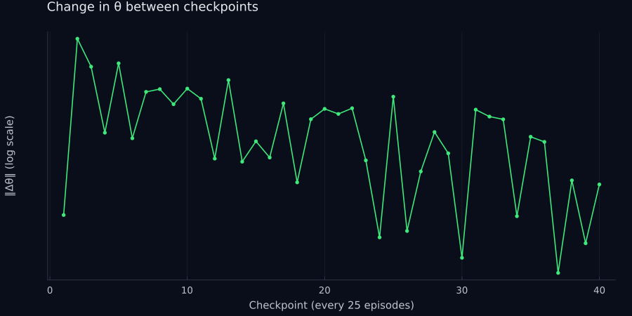
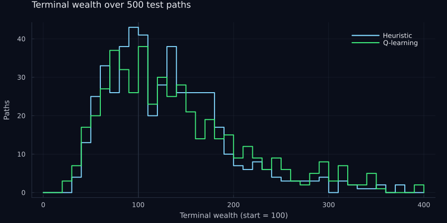
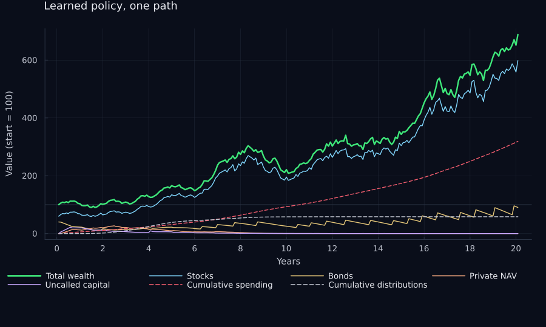

# Endowment asset allocation as a reinforcement learning problem

2023-12-12

In the fall of 2023 I took Stanford’s [AA228, *Decision Making Under
Uncertainty*](https://aa228.stanford.edu/), as a non-degree graduate
student. The course, taught by the inimitable Mykel Kochenderfer, works
through probabilistic reasoning, sequential decision problems, model and
state uncertainty, and multiagent systems, following the textbook by
Kochenderfer, Wheeler, and Wray, [*Algorithms for Decision
Making*](https://algorithmsbook.com/), which is free to read online.
“Decision making under uncertainty” is about as good a four-word
description of investing as I have come across, so the fit was natural.

The class is taught in the Julia language, and every algorithm in the
book is given as a few lines of readable code. I love Julia for this
kind of work. It reads like pseudocode and runs like compiled code, so
you never have to leave it to make something fast. Everything in this
post is executed from the notebook you are reading: the simulation, the
learner, every number in the tables, and every chart.

This is the written version of my final project, and it is an
exploration rather than a finished system. The question I set myself was
whether a reinforcement learning agent could learn to allocate an
endowment’s capital across liquid and illiquid investments, and whether
it could do that *better than a simple rules-based baseline*.

▸ **[Source on
GitHub](https://github.com/marketneutral/aa228-final-project)**

The short answer is **yes**, on average wealth and in simulation. The
longer answer is that most of the work was in building the environment,
shaping the reward, and constraining the actions so that the one outcome
an endowment cannot survive is off the table. The result is bound to the
environment I built. The agent learned to exploit a world with fixed
return parameters, a deterministic call schedule, and a liquidity rule
that does its risk management for it. Change any of those and the policy
has to be relearned, and nothing here says it would transfer to real
markets.

## The problem

Endowments and foundations manage large pools of capital for
institutions with decades-long horizons. The “endowment model” leads to
portfolios that have a diversified mix of liquid assets and illiquid
ones: e.g., venture, buyouts, real assets. There is a large literature
of primary research on asset allocation among liquid instruments. There
is much less on what to do when some of your assets have lock-ups,
capital calls you cannot refuse, and distributions you cannot time.

The setup here is a simplified version of the opportunity set endowments
face: an investment pool holding three instruments, with a spending
obligation, simulated monthly over twenty years. The agent’s job is to
end with as much wealth as possible without ever being unable to pay a
bill.

## The instruments

**Bonds.** A short-term Treasury bill: risk-free, growing at a constant
rate, and serving as the cash account that spending and capital calls
are paid from.

$$
V_t = V_{t-1}\left(1 + \frac{r_{bond}}{12}\right)
$$

**Stocks.** Think of an S&P 500 ETF. Geometric Brownian motion,
discretized monthly.

$$
S_t = S_{t-1}\left(1 + \frac{\mu_{stock}}{12} + \epsilon\right),
\qquad
\epsilon \sim N\!\left(0, \frac{\sigma^2_{stock}}{12}\right)
$$

**Private investments.** Think of a commitment to a venture capital
fund. This is the interesting one, because it behaves like nothing
liquid:

- At time zero you commit $\$x$mm. No cash moves.
- The fund has a known maximum life, here twelve years.
- In each month after that, the fund may: (a) do nothing, (b) call
  capital from you and invest it, or (c) distribute cash back to you.
- Called capital, the fund’s net asset value or NAV, earns a risky
  return: the stock return plus an excess return plus idiosyncratic
  noise.
- Calls arrive *deterministically* over the fund’s life. The timing of
  distributions is also *deterministic*, but the amount is a function of
  the fund’s return-to-date. The industry standard shape is from
  Takahashi and Alexander (2002).

$$
r_{stock} = S_t / S_{t-1} - 1
$$

$$
g = r_{stock} + \alpha_{priv} + \epsilon_{priv},
\qquad
\epsilon_{priv} \sim N\!\left(0, \frac{\sigma^2_{priv}}{12}\right)
$$

$$
NAV_t = NAV_{t-1}(1 + g) + \text{calls} - \text{distributions}
$$

Three structs hold the state of the world: one private fund, the pool
that owns everything, and the market parameters.

``` julia
mutable struct private_investment
    committed::Float64
    called::Float64
    distributed::Float64
    nav::Float64
    age::Int64
    max_age::Int64
    rate_of_contrib::Float64
    bow::Float64
    is_alive::Bool
    private_investment(committed::Float64) =
        new(committed, 0.0, 0.0, 0.0, 0, 144, 0.40, 2, true)
end

mutable struct investment_pool
    time_step::Int64
    horizon::Int64
    begin_wealth::Float64
    total_wealth::Float64
    bonds::Float64
    stocks::Float64
    private_investments::Vector{private_investment}
    total_uncalled::Float64
    max_wealth::Float64
    max_drawdown::Float64
    is_bankrupt::Bool
    spent::Float64
    distributed::Float64
    investment_pool() = new(
        1, 240, 100.0, 100.0, 40.0, 60.0, private_investment[],
        0.0, 100.0, 0.0, false, 0.0, 0.0,
    )
end

struct market_parameters
    stock_volatility::Float64
    stock_expected_return::Float64
    bond_return::Float64
    privates_beta::Float64
    privates_expected_alpha::Float64
    privates_idiosyncratic_volatility::Float64
    spending_rate::Float64
end
```

The pool starts with 100 of wealth, 60 in stocks and 40 in bonds, and
runs for 240 months. Each private fund calls 40% of its remaining
uncalled commitment at inception and again every eleven months, and
lives for 144 months. The market parameters are all annualized:

``` julia
mp = market_parameters(
    0.15,    # stock volatility
    0.08,    # stock expected return
    0.03,    # bond return
    1.0,     # privates beta to stocks
    0.025,   # privates expected alpha
    0.05,    # privates idiosyncratic volatility
    0.055,   # spending rate
)
```

| Parameter                         | Value |
|-----------------------------------|-------|
| Stock volatility                  | 15.0% |
| Stock expected return             | 8.0%  |
| Bond return                       | 3.0%  |
| Privates beta to stocks           | 1.0   |
| Privates expected alpha           | 2.5%  |
| Privates idiosyncratic volatility | 5.0%  |
| Spending rate                     | 5.5%  |

One month of the world is a single function. In order: pay spending out
of bonds, grow bonds, grow stocks, then for each live private fund
process its calls and distributions and grow its NAV. Distributions
follow the Takahashi-Alexander “bow”, where the fraction of NAV paid out
in a month is $\left(\frac{\text{age}}{\text{max age}}\right)^{2}$, and
whatever NAV remains at the end of the fund’s life is paid out in full.

``` julia
function step!(pool::investment_pool, mp::market_parameters)
    # spending comes out of bonds
    spending = pool.total_wealth * mp.spending_rate / 12
    pool.spent += spending
    pool.bonds -= spending

    # liquid assets
    pool.bonds *= 1 + mp.bond_return / 12
    stock_return = mp.stock_expected_return / 12 +
                   (mp.stock_volatility / sqrt(12)) * randn()
    pool.stocks *= 1 + stock_return

    # private investments
    for pi in pool.private_investments
        if pi.age >= pi.max_age
            # end of life: distribute whatever NAV is left
            pool.bonds += pi.nav
            pi.nav = 0.0
            pi.is_alive = false
        else
            uncalled = pi.committed - pi.called
            call = (pi.age == 0 || pi.age % 11 == 0) ?
                   pi.rate_of_contrib * uncalled : 0.0

            priv_alpha = mp.privates_expected_alpha / 12 +
                (mp.privates_idiosyncratic_volatility / sqrt(12)) * randn()
            g = priv_alpha + mp.privates_beta * stock_return

            rd = ((pi.age - 1) / pi.max_age)^pi.bow   # Takahashi-Alexander
            dist = rd * (pi.nav * (1 + g))

            pi.distributed += dist
            pi.called += call
            pi.nav = pi.nav * (1 + g) + call - dist
            pi.age += 1

            pool.bonds -= call
            pool.bonds += dist
        end
    end
    pis = pool.private_investments
    pool.total_uncalled = sum([x.committed - x.called for x in pis];
                              init = 0.0)
    pool.total_wealth = pool.bonds + pool.stocks +
                        sum([x.nav for x in pis]; init = 0.0)
    pool.max_wealth = max(pool.max_wealth, pool.total_wealth)
    pool.time_step += 1
end
```

The agent can do three things to the pool: buy stocks with bonds, sell
stocks into bonds, or commit to a new private fund. None of them can
spend bonds the pool does not have.

``` julia
function buy_stocks!(pool::investment_pool, amount::Float64)
    amount = min(amount, pool.bonds)
    pool.stocks += amount
    pool.bonds -= amount
end

function sell_stocks!(pool::investment_pool, amount::Float64)
    amount = min(amount, pool.stocks)
    pool.stocks -= amount
    pool.bonds += amount
end

function commit!(pool::investment_pool, amount::Float64)
    amount = min(amount, pool.bonds)
    push!(pool.private_investments, private_investment(amount))
end
```

To see what one fund looks like over its life, commit to it and let the
world run with no further actions. Capital is called in steps, NAV
builds and then bleeds out as distributions, and the fund ends up
returning more than was committed as a function of its excess return
(subject to idiosyncratic noise).

``` julia
Random.seed!(1)
pool = investment_pool()
commit!(pool, 5.0)
pi_path = [deepcopy(pool)]
for _ in 1:144
    step!(pool, mp)
    push!(pi_path, deepcopy(pool))
end
plot_private_investment(pi_path, 1)
```



The uncalled capital (so called “unfunded”) is the risk to the
endowment. It is a liability that will be called at a time of the fund’s
choosing, and it has to be paid out of bonds. Commit too much and a
cluster of calls arrives when the bond balance is thin. In this
simulation, that leads to “bankruptcy” (though in the real world, it’s
less severe).

## The problem as an MDP

The class’ framework for sequential decision problems is the Markov
decision process, or MDP. An MDP is a tuple

$$
\langle \mathcal{S}, \mathcal{A}, T, R, \gamma \rangle
$$

where $\mathcal{S}$ is the set of states the world can be in,
$\mathcal{A}$ is the set of actions the agent can take,
$T(s' \mid s, a)$ is the transition model giving the probability of
landing in state $s'$ after taking action $a$ in state $s$, $R(s, a)$ is
the expected reward for doing so, and $\gamma \in [0, 1]$ is a discount
factor. The Markov part is the assumption that the next state depends
only on the current state and action, not on the history of how we got
here. Whatever the agent needs to remember has to be in the state.

A policy $\pi$ maps states to actions. Following a policy from state $s$
produces a random stream of rewards, and the value of the policy in that
state is their expected discounted sum,

$$
U^{\pi}(s) = \mathbb{E}\left[\sum_{t=0}^{\infty} \gamma^{t} r_t
\;\middle|\; s_0 = s,\; a_t = \pi(s_t)\right]
$$

The discount factor trades off reward now against reward later. It also
keeps the sum finite over an infinite horizon, though here the horizon
is a fixed 240 months.

The object we are after is the **optimal policy** $\pi^*$, the one whose
value is at least as large as any other policy’s in every state. Its
value function $U^*$ satisfies the **Bellman optimality equation**,

$$
U^*(s) = \max_{a} \left[ R(s, a) + \gamma \sum_{s'} T(s' \mid s, a)\, U^*(s') \right]
$$

which says that acting optimally means picking the action that is best
when you account for the immediate reward and the optimal value of
wherever you end up. It is often more convenient to work with the
**action-value function** $Q^*(s, a)$, the value of taking $a$ in $s$
and acting optimally afterwards, because the optimal policy then falls
out directly:

$$
Q^*(s, a) = R(s, a) + \gamma \sum_{s'} T(s' \mid s, a) \max_{a'} Q^*(s', a')
$$

$$
\pi^*(s) = \arg\max_{a} Q^*(s, a)
$$

When the state and action spaces are small and the transition model is
known, you can solve these equations exactly by dynamic programming.
That is the first half of the book. Our problem fails both conditions.
The state is continuous, and nobody can write down $T$ for a portfolio
of private funds, but it is easy to *sample* from: given a state and an
action, run the simulation forward one month. The book calls this a
generative model (this is “generative” in the language of
“good-old-fashioned-AI”, not in the sense of LLMs/generative AI).
**Learning a policy from samples drawn from it, with no access to $T$
itself, is reinforcement learning.**

The endowment problem fits this frame neatly. The world is stochastic,
the consequences of today’s action arrive years later, and the state
carries everything the agent needs to know.

**State.** Continuous, and simply the `investment_pool` struct above:
the time step, total wealth, bond and stock holdings, total uncalled
commitments, total private NAV, the maximum drawdown so far, and a
bankruptcy flag.

**Actions.** Each month the agent can rebalance between the two liquid
assets or commit to a new private fund. I discretized this to four
actions, each sized at 5% of total wealth:

``` julia
action_space = [
    :do_nothing,
    :buy_stocks_5,     # buy stocks, sell bonds, 5% of total wealth
    :sell_stocks_5,    # sell stocks, buy bonds, 5% of total wealth
    :commit_5,         # commit 5% of total wealth to a new private fund
]
```

Not every action is available in every state. A real endowment runs
under a liquidity policy, and the MDP has one too: the agent may not buy
stocks or make a commitment if doing so would leave bonds below 10% of
wealth or below the total of its uncalled commitments, and if bonds ever
fall below that line it has to sell stocks. In the book’s terms the
feasible action set $\mathcal{A}(s)$ depends on the state. The learner
still chooses among the four actions; the constraint just maps an
infeasible choice onto a feasible one.

``` julia
function constrain(a, s; floor = 0.10)
    s.is_bankrupt && return :do_nothing
    w = s.total_wealth
    trade = 0.05w
    uncalled = sum([x.committed - x.called for x in s.private_investments];
                   init = 0.0)
    buffer = max(floor * w, uncalled)

    if s.bonds < buffer
        return s.stocks > 0 ? :sell_stocks_5 : :do_nothing
    end
    bonds_after = s.bonds - trade
    if a == :commit_5 && bonds_after < max(floor * w, uncalled + trade)
        return :do_nothing
    end
    if a == :buy_stocks_5 && bonds_after < buffer
        return :do_nothing
    end
    return a
end
```

**Transitions.** The `step!` function above, which is the generative
model. The agent never sees transition probabilities, only samples.

**Rewards.** At every step the agent receives the change in total wealth
since the last step, a number on the order of plus or minus three. At
the final step it receives the total wealth gained over the simulation.
Bankruptcy, defined as the bond balance going below zero, earns negative
one million and ends the episode.

**Discount.** $\gamma = 0.999$. With 240 monthly steps, anything much
smaller makes the agent too myopic to care about the terminal reward.

## Reward shaping

The bankruptcy penalty is the most important signal in the problem, and
it is also extremely sparse. An agent exploring at random sees it rarely
and late, after a long sequence of actions that each looked fine at the
time. That makes it very hard to learn from.

Bankruptcy happens when a capital call or a spending draw cannot be paid
out of bonds, so the fix was **a penalty** that grows quadratically as
bonds fall below 20% of total wealth.

``` julia
bond_penalty(bonds_pct) = -1_000 * (100 * (0.20 - bonds_pct))^2

plot(0.0:0.005:0.20, bond_penalty, legend = false, linewidth = 2.2,
     title = "Shaped penalty as bonds run down",
     xlabel = "Bonds as a share of wealth", ylabel = "Reward",
     xflip = true, yformatter = kfmt, fillrange = 0, fillalpha = 0.12,
     xticks = (0:0.05:0.20, ["0%", "5%", "10%", "15%", "20%"]))
```



This turns a cliff into a slope. The agent gets a dense, smooth signal
pointing away from the edge long before it gets there. The commit
history on the project is honest about how much this mattered: “learns
to not become bankrupt” came several commits before “works! works!”.

The generative model puts it all together: step the world, check for
bankruptcy or the end of the horizon, apply the action, and compute the
reward.

``` julia
function generate(s::investment_pool, a, mp::market_parameters)
    r = -1.0
    s′ = deepcopy(s)
    step!(s′, mp)

    if s′.total_wealth < 0 || s′.bonds < 0
        s′.is_bankrupt = true
        return s′, r - 1_000_000
    end

    if s′.time_step == s′.horizon
        return s′, r + s′.total_wealth - 100
    end

    trade = s′.total_wealth * 0.05
    a == :buy_stocks_5  && buy_stocks!(s′, trade)
    a == :sell_stocks_5 && sell_stocks!(s′, trade)
    a == :commit_5      && commit!(s′, trade)

    r += s′.total_wealth - s.total_wealth

    bonds_pct = s′.bonds / s′.total_wealth
    bonds_pct < 0.20 && (r += bond_penalty(bonds_pct))

    drawdown = (s′.max_wealth - s′.total_wealth) / s′.max_wealth
    s′.max_drawdown = max(s′.max_drawdown, drawdown)

    return s′, r
end
```

Two utilities run a policy over one path or many, and a third summarizes
the terminal outcomes.

``` julia
function run_one_path(model, s, policy, mp)
    path, rewards = [deepcopy(s)], Float64[]
    for _ in 1:s.horizon
        a = policy(model, s)
        s, r = generate(s, a, mp)
        push!(path, deepcopy(s))
        push!(rewards, r)
        s.is_bankrupt && break
    end
    return path, rewards
end

function run_many_paths(model, s, policy, mp, n_paths = 1000)
    [run_one_path(model, deepcopy(s), policy, mp)[1][end]
     for _ in 1:n_paths]
end

function summarize_many_paths(paths)
    w = [x.total_wealth for x in paths]
    (n = length(paths),
     avg_wealth = mean(w),
     w90 = quantile(w, 0.9),
     w10 = quantile(w, 0.1),
     avg_mdd = mean([x.max_drawdown for x in paths]),
     avg_spent = mean([x.spent for x in paths]),
     bankrupt = sum([x.is_bankrupt for x in paths]))
end
```

## Baseline: a simple heuristic

Before learning anything, I wanted a baseline: a simple, somewhat
realistic rules-based policy. Target a net equity exposure, where net
equity is stocks plus private NAV as a share of wealth. If you are above
target by more than a rebalance band, sell stocks; if below, buy. Every
six months, make a new private commitment as long as uncalled capital is
below a cap, bonds are above a floor, and private NAV is below its own
cap. Otherwise do nothing.

``` julia
struct Heuristics
    max_privates::Float64
    max_equity_net::Float64
    max_uncalled::Float64
    target_equity_net::Float64
    rebalance_band::Float64
    pacing_months::Int64
    min_cash::Float64
end

function policy(model::Heuristics, s)
    s.is_bankrupt && return :do_nothing

    pis = s.private_investments
    bonds_pct    = s.bonds / s.total_wealth
    stocks_pct   = s.stocks / s.total_wealth
    privates_pct = sum([p.nav for p in pis]; init = 0.0) / s.total_wealth
    uncalled_pct = sum([p.committed - p.called for p in pis]; init = 0.0) /
                   s.total_wealth

    gap = stocks_pct + privates_pct - model.target_equity_net
    gap >  model.rebalance_band && return :sell_stocks_5
    gap < -model.rebalance_band && return :buy_stocks_5

    if s.time_step % model.pacing_months == 0 &&
       uncalled_pct < model.max_uncalled &&
       bonds_pct > model.min_cash &&
       privates_pct < model.max_privates
        return :commit_5
    end

    return :do_nothing
end
```

With a 70% equity target, a 5% band, a 25% cap on privates, and a 25%
cap on uncalled commitments, one sampled twenty-year path looks like
this. The private book is paced in, distributions eventually cover
spending, and bonds never get close to zero.

``` julia
heuristic_pi = Heuristics(
    0.25,   # max privates
    0.75,   # max equity net
    0.25,   # max uncalled
    0.70,   # target equity net
    0.05,   # rebalance band
    6,      # pacing months
    0.05,   # min cash
)

Random.seed!(42)
path, _ = run_one_path(heuristic_pi, investment_pool(), policy, mp)
plot_one_path(path; title = "Heuristic agent, one path")
```



To measure it, I ran two versions over 500 paths each: one with private
investments switched off, one with them allowed.

``` julia
heuristic_no_pi = Heuristics(0.00, 0.75, 0.25, 0.70, 0.05, 99_999, 0.05)

Random.seed!(42)
ends_no_pi = run_many_paths(heuristic_no_pi, investment_pool(),
                            policy, mp, 500)
Random.seed!(42)
ends_pi = run_many_paths(heuristic_pi, investment_pool(), policy, mp, 500)

res_no_pi = summarize_many_paths(ends_no_pi)
res_pi    = summarize_many_paths(ends_pi)
results_table(["No privates", "Privates allowed"], [res_no_pi, res_pi])
```

| Metric                      | No privates | Privates allowed |
|-----------------------------|-------------|------------------|
| Simulated paths             | 500         | 500              |
| Average terminal wealth     | 123.3       | 133.2            |
| 90th percentile wealth      | 202.9       | 214.5            |
| 10th percentile wealth      | 59.6        | 63.8             |
| Average max drawdown        | 39.9%       | 38.1%            |
| Average cumulative spending | 121.2       | 126.9            |
| Times bankrupt              | 0           | 0                |

Allowing privates adds about ten points of average terminal wealth,
which is the alpha showing up, and the heuristic never goes bankrupt
either way. That is the bar the learner has to clear: more wealth, and
still zero bankruptcies.

## Q-learning with function approximation

The state space is continuous, so a tabular Q-function is out. Instead I
used a **linear action-value approximation**,
$Q_\theta(s, a) = \theta^\top \phi(s, a)$, and learned $\theta$ by
**gradient Q-learning**. This is Algorithm 17.4 in the book, but I added
an L2 regularization term.

The loss to minimize is

$$
\ell(\theta) = \frac{1}{2}\, \mathbb{E}_{(s,a)\sim\pi^*}
\left[ \big(Q^*(s,a) - Q_\theta(s,a)\big)^2 + \frac{\lambda}{2}\|\theta\|^2 \right]
$$

and the update, replacing the unknown $Q^*$ with the bootstrapped
target, is

$$
\begin{aligned}
\theta \leftarrow \theta + \alpha \Big\{
&\left[ r + \gamma \max_{a'} Q(s', a') - Q(s, a) \right] \nabla_\theta Q(s, a) \\
&- \lambda \theta \Big\}
\end{aligned}
$$

Because $Q$ is linear in $\theta$, the gradient is just the feature
vector. I also clip the gradient step to a maximum norm of 10, which
stopped the parameters from blowing up early in training when the first
bankruptcy penalty arrives.

``` julia
struct GradientQLearning
    A        # discrete action space
    γ        # discount
    Q        # parameterized action value function Q(θ, s, a)
    ∇Q       # gradient of the action value function
    θ        # parameters
    α        # learning rate
    λ        # regularization
end

scale_gradient(∇, L2_max) = min(L2_max / norm(∇), 1) * ∇

lookahead(model::GradientQLearning, s, a) = model.Q(model.θ, s, a)

function update!(model::GradientQLearning, s, a, r, s′)
    (; A, γ, Q, θ, α, λ) = model
    u = maximum(Q(θ, s′, a′) for a′ in A)
    Δ = (r + γ * u - Q(θ, s, a)) * model.∇Q(θ, s, a) - λ * θ
    θ[:] += α * scale_gradient(Δ, 10)
    return model
end

mutable struct EpsilonGreedyExploration
    ϵ   # probability of a random action
end

function policy(model::GradientQLearning, s,
                exploration::EpsilonGreedyExploration)
    rand() < exploration.ϵ && return rand(model.A)
    values = [lookahead(model, s, a) for a in model.A]
    return model.A[argmax(values)]
end

# one training episode: act, observe, update, repeat
function simulate(model, policy, s, gen)
    path, rewards = [deepcopy(s)], Float64[]
    for _ in 1:s.horizon
        a = policy(model, s)
        s′, r = gen(s, a)
        update!(model, s, a, r, s′)
        s = s′
        push!(path, deepcopy(s))
        push!(rewards, r)
        s.is_bankrupt && break
    end
    return path, rewards
end
```

**Features.** The basis function maps a state and an action into 152
features. It’s beyond the scope of this blog post, but every old-school
Kaggler and machine learning practitioner who has taken Andrew Ng’s
*Machine Learning* Coursera course knows these ideas:

- *Periodicity.* Sine and cosine of the time step with a twelve-month
  period. Capital calls arrive on a roughly annual cadence, and this
  lets the agent see where it is in that cycle.
- *State.* Wealth relative to starting wealth, stock share, bond share,
  uncalled commitments as a share of wealth, uncalled commitments as a
  multiple of bonds, private NAV share, and maximum drawdown.
- *Polynomial.* Squares, cubes, and fourth powers of every state
  feature, plus an indicator for bonds below 10% of wealth.
- *Action.* A one-hot encoding of the action.
- *Combinations.* The outer product of every state feature with every
  action indicator.

That is 37 state features times 4 actions, plus the 4 action indicators.
The combination terms are what let a single linear model express a
different value function for each action.

``` julia
function basis(s, a)
    cos_t = cos((2π / 12) * (s.time_step - 12))
    sin_t = sin((2π / 12) * (s.time_step - 12))

    total_wealth = s.total_wealth + 1e-6
    bonds = max(s.bonds, 1e-6)
    bonds_pct = bonds / total_wealth

    state_features = [
        total_wealth / s.begin_wealth - 1,
        s.stocks / total_wealth,
        bonds_pct,
        s.total_uncalled / total_wealth,
        s.total_uncalled / bonds,
        (total_wealth - s.stocks - bonds) / total_wealth,
        s.max_drawdown,
        cos_t,
        sin_t,
    ]

    # polynomial features
    p2 = state_features .^ 2
    p3 = state_features .^ 3
    p4 = state_features .^ 4
    state_features = vcat(bonds_pct < 0.10, state_features, p2, p3, p4)

    action_ohe = [a == action for action in action_space]

    # every state feature crossed with every action indicator
    combs = [s_f * a_f for s_f in state_features, a_f in action_ohe]

    return vcat(action_ohe, vec(combs))
end

Q_func(θ, s, a) = dot(θ, basis(s, a))
grad_Q_func(θ, s, a) = basis(s, a)

n_features = length(basis(investment_pool(), :do_nothing))
println("Number of features: ", n_features)
```

    Number of features: 152

**Before training.** With $\theta$ drawn uniformly from $[-1, 1]$ and a
greedy policy, the agent has no idea what it is doing. To see what the
bankruptcy penalty looks like, run it once with the liquidity constraint
switched off. On this path it buys stocks with every bond it has,
monthly spending drains what is left, and it is bankrupt in about two
years.

``` julia
α = 0.01       # learning rate
λ = 0.1        # regularization
γ = 0.999      # discount
n_sims = 1_000 # training episodes
ϵ = 0.20       # exploration

greedy = EpsilonGreedyExploration(0.0)
unconstrained_greedy = (m, s) -> policy(m, s, greedy)
greedy_policy = (m, s) -> constrain(policy(m, s, greedy), s)

Random.seed!(42)
θ_untrained = 2 .* (rand(n_features) .- 0.5)
untrained = GradientQLearning(action_space, γ, Q_func, grad_Q_func,
                              θ_untrained, α, λ)

random_path, random_rewards = run_one_path(untrained, investment_pool(),
                                           unconstrained_greedy, mp)
println("Untrained agent survived ", length(random_rewards), " months")
plot_one_path(random_path; title = "Untrained agent, one path")
```

    Untrained agent survived 25 months



The per-step reward on that path shows what the shaping does. The reward
is near zero while bonds are healthy, the quadratic penalty ramps up as
they run down, and then the cliff arrives: the final step is the
negative one million bankruptcy penalty, which is off the chart by
design.

``` julia
n = length(random_rewards)
plot(1:n-1, random_rewards[1:n-1], label = "Shaped reward",
     linewidth = 2.2, title = "Untrained agent, per-step reward",
     xlabel = "Months", ylabel = "Reward", yformatter = kfmt,
     legend = :left, fillrange = 0, fillalpha = 0.12)
vline!([n], label = "Bankruptcy (reward −1,000,000)", color = OOS.red,
       linestyle = :dot, linewidth = 1.5)
```



**Training.** Each episode is one twenty-year path, and training runs
1,000 of them with epsilon-greedy exploration: with probability
$\epsilon$ the agent takes a random action, otherwise the one its
current $Q$ rates highest. Either way the choice passes through the
liquidity constraint, so the agent learns the values of the actions it
will actually be allowed to take.

| Parameter          | Value |
|--------------------|-------|
| Number of features | 152   |
| Learning rate α    | 0.01  |
| Regularization λ   | 0.1   |
| Discount γ         | 0.999 |
| Training episodes  | 1000  |
| Epsilon            | 0.2   |

``` julia
function train!(model, n_sims, ϵ, mp; checkpoint_every = 25)
    exploration = EpsilonGreedyExploration(ϵ)
    explore_policy = (m, s) -> constrain(policy(m, s, exploration), s)
    gen = (s, a) -> generate(s, a, mp)
    θs = [copy(model.θ)]
    n_bankrupt = 0
    for i in 1:n_sims
        path, _ = simulate(model, explore_policy, investment_pool(), gen)
        n_bankrupt += path[end].is_bankrupt
        i % checkpoint_every == 0 && push!(θs, copy(model.θ))
    end
    return θs, n_bankrupt
end

Random.seed!(7)
θ = 2 .* (rand(n_features) .- 0.5)
model_gql = GradientQLearning(action_space, γ, Q_func, grad_Q_func,
                              θ, α, λ)

t_train = @elapsed θs, n_bankrupt = train!(model_gql, n_sims, ϵ, mp)
println("Trained $n_sims episodes in $(round(t_train; digits = 1)) s")
println("Bankruptcies during training: $n_bankrupt")
```

    Trained 1000 episodes in 41.9 s
    Bankruptcies during training: 0

With the constraint in place the explorer never goes bankrupt, even with
a 20% chance of a random action every month. What it does see, often, is
the shaped bond penalty and the forced stock sales that follow a
commitment it could not really afford, and that is where the learning
signal comes from.

I checkpointed $\theta$ every 25 episodes and tracked the norm of the
change between checkpoints. It drops by an order of magnitude over the
first few checkpoints and then wanders without fully settling, which is
what you would expect from a constant learning rate and an exploration
rate that never decays.

``` julia
plot(1:length(θs)-1, [norm(d) for d in diff(θs)], legend = false,
     yscale = :log10, yticks = ([0.5, 1, 2, 5, 10, 20],
                                ["0.5", "1", "2", "5", "10", "20"]),
     marker = :circle, markersize = 3, markerstrokewidth = 0,
     linewidth = 1.6, title = "Change in θ between checkpoints",
     xlabel = "Checkpoint (every 25 episodes)", ylabel = "‖Δθ‖ (log scale)")
```



## Results

Now evaluate the trained policy greedily, with no exploration, over 500
fresh test paths, next to the heuristic with privates allowed.

``` julia
Random.seed!(42)
ends_q = run_many_paths(model_gql, investment_pool(), greedy_policy,
                        mp, 500)
res_q = summarize_many_paths(ends_q)

results_table(["Heuristic, privates allowed", "Q-learning"],
              [res_pi, res_q])
```

| Metric                      | Heuristic, privates allowed | Q-learning |
|-----------------------------|-----------------------------|------------|
| Simulated paths             | 500                         | 500        |
| Average terminal wealth     | 133.2                       | 149.5      |
| 90th percentile wealth      | 214.5                       | 264.5      |
| 10th percentile wealth      | 63.8                        | 62.2       |
| Average max drawdown        | 38.1%                       | 42.9%      |
| Average cumulative spending | 126.9                       | 134.0      |
| Times bankrupt              | 0                           | 0          |



The learned policy ends with an average of 149.5 against 133.2 for the
heuristic, with 0 bankruptcies in 500 test paths. Most of the gain is in
the right tail: the 90th percentile moves from 214.5 to 264.5, while the
10th percentile is 62.2 against 63.8 and the average maximum drawdown is
42.9% against 38.1%. The agent is paid for taking more equity risk, and
it takes it.

The liquidity constraint is doing real work here. My first version had
no constraint and relied on the shaped reward alone. That policy earned
slightly more on average and went bankrupt in a few percent of test
paths, and every one of those failures was on a path where things had
gone very well: wealth several times its starting level, almost all of
it in stocks, bonds at zero, and a small capital call tipping the
account negative with hundreds of dollars of stock sitting right there.
Far outside the range of states it was trained on, the linear Q-function
with polynomial features extrapolated badly and stopped valuing the bond
buffer at all. More training did not fix that, and a harsher bond
penalty made the agent hide in bonds. A hard constraint did, and that is
also how a real allocator would handle it: the reward says what you
want, the constraint says what you will never do.

Here is one sampled path from the learned policy:

``` julia
Random.seed!(7)
q_path, _ = run_one_path(model_gql, investment_pool(), greedy_policy, mp)
plot_one_path(q_path; title = "Learned policy, one path")
```



What the agent learned is less subtle than I had hoped and more honest
than I expected. It makes a handful of private commitments in the first
few years, lets that book run off as distributions come back, and
otherwise holds as much stock as the liquidity rule allows. Bonds sit
right on the floor: the sawtooth in the bond line is spending drawing
bonds below 10% of wealth and the constraint forcing a stock sale to top
them back up. The agent has, in effect, discovered that the constraint
will do its liquidity management for it, and spends its own attention on
being long. That is a fair reading of the reward it was given, which
pays for wealth and not for sleeping well.

## Where this could go

This was a course project and an exploration, and the list of potential
follow-ups is long!

- **Interpret the agent.** The policy is a linear function of hand-built
  features, so it is in principle readable. What does it believe about
  the right level of uncalled commitments relative to bonds?
- **Richer endowment world model.** More asset classes (hedge funds in
  publics; differentiating between buyouts and venture); a preference
  for a smoother privates pacing.
- **Richer process dynamics.** Jumps and stochastic volatility in the
  stock process. Randomness in the timing of calls and distributions,
  correlated with stock returns, since the real world calls capital in
  bad markets and distributes it in good ones. Some randomness in the
  spending.
- **Richer Q-function.** Drop the manual feature engineering and use a
  deep Q-network.
- **Less reward shaping.** The bond penalty encodes a lot of my own
  prior about what safe looks like. It would be a better result if the
  agent could learn that from the sparse bankruptcy signal alone.
- **Better features far from home.** The unconstrained agent failed on
  paths where wealth was several times its starting level, because
  fourth powers of the wealth ratio are enormous there. Bounded
  features, or a network, would extrapolate more gracefully.
- **Risk in the objective.** The agent maximizes expected wealth. An
  endowment cares at least as much about the left tail, and a penalty on
  drawdown or on the probability of ruin belongs in the reward.

## References

- Kochenderfer, M. J., Wheeler, T. A., and Wray, K. H. (2022).
  *Algorithms for Decision Making*. MIT Press.
  [algorithmsbook.com](https://algorithmsbook.com/)
- Stanford AA228/CS238, *Decision Making Under Uncertainty*.
  [aa228.stanford.edu](https://aa228.stanford.edu/)
- Takahashi, D. and Alexander, S. (2002). “Illiquid Alternative Asset
  Fund Modeling.” *Journal of Portfolio Management*, 28(2), 90–100.
- Sutton, R. S. and Barto, A. G. (2018). *Reinforcement Learning: An
  Introduction*, 2nd ed. MIT Press.
- Swensen, D. F. (2009). *Pioneering Portfolio Management: An
  Unconventional Approach to Institutional Investment*, 2nd ed. Free
  Press.
- Project source:
  [marketneutral/aa228-final-project](https://github.com/marketneutral/aa228-final-project)
