It makes sense to most people that AI beat us at chess, Go and Atari. Those are closed systems: the rules are known, the score is clear, and the machine can play itself as often as it likes. The common objection today is about language models. A model trained on text that people wrote, the argument goes, cannot get past the people who wrote it, and nothing outside a closed game will let it.

It usually comes in one of two forms (from here on, “AI” is synonymous with LLM-based AI).

> *“AI is just the average of its training data.”*
>
> *“AI can’t do anything it hasn’t seen in its training data.”*

I hear both from smart, successful, creative people in finance. They are not dumb. The answer is just not very intuitive. I have studied this stuff formally, I work on applied AI in investing every day, and last month I made the same mistake! A data broker was selling data produced by non-experts, and my knee-jerk reaction was that an LLM trained on it could never match a human expert in that field. It is the same claim, dressed differently.

Neither objection above is precise as stated. The first says a model is the mean of what people did. The second has a weak form (at best, a model finds the best thing a person did and copies it) and a strong form (a model can only rearrange pieces it has already seen, so it cannot be creative). All three are claims about what a machine computes from its data, and they can be tested.

In investing the same objection shows up as: “an AI can never invest better than people do, because it learns from what people wrote.” This post is *not* about investing, but I come back to that version at the end.

I built the smallest world I could to test these claims. Six hundred people try to cross a small grid, badly, and every step they take is recorded. The recording never changes. Then four machines take a turn, on rungs 0 to 3 of a ladder.

The first three get no referee. They never touch the grid. All they have is the recording of what people did, and each asks a different question of it. That is the situation the objection describes, and **the last of those three still beats every person in the data.** The fourth gets the one thing a closed game has: it can try a move and see what happens. The end of the post is about why language models can have that too, well outside games.

OK, I’ll admit: being superhuman in a world of 25 cells is not much of an achievement. But it is didactic. What we care about is how each machine gets there. The world we work in here is not a language model. It is a grid and a robot. But **each rung maps onto a stage in how language models are trained**, and each ends with a short note saying how tight the mapping is. You need to know nothing about “tokenizers,” “the transformer mechanism,” “mixture of experts,” or similar AI internals to follow it.

## The world

A 5×5 grid. Everyone, human or robot, starts at START, and the goal is to reach the TREASURE.

<figure class="diagram">
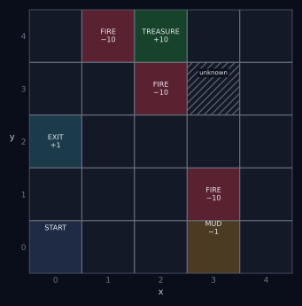
<figcaption>The world. Start bottom-left. The treasure can only be entered from its right. The route the humans are taught runs along the bottom through the mud, up the right edge and across the top. The hatched cell comes up in the next section.</figcaption>
</figure>

Cells are named by their coordinates $(x, y)$, counted from the bottom-left corner: $x$ is the column, $y$ is the row, and both start at 0. The start is $(0, 0)$; the treasure is $(2, 4)$; the exit is $(0, 2)$.

- The **treasure** (+10, and the walk ends) is at the top-middle.
- A **safe exit** (+1, and the walk ends) is two steps up from the start.
- Three cells are **fire** (−10, and the walk ends).
- One cell on the bottom row is **mud**: crossing it costs 1 extra point.
- Every step costs half a point, so short routes matter.

A walk’s score is the sum of all that. For example, a 10-step walk through the mud that ends at the treasure scores 10 × (−0.5) − 1 + 10 = **4.0**.

Fire sits on two sides of the treasure, so the only way in is from the cell to its right.

## The people

Six hundred people attempted the grid. Each of them was taught the same route verbally: **“go all the way right along the bottom, up the right edge, then left along the top to the treasure.”** It goes straight through the mud. Nobody had a map, and people err. They misstep, they get turned around, they wander off the route and find their way back to it by habit. Some of those detours run through the middle of the grid, and nobody notices that the middle is a better way.

Here are all six hundred attempts as the log records them, drawn the way people actually walk. The route everyone was taught is the bright band. The faint strands are people who got lost, and the habits that brought them back.

<figure class="diagram">
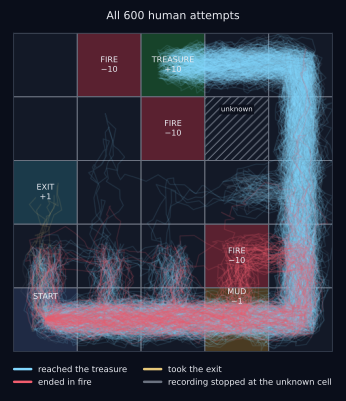
<figcaption>Every one of the 600 attempts, as the log records them, drawn the way a person walks: everyone starts from the same point, each later cell visit lands somewhere near the center of the cell, and each step wanders a little on the way. Blue walks reached the treasure, red ones ended in fire, amber took the exit. Nearly all of them trace the loop through the mud. The recordings that stop short at its edge are the ones cut there.</figcaption>
</figure>

Each person veers off course now and then, some more often than others, and an error can be fatal: fire ends a walk. I know, that’s morbid, but I wanted the data to hold plenty of complete failures. Of the six hundred, 408 reached the treasure, 6 gave up at the exit, and 108 burned, most of them in the fire beside the mud. The remaining 78 recordings stop early. More on those in a moment.

Imagine every one of them wore a Garmin (or Apple Watch, iPhone with Strava, whatever). The log is the pile of activity files: where each person was, which way they went, and where they ended up, step by step. The watch does not record points, and it does not need to: they can be read off the track afterward. A single row of the log has four items:

$$
(s, a, r, s') = (\text{cell},\ \text{direction},\ \text{points read off afterward},\ \text{next cell}).
$$

One cell is missing from every recording: the hatched cell marked **unknown** on the map, just right of the fire beside the treasure. Whenever a person was about to step into it, the watch stopped recording. Seventy-eight recordings end that way. The people kept walking; only the recording stopped. Whatever happens in that cell, the log does not know. I did this on purpose, to *make the machines’ job harder*: the data holds fire where people died, and a part of the map that nobody recorded.

The scoreboard, starting with the humans. Each person is scored on the walk they actually took, treasure, fire or exit. For the 78 whose recording stopped early, that includes the part the watch never saw.

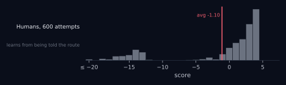

A perfect walk of the route without a single error scores **4.0**: 152 attempts did exactly that, and twelve more reached 4.0 after errors that happened to cost nothing. Nobody scored better than 4.0. The average is about **−1.1**, dragged down by a long tail of wasted steps, mud paid twice, and walks into fire.

There are better routes, as we will learn below, but nobody in this crowd walked any of them, so **no route worth more than 4.0 appears in the log (the training data).**

## Rung 0: learn to be the average human

Now the machine. Picture your favorite little robot (BB8 and Wall-E come to my mind). It never sees a map of the grid. It cannot try a route, run a simulation, or ask a question. **All it has is the pre-recorded human log.** A language model starts in the same position, with the text people wrote and nothing else. Think of a walk as a sentence and a move as a word.

One piece of notation first. A **policy** is a rule for choosing a move, written $\pi$. For each cell $s$ it gives the probability that the robot chooses direction $a$, and $\pi(a \mid s)$ reads “the probability of going $a$ from cell $s$.” The four probabilities in a cell add up to one. A policy can spread its probability over several directions or put all of it on one. **Every machine in this post is a different way of turning a log of training examples into a $\pi$.**

The most literal way to learn from people is to imitate them. For every cell, count which direction the humans went, turn the counts into probabilities, and when you’re in that cell, roll the dice to act the same way they did. This is **behavioral cloning**, and it is the ordinary meaning of “imitation” \[1\].

$$
\pi_{\text{copy}}(a \mid s) = \frac{\#\{\text{times humans went } a \text{ from } s\}}{\#\{\text{times humans were in } s\}}.
$$

The clone averages **−0.6**, against the humans’ **−1.1**. It is a faithful enough statistical portrait of the crowd: it mostly takes the outside route through the mud because they did, and in every cell where some humans veered toward fire, it veers toward fire in the same proportion. It has learned *what people do*, and what people do, on average, is lose.

This is the “average of its training data.” The first claim is true of this machine, and it is what a machine gets when the only question it asks of the data is *what did they do here?*

**In a language model: pre-training.** A language model is a policy too. Its state $s$ is the context: all the text so far. Its action $a$ is the next word. And $\pi(a \mid s)$ is the probability it gives to each possible next word. Pre-training fits that $\pi$ to text people wrote, the same way the clone fits its $\pi$ to the log. Sample from it faithfully and you get the crowd back, its knowledge and its mistakes, each in proportion. The difference is size. The robot has only 25 states. A language model has more possible contexts than anyone could count, so it uses a neural network to estimate the probabilities.

The scoreboard so far. The clone rolls dice, so its walks vary as much as the humans’ do, from disasters to the occasional lucky walk.

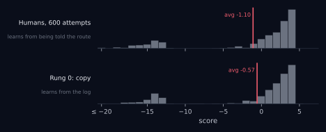

## Rung 1: learn to be the best human

Now the robot reads the same counts a different way. On rung 0 it sampled a move in proportion to what the humans did, so its walks contained some randomness. On rung 1 it always takes the **most common** move in each cell, so the randomness is gone.

Nothing else changes. There is no new data and no reward, and the robot still has no idea what a treasure is. Where the humans disagreed about a cell, it goes with the majority.

<figure class="wide">
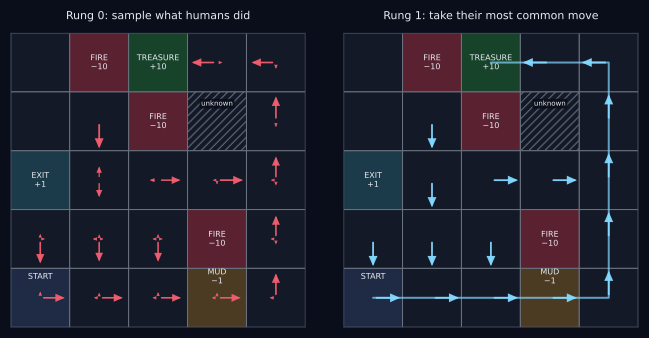
<figcaption>Left: rung 0’s policy. Each arrow’s length is the probability of that move, so the arrows in any cell add up to the same total: a 60/40 cell shows two solid arrows, an 85/5/5/5 cell one long arrow and three ticks. Every cell where humans veered toward fire keeps a tick toward fire. Right: rung 1’s policy: the most common move only. It is the humans’ route, walked perfectly, mud included.</figcaption>
</figure>

The consensus robot scores **4.0**, every time: it never veers. That is a perfect walk of the humans’ route. Only 152 of the 600 human attempts managed it, twelve more got there by luck, and nobody did better. **The robot now matches the best attempt in the data.** That looks like the weak form of the second claim: find the best thing a person did and copy it. But consensus never looked for the best. It took the most common move in each cell, and here that is the taught route, mud included.

This works because errors are noise, and noise is different for everyone. This consensus robot was trained on nothing but what people did. It never saw a score. It is a model of the training data, and it does on every walk what only 164 of the 600 people managed even once. The average is one of several things you can compute from the same distribution, and the mode is a better one.

This has been measured outside toy worlds. One example is from a paper I absolutely love. The case is chess with everything that makes chess a closed game taken away. Zhang and co-authors trained a model the way a language model is trained: to predict the next move in text records of human games, all between players below a rating cap \[2\]. It is an LLM, and it was never given the rules of chess. It did not search ahead, and it never played itself. When it always played its likeliest move (as our robot on rung 1 does), **it played better than every player in its data**, a stronger result than our rung 1. They called it *transcendence*, and their explanation is the one above: individual errors are scattered, so the majority has fewer of them.

In my grid 152 people walked the route without an error, so consensus can only tie them. A chess game is long enough that nobody below the cap gets through one without errors, so there consensus beat everyone. This is where my reaction to the data broker went wrong: **no expert has to be in the data.**

**In a language model: decoding.** Decoding is how a move gets chosen once $\pi$ is fixed. A setting called temperature, $T$, reshapes the policy before sampling: $\pi_T(a \mid s) \propto \pi(a \mid s)^{1/T}$. At $T = 1$ that is rung 0. As $T$ falls toward 0 the likeliest word takes all the probability, and that is rung 1. The same vote works on whole answers: sample several at a low temperature, and keep the answer most of them agree on. This is called self-consistency. Either way it is an ensemble, a vote among the many people folded into $\pi$. Nothing about the training changes. Only the question asked of it does.

The scoreboard so far. Consensus never varies: it walks the same route every time.

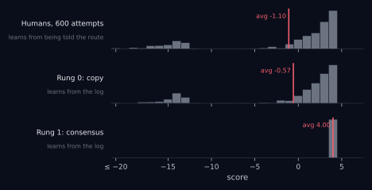

## Rung 2: learn to exceed the best human

Look again at a row of the log: $(s, a, r, s')$. Rungs 0 and 1 used the first two entries, where the human was and what they did. They threw away the other half of every row: what each step cost, and where it led.

Rung 2 uses the whole row. Its question is *what happened next?*, and it keeps score.

### The table

The machine keeps a table with one entry for every (cell, direction) pair: 25 cells × 4 directions = 100 numbers. Call the entry $Q(s,a)$. It is meant to answer one question: *if I’m in cell $s$ and go direction $a$, how many points will I have collected by the time the walk ends?*

Every entry starts at zero, which here means *I know nothing yet*. Everything the table will ever contain comes from the log.

### One pass

A pass means: read every row of the log once, and for each row, overwrite one cell of the table with this rule \[3\]:

$$
Q(s, a) \leftarrow r + \max_{a'} Q(s', a').
$$

In words: *the value of going this way from here is the points it paid right now, plus the cumulative future value of the best move anyone ever made from where you landed.* The **max** is taken over single moves, one cell at a time, never over whole walks. Rung 0 took a mean over what people did. Rung 1 took a mode. Rung 2 asks, in each cell, which one move led to the best result from there, and it does not care how many people made that move, only that someone did and it went well. **So no human has to have walked the whole route. It is assembled move by move, from different people’s walks.**

One rule for learning from a fixed log: the max ranges only over moves that appear in the log for cell $s'$. The robot assumes nothing about a move nobody tried.

### Watch the value propagate

Here is what the table knows after 0, 1, 2, 3, 5 and 10 passes. The number in a cell is the value of the best logged move out of that cell, the one the max picked. A cell with one excellent move and three terrible ones shows the excellent one.

<figure class="wide">
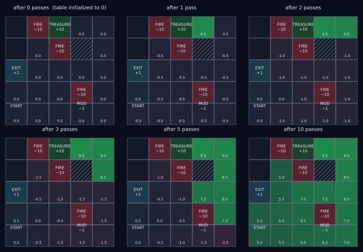
<figcaption>The value table after 0, 1, 2, 3, 5 and 10 passes over the log. Each visited cell shows the value of its best logged move, the largest of its four table entries. Value enters at the treasure on pass 1 and travels one cell per pass; cells that have not yet heard from anything good just accumulate step costs.</figcaption>
</figure>

Read the panels in order.

**After 0 passes**, everything is zero. The table has not been told anything.

**After 1 pass**, the table knows one kind of thing: what each move paid immediately. Every ordinary move is worth −0.5, so in most cells that is what shows. Three kinds of move are different. The move from the cell beside the treasure into the treasure paid +9.5, and that cell lights up green. The move from the cell below the exit into the exit paid +0.5. And every move into fire paid −10.5; those entries are in the table too, but never show on the map, because a cell’s best move is never the one into the fire. After one pass the table is a map of immediate consequences.

**After 2 passes**, the news spreads one cell. Take the top-right corner. One of its logged moves is Left, into the cell beside the treasure. On pass 1 that move was worth −0.5, like every other move out of the corner. Now the rule adds the step’s −0.5 to the best value in the cell it leads to, which as of the last pass is 9.5. So the move is worth 9.0, it is the corner’s best by far, and the corner shows 9.0.

Something smaller happened at the start. On pass 1 the cell above the start learned that going up into the exit is worth +0.5. On pass 2 the start learned that going up into that cell is worth −0.5 + 0.5 = 0.0. The start now believes the best thing it can do is head for the exit, and it will believe that until pass 10.

**After 3 and 5 passes**, the treasure’s value keeps spreading, one cell per pass: down the right edge, then around the corner into the middle row. The green region is the set of cells from which the treasure is at most that many logged moves away. Notice the cells that have heard nothing yet: they get worse each pass, −0.5, then −1.0, then −1.5. A cell that has not heard of anything good can only add up step costs.

**After 10 passes**, the news reaches all the way back to the start. The best route from the start to the treasure is ten moves long, so it takes ten passes for the treasure’s value to arrive. When it does, the start’s Right move is worth 5.0 and the start switches from 0.0 to 5.0. (Its Up move reaches 5.0 on the same pass, by a different ten-move route around the mud. When two moves are worth exactly the same, the robot takes the one that appears more often in the log, which is Right.) Passes 11 through 200 leave every number where it is. The table has converged.

**Sidebar: why the mud cell reads higher than the start.** Points are charged for entering a cell, not for standing in it: −0.5 for an ordinary cell, −1.5 for the mud, +9.5 for the treasure. So $r$ is the price of the move about to be made, and $Q(s,a)$ is everything collected from that move onward, its own price included. The maps show, for each cell, the value of the best move out of it. That is why the mud cell reads 6.5, higher than the start’s 5.0: whoever is standing on the mud has already paid, and the treasure is seven moves away. The mud’s penalty lives in the move that enters it. In the cell before the mud, going right is worth −1.5 + 6.5 = 5.0 and going up is worth −0.5 + 6.5 = 6.0, so the route goes up.

### What the max did

The robot scores **5.0**. That is better than the humans’ route walked perfectly and better than the best walk in the log, on a route no human walked. So the weak form of the second claim is wrong: the robot did not find the best human and copy them.

**It also had no referee.** The robot never set foot on the grid. Everything it used was in the recording: what people did, and how each walk ended.

<figure class="diagram">
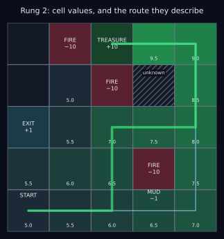
<figcaption>Rung 2. Each visited cell shaded and labeled by the best value any logged move from it achieved. Thin blue: the humans’ route (rung 1). Green: the route the values describe, around the mud, walked by no human, worth 5.0.</figcaption>
</figure>

The route skirts the mud by cutting through the middle of the grid. The log contains some steps in these directions, a handful of errors by people knocked off the loop, but nobody walked the complete path. Here is the route move by move, with the number of times each move appears among the 6,764 steps in the log. (A count can exceed 600 because people who get turned around pass through a cell more than once.)

| step | from   | move  | times in the log |
|------|--------|-------|------------------|
| 1    | (0, 0) | right | 657              |
| 2    | (1, 0) | right | 665              |
| 3    | (2, 0) | up    | 69               |
| 4    | (2, 1) | up    | 4                |
| 5    | (2, 2) | right | 4                |
| 6    | (3, 2) | right | 40               |
| 7    | (4, 2) | up    | 535              |
| 8    | (4, 3) | up    | 509              |
| 9    | (4, 4) | left  | 481              |
| 10   | (3, 4) | left  | 408              |

The first two moves and the last four are the humans’ own route, made hundreds of times. Steps 3 to 6 are the detour. Steps 3 and 4 are mistakes, two in a row, and the second appears only four times. Steps 5 and 6 are habit, heading back toward the taught route. Nobody who took the detour came out ahead: each of them wasted steps somewhere else, or burned. The max kept the detour and dropped the waste.

This is called **stitching** \[4\]: a machine that values moves by their outcomes can assemble, from fragments of many mediocre walks, a walk better than any in the data. The information was in the log as consequences, scattered across six hundred people who did not notice.

Rung 1 matched the best of the humans by finding what they agreed on. Rung 2 beat that by finding what *worked*, whether or not anyone agreed on it.

### Is that creative?

Now the strong form of the second claim: a model can only rearrange what it has seen. Look at the table again. The claim is right. Every move on the new route is in the log. The robot did not invent a move. It rearranged.

But look at what the claim had to become in order to be right. It began as “it can’t do anything it hasn’t seen” and has become “it can’t do anything whose smallest pieces it hasn’t seen.” Those are different claims. Every sentence anyone writes is made of words they have seen, and every proof is made of steps that were already legal. What was not in the data is the route: ten moves in an order no person put them in, scoring more than any person scored. Whether to call that creative is arguable. The route is new, and it is better.

A language model stitches in the same sense. When it explains a hedging problem with an idea borrowed from ecology, and no text in its training data ever put the two together, each piece was written by someone and the connection was not. Arora and Goyal argue that this is what a model does with the skills it learned separately, and Yu and co-authors measured it: asked to combine random sets of skills in a short text, GPT-4 (an ancient model by today’s standards) produced combinations too numerous to have been in any training set \[5\]. Rung 2 is the smallest version of that: moves made by different people, for different reasons, combined into a route nobody took.

**In a language model: post-training with a reward model.** Everything done to an LLM after pre-training is called post-training, and its best-known method is reinforcement learning from human feedback (RLHF). For a small set of examples, people are shown two of the model’s generations and say which is better. A second model (a reward model) is trained to predict those preferences, and the language model is then tuned toward answers that score well. The rater rates and the reward model learns to supply an $r$, never an $a$. That matters, because *criticizing is easier than doing*: someone who cannot write poetry can still, more often than not, say which of two poems is the better one. So the reward signal is not capped at what the raters could produce themselves. (Text carries outcomes too: which answer was accepted, which code passed its tests.) This is the loosest match of the four, but I believe the analogy holds. The table learns from a fixed log, while here the model writes new answers and is scored on them, which is already half a step toward rung 3.

The scoreboard so far.

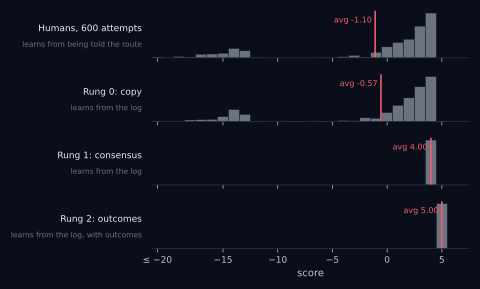

**If the post stopped here, the objections would already have failed in this world.** A machine that only read a static log of what people did has beaten all of them, with no rules, no practice and no referee.

Can our robot get *even better* and exceed a score of 5.0? To go further the robot has to learn something the humans never recorded, and for that it needs what a closed game has: a **verifier**.

## Rung 3: learn what no human knew

Rungs 0 to 2 read a frozen log. Rung 3 adds to it. This is the rung the objectors already accept, *as long as it stays inside a game.*

The verifier here is the grid itself. Until now the robot could only read other people’s recordings. Now it is allowed to walk the grid on its own, Garmin on, and keep the recording. It proposes a route, walks it, and reads off what happened, step by step, including when it burns. Nobody tells it the best route, and nobody tells it where the fire is. The world answers the one question it has always answered: what happens if I step here? A verifier is a way to check a proposal against reality without anyone knowing the answer in advance. For a coding AI it is running the tests. For a math AI it is a proof checker. For our robot it is a walk. (One simplification: here the world reports every step’s points, not just the route’s final score. A real checker usually returns one verdict at the end, which makes the learning slower. I don’t show that version in this post, but I ran it, and it works.)

Now run the simplest loop there is \[6\]:

1.  **Propose.** Start from the best route you know. Mostly follow it; sometimes take a random step.
2.  **Verify.** Run the proposal. Record what happened, step by step, including when it burns.
3.  **Keep.** Add every verified step to the log.
4.  **Retrain.** Re-run rung 2 on the bigger log.
5.  Repeat.

<figure class="diagram">
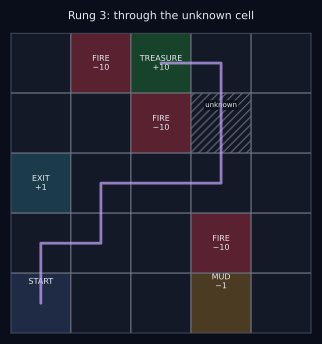
<figcaption>Rung 3: the route it found, through the cell no human visited.</figcaption>
</figure>

<figure class="diagram">
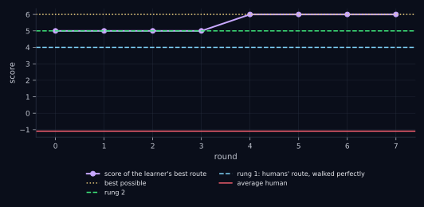
<figcaption>The score of the machine’s best route after each round of propose, verify, keep, retrain. It starts from rung 2’s route and finds the best possible one in round 3.</figcaption>
</figure>

The robot scores **6.0**. By round 3 it has found the 8-step route, through the cell no human ever stood on, and it knows the route is good because it has walked it. Along the way, 105 of its 300 proposals walked into fire. Every one of those was a cheap, verified fact about the world, and not one of them cost a human anything. On rung 2, the only way to learn that a cell was fire was for a person to die in it. On rung 3, the robot buys that knowledge with compute.

Rung 1 matched the best human, on every walk, by doing what they all meant to do. Rung 2 beat that by assembling what they stumbled into. Rung 3 goes past everything the humans knew about the grid, because nothing it does is limited to what they did: it can propose anything, and it keeps what checks.

**Rung 3 did not get more out of its training data. It made more training data.** The step into the unknown cell is in no human’s recording; it is in the robot’s own. If the question is whether a machine can exceed the *human* data, rung 3 says yes. To know something that is in no data at all, the facts have to come from somewhere, and the verifier is where.

### A verifier is not only for games

The objectors accept all of this for Atari, Go, or chess because those are closed games. But look at what the grid gave the robot on this rung. The robot was never handed the rules, and the world did not have to be simple. It needed one thing: something that would check a proposal and report back.

Plenty of work that has nothing to do with games comes with that. Code has tests. A proof has a proof checker. A puzzle has an answer.

So put a language model in the robot’s loop. It is given a problem in plain language. There is no board and no list of legal moves: its next word can be any word. It reasons for as long as it needs, sometimes for thousands of words, and writes down an answer. Then the checker says one thing, yes or no. It does not say where the reasoning went wrong, and it does not say what the right answer was. The model is trained toward the reasoning that ended in yes, and the loop runs again.

**The checker does not have to know how to solve the problem.** It only has to recognize a correct solution when it sees one. So nothing in the loop is capped at what people can do. In a closed game like Go, the loop had the rules to lean on. **In language it has only the verdict, and the verdict is enough to learn from.**

I find this remarkable. A machine working in open-ended language, with no fixed rules, can be told nothing but yes or no at the very end, and that is enough. The field calls it reinforcement learning with verifiable rewards, and language models are increasingly trained this way.

So the objectors have drawn their line in the wrong place. Games are one kind of work that can be checked. For superhuman AI, **the line that matters runs between work that can be checked and work that cannot**, and more of what language models are asked to do is on the checkable side than the word “game” suggests. Where nothing can check an answer, this rung does not apply, and a model is back to what rungs 0 to 2 can do.

**In a language model: reinforcement learning with verifiable rewards.** The state is the problem plus everything the model has written so far. The actions are the words of its reasoning and its answer. The reward is 0 at every step and arrives once, at the end: 1 if the checker accepts, 0 if it does not. That is harder than the robot’s version, where every step reported its points. Go’s reward is just as sparse, but a Go program also has the rules and can search ahead with them \[7\]. A language model has no rules to search. Training raises the probability of the word choices on the attempts that passed. Where a checker exists the match to rung 3 is tight.

## What the ladder says

The full scoreboard.

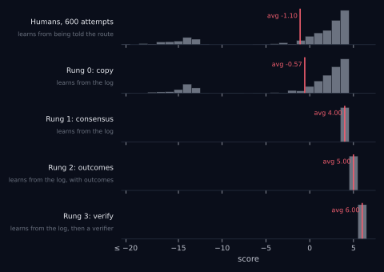

Go back to the objection: outside a closed game, a model trained on what people produced cannot get past the people. The ladder answers it twice. **Rungs 0 to 2 had no game at all, only the recording, and rung 2 beat every person in it.** Rung 3 added a verifier and went past what the people knew, and a verifier is something a language model can have wherever an answer can be checked.

Three things changed on the way up. From rung 0 to rung 1 the data stayed the same and the *question* changed: the likeliest move in place of a sampled one. From 1 to 2 the *signal* changed: outcomes as well as actions. From 2 to 3 the *source* changed: the world as well as the recordings. Ask which of those a system has and you know where its ceiling is. On the top rung, no part of the ceiling is made of human data.

Now the claims. The first, that a machine computes the average of its training data, is true of rung 0. The weak form of the second, that a machine can at best copy the best person, fell on rung 2: the same frozen log, and a better route than any person walked. The strong form, that a machine only rearranges what it has seen, is true of rungs 0 to 2, but it means less than it seems to, because the rearrangement beat everyone. On rung 3 it is false. The robot stood where no human stood, because it had stopped depending on humans for its facts.

Each rung has its own limit. Consensus is bounded by what the humans intended. It worked here because everyone was attempting the same route and each person’s errors were their own; where a crowd is split, or wrong in the same direction, the majority’s move is no better than the crowd. Outcomes are bounded by what the data covers, and by luck, since a max cannot tell a good move from a lucky one. That is also why rung 2 refused to assume anything about a move nobody tried: a machine that guesses across an unknown cell in its data can walk confidently into fire. Verification is bounded by the existence of a verifier, and by the cost of being wrong while learning: 105 burned robots are cheap only in a simulation. None of those limits says a machine cannot exceed its data. Each says on which rung, and in which kind of task, the ceiling sits.

“The average of its training data” describes one machine, on one rung, decoded one way. **A modern language model is on all four. It is pre-trained on rung 0, decoded on rung 1, tuned on human feedback in a way that resembles rung 2 and, increasingly, trained against checkers on rung 3.**

## A note on fundamental investing

The objection at the top has an investing version: “an AI can never invest better than people do, because it learns from what people wrote.” Let’s put that claim on the ladder. In fundamental investing the log is the investment process as people recorded it: the research, the thesis, the model, the internal and external discussions and debates, the gathering of data points for the mosaic, the investment memo, the decision, the sizing. The outcome is the P&L (properly residualized).

A machine that only copies the process is on rung 0, and the objection is true of it. A machine that also reads how each decision turned out is on rung 2, and one that makes its own decisions and waits for the P&L has a verifier of a kind.

The caveats are large. The written record of most firms leaves out much of why a decision was really made, so a firm would first have to change what it records. A P&L is a slow and noisy grade: a thesis can take months to quarters to play out, and a good decision can lose money while a bad one makes it, so the luck problem from rung 2 is at its worst here. Nothing can be re-run, and every mistake costs real money.

I am not claiming the ladder is easy to climb in investing. My claim is narrower, but still important: **the objection, as stated, does not settle whether the ladder can be climbed in investing.**

**Background material.** This post owes a lot to three Stanford courses I took as a non-degree graduate student over the past several years: [CS221, *Artificial Intelligence: Principles and Techniques*](https://stanford-cs221.github.io/spring2022/), taught by Tatsunori Hashimoto in spring 2022 \[8\]; [CS224R, *Deep Reinforcement Learning*](https://cs224r.stanford.edu/spring_2025/), taught by Chelsea Finn in spring 2025 \[9\]; and [CS224N, *Natural Language Processing with Deep Learning*](https://web.stanford.edu/class/archive/cs/cs224n/cs224n.1234/), taught by Christopher Manning and John Hewitt in winter 2023 \[11\]. The idea to cast this as a ladder came from *The Book of Why*, by Judea Pearl and Dana Mackenzie \[10\]. (I suspect Pearl would argue with where my ladder ends up, but that is for another day.) CS221 provided the famous “grid world” idea and its solution via Markov decision processes. CS224R’s readings on implicit Q-learning (IQL), an offline reinforcement learning method, motivated the idea that a machine with nothing but a log could beat the best example in it. Reinforcement learning with verifiable rewards comes from the same course’s material on group relative policy optimization (GRPO). Pre-training and RLHF come from CS224N.

## References

**Source.** The notebook that produced every number and figure in this post is [in the blog’s repository](https://github.com/marketneutral/marketneutral.github.io/blob/main/notebooks/2026-11-10-exceed-training-data.qmd). The full specification of the world, the crowd, and each rung (seeds, costs, sweep counts) is in a comment at the top of that notebook.

1.  Pomerleau, D. A. (1989). *ALVINN: An autonomous land vehicle in a neural network.* NeurIPS 1.
2.  Zhang, E., Zhu, V., Saphra, N., Kleiman, A., Edelman, B. L., Tambe, M., Kakade, S. M., & Malach, E. (2024). *Transcendence: Generative Models Can Outperform The Experts That Train Them.* NeurIPS 2024. <https://arxiv.org/abs/2406.11741>
3.  Watkins, C. J. C. H., & Dayan, P. (1992). *Q-learning.* Machine Learning 8, 279–292.
4.  Levine, S., Kumar, A., Tucker, G., & Fu, J. (2020). *Offline Reinforcement Learning: Tutorial, Review, and Perspectives on Open Problems.* arXiv:2005.01643. Kumar, A., Hong, J., Singh, A., & Levine, S. (2022). *When Should We Prefer Offline RL to Behavioral Cloning?* ICLR 2022.
5.  Arora, S., & Goyal, A. (2023). *A Theory for Emergence of Complex Skills in Language Models.* arXiv:2307.15936. Yu, D., Kaur, S., Gupta, A., Brown-Cohen, J., Goyal, A., & Arora, S. (2024). *Skill-Mix: a Flexible and Expandable Family of Evaluations for AI Models.* ICLR 2024. <https://arxiv.org/abs/2310.17567>
6.  Anthony, T., Tian, Z., & Barber, D. (2017). *Thinking Fast and Slow with Deep Learning and Tree Search.* NeurIPS 2017. Zelikman, E., Wu, Y., Mu, J., & Goodman, N. (2022). *STaR: Bootstrapping Reasoning With Reasoning.* NeurIPS 2022. <https://arxiv.org/abs/2203.14465>
7.  Silver, D., et al. (2016). *Mastering the game of Go with deep neural networks and tree search.* Nature 529, 484–489. Silver, D., et al. (2017). *Mastering the game of Go without human knowledge.* Nature 550, 354–359.
8.  Hashimoto, T., et al. (2022). *CS221: Artificial Intelligence: Principles and Techniques.* Stanford University, Spring 2022. <https://stanford-cs221.github.io/spring2022/>
9.  Finn, C., et al. (2025). *CS224R: Deep Reinforcement Learning.* Stanford University, Spring 2025. <https://cs224r.stanford.edu/spring_2025/>
10. Pearl, J., & Mackenzie, D. (2018). *The Book of Why: The New Science of Cause and Effect.* Basic Books.
11. Manning, C. D., & Hewitt, J. (2023). *CS224N: Natural Language Processing with Deep Learning.* Stanford University, Winter 2023. <https://web.stanford.edu/class/archive/cs/cs224n/cs224n.1234/>
