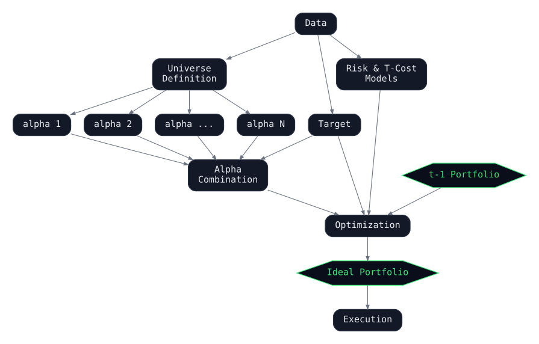

On October 2, 2025 I gave a guest lecture at MIT in 18.642,
*Topics in Mathematics with Applications in Finance*, on where the hedge
fund world is heading. This post is a written version of that talk.

▸ **[View the slides](https://marketneutral.github.io/hedge_fund_evolution/hf_evolution.html)**

The argument is that two trends are reshaping the industry, and that both
are downstream of ideas that are decades old:

1. **Unbundling.** Parts of the hedge fund workflow are moving *outside the
   firm*, to crowds of data scientists coordinated by competitions and, in
   some cases, blockchain-based incentives.
2. **Human + machine collaboration.** The evidence is now fairly clear that
   combining human forecasts with machine forecasts beats either alone. Perhaps in the future, machines alone will suffice, but today, humans are still adding value.

## Background and theory

Almost everything interesting about these trends follows from a handful of
results in statistics, machine learning, and social science.

**Condorcet's jury theorem (1785).** Machine learning started in...1785. If each juror is right with
probability greater than one half, and errors are independent, the
probability that the majority is correct goes to one as the number of
jurors grows:

$$
P(\text{majority correct}) \to 1 \quad \text{as } n \to \infty
$$

The catch is in the fine print. Independence and diversity of errors
matter. A thousand copies of the same model is one juror.

**Boosting (1988) and stacking (1992).** Kearns asked whether weak learners
could be combined into a strong one, and Friedman's gradient boosting
machine made that practical. Boosting fits models *sequentially*, each one
to the residual errors of the ensemble so far:

$$
F_m(x) = F_{m-1}(x) + \gamma\, h_m(x)
$$

Wolpert's stacked generalization went the other way. Train diverse base
models independently, collect their out-of-fold predictions, and fit a
meta-model $g$ on top:

$$
\hat{y}(x) = g\!\big(f_1(x),\, f_2(x),\, \dots,\, f_M(x)\big)
$$

Model averaging is just stacking where $g$ is a weighted sum. Gradient
boosted trees remain the dominant approach for tabular data, and, often together with stacking, are how nearly every classic tabular Kaggle competition was won.

**The Dunbar number (1992).** Dunbar estimated that humans can maintain
roughly 150 stable relationships. Past that, organizations fracture into
silos and lean on process. This is a constraint on how a firm built on
trust can grow.

**Wisdom of crowds (2004).** Surowiecki's conditions for a crowd to beat
its experts: diversity of opinion, independence, decentralization, and a
mechanism for aggregation. Note how closely this mirrors the conditions
for an ensemble to work.

**The common task framework (2007 onward).** Donoho's name for the recipe
that drove the machine learning boom: a clear task, a shared dataset with
hidden test labels, an evaluation metric, and an open competition. The
Netflix Prize, Kaggle, and ImageNet are all instances. It turns out to be
an extraordinarily efficient way to extract predictive power from a large
group of strangers.

**Machine, platform, crowd (2017).** McAfee and Brynjolfsson tie the above
together for business. This book has been very influential on my thinking. Crowds beat experts, platforms unlock assets that
were previously stranded, trust can be built through leaderboards and
ratings, and success is a function of incentives and governance.

Takeaways: ensembles work, competitions scale, and social science has a
lot to say about how to design the organizations and incentives that
harness collective intelligence.

## The traditional hedge fund

How does a hedge fund scale without breaking? Mostly by respecting Dunbar.
The multi-manager platform does it with pods: small teams, central risk.
The lean fund does it by capping its own organization size. The bureaucratic fund does
it with heavy process. And the quant fund does it by structuring itself as
an assembly line.

I wrote up that assembly line in 2016 as
[A Professional Quant Equity Workflow](https://github.com/marketneutral/lectures/blob/master/A%20Professional%20Quant%20Equity%20Workflow.pdf).
Separate teams own separate stages:

- Data acquisition
- Alpha research, which is feature engineering by another name
- Signal combination, which is modeling
- Risk and transaction cost modeling
- Portfolio construction, which is optimization
- Execution

<figure class="wide" id="workflow">
  
</figure>

The 2017 *Wall Street Journal* piece on WorldQuant's "alpha factory," with
125 PhDs across 15 countries, is this workflow at industrial scale. Alphas
are produced upstream, combined in the middle, and optimized and executed
downstream. The important point for what follows is that **the stages are
separable.** Once you can describe the interface between them, you can
imagine moving one of them outside the building.

## Unbundling

That is exactly what the decentralized hedge funds do. Part of the
workflow, usually alpha research and signal combination, is pushed out to
a global crowd, coordinated by a competition and often paid in a token.
Four examples, as of October 2025.

**Numerai** (San Francisco, 2015) runs weekly tournaments on anonymized,
obfuscated market data. Participants submit predictions, are scored on
correlation with realized returns, and stake the NMR token on their own
models. Accurate models earn, inaccurate ones are burned. The firm builds
a stake-weighted meta-model from the community's submissions and trades
it. The crowd generates intelligence; the company curates data, runs the
fund, and executes.

**Yiedl** (Italy, 2023) takes the idea fully on-chain. It is a DAO rather
than a company, running weekly tournaments on 75 crypto assets, with
predictions encrypted to IPFS, smart contracts that reward and penalize
automatically, and vaults on Optimism and Synthetix that execute the
resulting strategies. Token holders govern it. There is no general partner.

**CrunchDAO** (Paris, Dubai, New York, 2021) is a decentralized data
science collective rather than a fund. Over 5,000 contributors, including
roughly 600 PhDs, compete on anonymized datasets with code submissions
run in controlled environments and compute quotas for fairness. Some
challenges are financial, such as the DataCrunch equity market neutral
challenge and the ADIA Lab structural break challenge, and the aggregated
consensus signals are licensed to institutional clients. Prizes are paid in
USDC today; a native CRUNCH token is planned.

**CrowdCent** combines fundamental analysts with machine learning.
Analysts share written fundamental investment theses through SumZero, internal data scientists build
models on those ideas plus market data, and a community of data
scientists competes in challenges such as ranking Hyperliquid assets by
forward returns. There is no native token, but the firm runs a vehicle
that stakes within Numerai's ecosystem, bridging decentralized funds
together.

The common threads are community-driven intelligence, machine learning
as the aggregation mechanism, and crypto as both incentive and settlement
infrastructure. Whether every one of these survives is beside the point.
The pattern is the same one that produced Kaggle, applied to the alpha
research stage of the workflow.

## Human + machine collaboration

The second trend is quieter but well evidenced. There are two shapes
collaboration can take.

**Horizontal.** Treat the human forecast as one more feature. *Concatenate
it* with the machine's inputs and fit a model on both.

Cao, Jiang, Wang, and Yang (*Journal of Financial Economics*, 2024) do
this at scale. Their human forecasts are 948,054 twelve-month price targets
from 11,341 analysts on 6,190 firms, 2001 to 2018. The machine is an
ensemble of random forests, boosting, and LSTMs trained on fundamentals,
10-K and 10-Q text, and macro series, with analyst forecasts deliberately
excluded. The machine alone beats the analyst 54% of the time. The
machine with the analyst's forecast included as a feature beats the analyst
57% of the time. The human forecast carries information the machine
cannot recover from public data on its own.

**Vertical.** Stepwise. Human first, machine second (or the reverse). The
human generates ideas and the machine filters, ranks, or optimizes.

deHaan, Lee, Liu, and Noh (Stanford GSB, 2025) construct 170 alphas from
public data and fit a random forest to forecast one-quarter-ahead
DGTW-adjusted returns. The "human" portfolios are the 13-F holdings of
3,337 active US equity mutual funds from 1990 to 2020. The AI analyst
then adjusts each manager's portfolio within its own style group:

- Keep the manager's picks that the model places in the top decile.
- For picks in deciles one through nine, swap into the best available
  top-decile name from the same style group, subject to a liquidity cap.
- Drop anything left in the bottom decile and replace it with the group's
  style index, so the portfolio stays in-style.
- Renormalize.

<figure class="diagram" id="dehaan">
  
  <figcaption>The vertical configuration in deHaan, Lee, Liu, and Noh (2025). The human picks the stocks; a random forest on public data decides what to keep, swap, or replace, one style group at a time. Green marks the portfolios going in and coming out.</figcaption>
</figure>

The average human Sharpe is about 0.47. **The average paired improvement
from the AI adjustment is about 0.17, with a t-statistic near 69, and
roughly 95% of funds improve.** That holds net of transaction costs, and
under a conservative payout convention where the AI's incremental gains
are paid out each quarter so it never compounds an AUM advantage. A random
forest on public data, sitting downstream of a human stock picker, adds
meaningful risk-adjusted return to nearly every fund in the sample.

## Conclusions

- Ensemble methods are the workhorse of applied machine learning, and
  their conditions for success are the same as the conditions for a crowd
  to be wise.
- The common task framework drove progress in AI, and it is now being
  applied to the alpha research stage of the hedge fund workflow.
- Social science has concrete guidance on how to design incentives and
  governance for collective intelligence, and the decentralized funds are
  running that experiment in public.
- Hedge funds are unbundling, with crowdsourcing and crypto incentives
  moving pieces of the workflow outside the firm.
- Human plus machine beats either alone, in both the horizontal and the
  vertical configuration, and the evidence is from large samples.

## References

- Cao, S., Jiang, W., Wang, J., and Yang, B. "From Man vs. Machine to Man +
  Machine: The Art and AI of Stock Analyses." *Journal of Financial
  Economics* 160, 2024.
  [papers.ssrn.com](https://papers.ssrn.com/abstract=3840538)
- Condorcet, M. de. *Essai sur l'application de l'analyse à la probabilité
  des décisions rendues à la pluralité des voix*. Imprimerie Royale, 1785.
- deHaan, E., Lee, C., Liu, M., and Noh, S. "The Shadow Price of 'Public'
  Information." Working paper, Stanford Graduate School of Business, 2025.
  [gsb-faculty.stanford.edu](https://gsb-faculty.stanford.edu/ed-dehaan/files/2025/05/DLLN-Shadow-Price.pdf)
- Donoho, D. "50 Years of Data Science." *Journal of Computational and
  Graphical Statistics* 26(4), 2017.
  [stat.berkeley.edu](https://www.stat.berkeley.edu/users/aldous/157/Papers/donoho_50YearsDataScience.pdf)
- Dunbar, R. I. M. "Neocortex Size as a Constraint on Group Size in
  Primates." *Journal of Human Evolution* 22(6), 1992.
- Friedman, J. H. "Greedy Function Approximation: A Gradient Boosting
  Machine." *Annals of Statistics* 29(5), 2001.
- Hope, B. "With 125 Ph.D.s in 15 Countries, a Quant 'Alpha Factory' Hunts
  for Investing Edge." *Wall Street Journal*, April 2017.
- Kearns, M. "Thoughts on Hypothesis Boosting." Unpublished manuscript,
  1988.
- Larkin, J. *A Professional Quant Equity Workflow*. Lecture notes, 2016.
  [github.com/marketneutral/lectures](https://github.com/marketneutral/lectures/blob/master/A%20Professional%20Quant%20Equity%20Workflow.pdf)
- Larkin, J. *The Evolution of the Hedge Fund*. Guest lecture, MIT 18.642,
  October 2025.
  [marketneutral.github.io/hedge_fund_evolution](https://marketneutral.github.io/hedge_fund_evolution/hf_evolution.html)
- McAfee, A. and Brynjolfsson, E. *Machine, Platform, Crowd: Harnessing Our
  Digital Future*. W. W. Norton, 2017.
- Surowiecki, J. *The Wisdom of Crowds*. Doubleday, 2004.
- Wolpert, D. H. "Stacked Generalization." *Neural Networks* 5(2), 1992.
