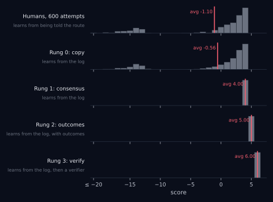
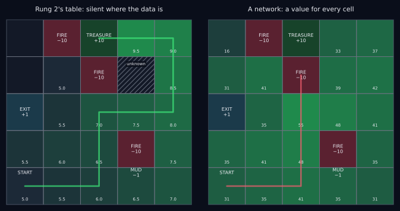
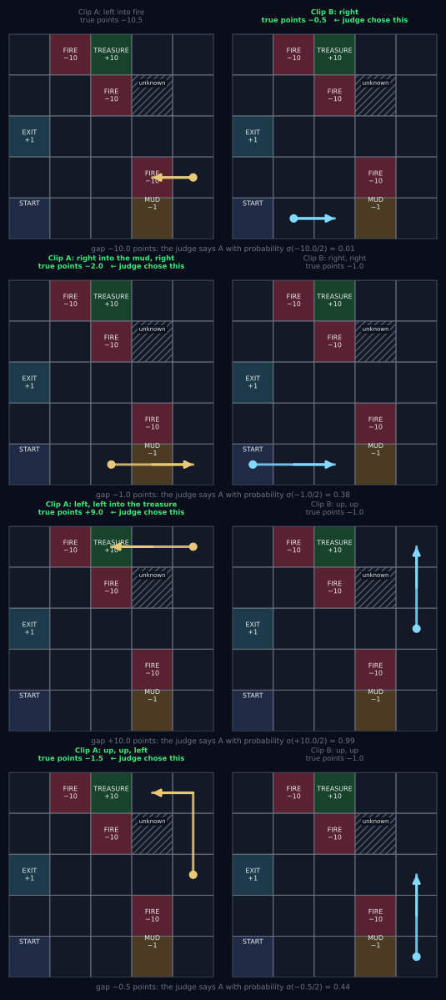
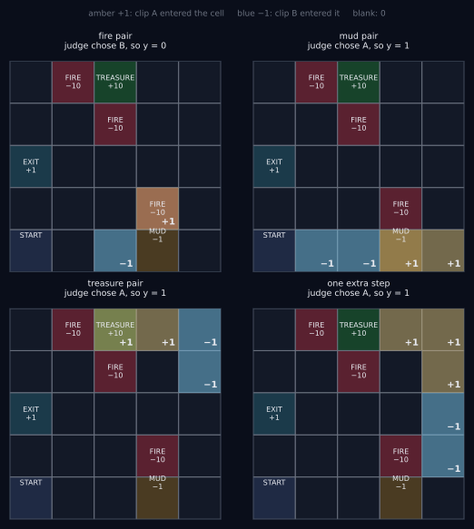
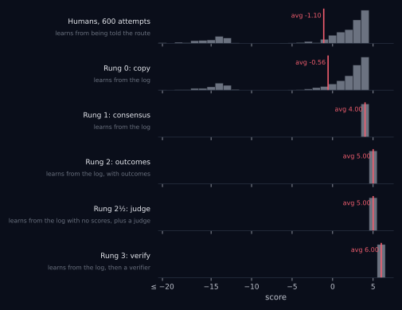
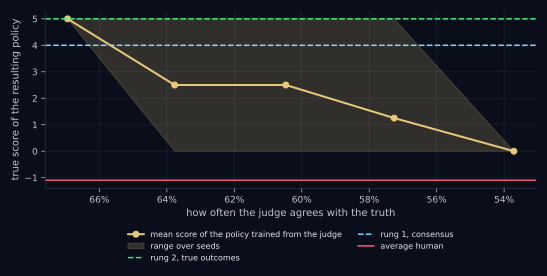
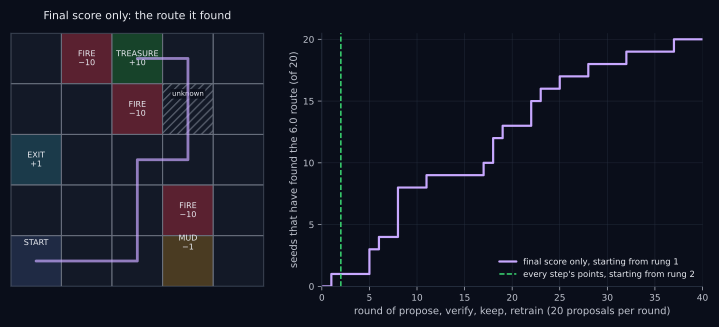

In [the first post](./posts/exceed-training-data/) I built the smallest world I could think of: a 5×5 grid, a treasure, three fires, a patch of mud. Six hundred people were told a route and walked it badly, and every step was recorded. Then the recording was frozen and four machines took a turn. The first asked *what did people do here?* and became the average human. The second asked *what did most people do here?* and became the best human. The third asked *what happened next?* and assembled a route no human had walked, from fragments of many walks. The fourth was allowed to try routes and see what happened, and found the best route on the grid, through the one cell nobody had ever recorded.

A certain kind of reader stopped there: *a grid is not a language model.* Correct, and beside the point. Nothing in the argument depended on the grid. The argument depends on four facts about what a learner computes from a body of data (a mean, a mode, a max, a check), and each of those four facts has been established at language-model scale by a published result with numbers attached. The grid is a microscope. It exists so that you can *watch* the mechanism in a world small enough to see all of it, not to prove the mechanism scales. The proof that it scales is below.

So the question to hold in mind while reading is not “is a grid like an LLM?” It is: **if you believe a model is the average of its training data, which function do you think it computes?** If it is the mean, you have to explain the results in the next section. If it is not the mean, the claim was wrong when you made it.

This post is more technical than the first. It has three jobs. First, the receipts: the published results, one per rung. Second, two experiments the first post skipped, because each closes a gap between the grid and a language model. Rung 2 in the grid was handed points by the world; language models are handed opinions by people, so I strip every score out of the log and learn from a judge who is wrong a third of the time. Rung 3 in the grid was told what every step cost; a language model is told one thing, yes or no, at the very end, so I run rung 3 again with only that. Third, the objections, answered one at a time.

<figure class="diagram">

<figcaption>The ladder from the first post, rebuilt here. One row per learner, a histogram of its scores on a shared axis, a red line at its average. The humans average about −1.1. Rung 0 copies them. Rung 1 walks their route without error, 4.0. Rung 2 assembles a route no human walked, 5.0. Rung 3, allowed to try routes and keep what checks, finds the best route on the grid, 6.0.</figcaption>
</figure>

## The receipts

Each rung is a stage in how language models are trained, and each has at least one published result in which a model climbed past the humans who produced its data.

| Rung | What was done | The humans, and then the model | Source |
|----|----|----|----|
| 1, consensus | A transformer trained only on chess games between players rated at most 1000 | at most 1000, then about 1500 at low temperature | Transcendence, 2024 \[1\] |
| 1, consensus | Majority vote over a model’s own reasoning samples | nothing added, then +17.9 points on grade-school math | Self-consistency, 2022 \[2\] |
| 2, judge | Models trained on preferences between summaries, against the human-written references | the reference writers, then summaries preferred to theirs about 70% of the time | Stiennon et al., 2020 \[3\] |
| 3, verify | A 6B model bootstraps its own reasoning from an answer key | no reasoning demonstrations, then a match for a model 30× its size | STaR, 2022 \[4\] |
| 3, verify | Verifiable-reward RL on a base model | no reasoning demonstrations, then AIME 2024 from 15.6% to 71.0% | DeepSeek-R1-Zero, 2025 \[5\] |
| 3, verify | Self-play against a win/loss check | **zero human games**, then superhuman at chess, shogi and Go | AlphaZero, 2018 \[6\] |
| 3, verify | IMO 2025 problems under contest conditions | the best human students, then a gold-medal score | 2025 \[7\] |
| 3, verify | 4×4 complex matrix multiplication | every mathematician since 1969, then 48 multiplications against Strassen’s 49 | AlphaEvolve, 2025 \[8\] |

Every row is a model outperforming the humans whose data it learned from, or, in the last four, humans as such. The rest of this post says what each row is an instance of, and where the grid and the language model part ways.

**Rung 0 is pre-training.** A language model’s state is the text so far. Its action is the next token. Pre-training asks it to reproduce the distribution of what people wrote next:

$$
\pi_{\text{pretrain}}(\text{next token} \mid \text{text so far}) \approx \pi_{\text{humans}}(\text{next token} \mid \text{text so far}).
$$

That is behavioral cloning over a trillion words \[9\]. Sampled at full temperature it is the copy robot: a faithful portrait of the crowd, mistakes in proportion. The “stochastic parrot” critique is a description of rung 0, and as a description of rung 0 it is correct.

**Rung 1 is decoding.** Take the same pre-trained model and sample at low temperature, or sample many times and vote. Nothing is added. The crowd is decoded for its consensus instead of its noise. Zhang and co-authors trained a transformer on nothing but chess games between players rated at most 1000, and at low temperature it played around 1500, above every player in its data; at full temperature it did not, and the effect disappeared when the training players were too similar to one another, which is exactly what the majority-vote explanation predicts \[1\]. Wang and co-authors sampled many reasoning chains from one model and took a majority vote on the answer: 17.9 points better on grade-school math with no training at all \[2\]. The model’s own samples are the crowd.

**Rung 2 is post-training on human preferences.** Post-training changes the question from *what did people write?* to *which did people prefer?* People compare two of the model’s answers. A reward model is fit to their preferences. The language model is then trained to make higher-rated answers more likely. That is valuing an action by its outcome, with human judgment standing in for the score. Stiennon and co-authors showed what that buys: models trained to *imitate* human reference summaries stayed below them, and models trained on human *preferences between* summaries were preferred to the human references themselves about 70% of the time (65% after controlling for length) \[3\]. Same task, same base models, same raters. The demonstrations were the ceiling for the imitator and not for the preference-trained model. “Standing in” is the operative phrase, and the judge experiment below is about how much weight it bears.

**Rung 3 is reinforcement learning with verifiable rewards.** For tasks with a checker (do the tests pass, does the proof verify, is the final answer right) the loop is the grid’s: propose, verify, keep, retrain. STaR had a 6B model generate its own reasoning, keep the reasoning that reached the right answer, train on it, and repeat; with no reasoning demonstrations in its data, only an answer key, it matched a model 30 times its size \[4\]. DeepSeek-R1-Zero ran verifiable-reward RL on a base model with no demonstrations of reasoning at all; self-checking and backtracking emerged, and its accuracy on the 2024 AIME rose from 15.6% to 71.0% \[5\]. AlphaZero saw zero human games and became superhuman at chess, shogi and Go from self-play against a win/loss check \[6\]. In 2025 a model from Google DeepMind scored at gold-medal level on the International Mathematical Olympiad under contest conditions, certified by the competition’s graders, and OpenAI reported the same score for an experimental model of its own \[7\]. AlphaEvolve, a language model inside a propose-and-verify loop, found a way to multiply two 4×4 complex matrices in 48 scalar multiplications, improving on Strassen’s 49, a bound that had stood since 1969 \[8\].

Those last results are not “better than the average human.” They are better than the best humans who have ever worked on the problem. That is rung 3 doing what rung 3 does: the data got the model started, and the verifier took it past the data.

## Pre-training builds a map

Before the two experiments, one thing the grid robot never had.

In the first post, the unknown cell was the wall. Rung 2 refused to assume anything about a move nobody tried, and I said that a machine that guesses across a gap in its data can walk confidently into fire. Here is that machine.

<figure class="wide">

<figcaption>Left: rung 2’s table, which values only moves that appear in the log and leaves the unknown cell blank. Right: a small neural network trained on the same log, allowed to put a value on every move. The numbers in the never-visited cells are guesses, and the guesses fed on themselves pass after pass. The route in red is what the network’s policy did.</figcaption>
</figure>

Replace rung 2’s table with a small neural network, train it on the same frozen log by the same rule, and remove one restriction: let the max range over all four moves in a cell, not only the moves someone made. The network now has to put a value on moves nobody tried, and it does, by resemblance to the moves it has seen. The cell beside the treasure looks like the cells around it, and so does the fire cell beside that. On the first pass those guesses are modest. But the max keeps picking the guessed move, the guess becomes the target for the cell before it, and the next pass guesses higher. After twelve passes the network values the unknown cell somewhere between 14 and 40 points, in a world where the best possible score is 6. On one seed in five the policy walked straight into fire. On the other four it found two neighboring cells whose made-up values made walking back and forth between them look better than anything else, and did that forever.

That failure has a name, **extrapolation error**, and it is the central hazard of learning from a fixed log \[10\]. A guess about the unseen is only as good as the prior behind it, and this log offers no prior at all: from the data, the unknown cell and the fire beside it are indistinguishable. Rung 2 in the first post avoided this by refusing to guess, which is the right choice in a world with no prior. Rung 3 avoided it by checking.

A language model is in a different position, and it is the one real advantage it has over the grid robot. Predicting text well requires knowing what is true, what is dangerous and what follows from what, so imitation at that scale builds an approximate model of the world as a side effect. The grid robot has no idea where the fire is. A pre-trained language model, approximately, does. That is why a model’s proposals on rung 3 are not random walks but plausible attempts, so verification is affordable and the loop converges. It is why post-training generalizes to prompts it never saw without hallucinating its way into fire, most of the time.

*Most* of the time. The map is approximate, and every place it is wrong is a place where post-training can be fooled. That is the honest reading of reward hacking and confident nonsense: the network above, at scale. Pre-training is both the average-human policy the model has to climb past and the prior that makes climbing possible. The second role is why language models can do what the grid robot cannot. The first is why the climb is needed at all.

## RLHF is rung 2, run on preferences

Rung 2 had a quiet luxury. The log recorded *points*. Every row looked like

$$
(\text{cell},\ \text{direction},\ \text{points},\ \text{next cell}),
$$

and the third entry was a number the world had handed over: −0.5 for a step, −1.5 for the mud, +9.5 for the treasure. Rung 2’s whole trick was to add those numbers up along the best path.

That is what a grid gives you. It is not what the world gives you. Nobody records the score of an essay, a diagnosis, a joke, a customer-service reply. What people record, what they *can* record, is a preference: *this one was better than that one.* If rung 2 needs numbers and the world only offers preferences, then the sidebar in the first post that mapped rung 2 onto RLHF was a metaphor, not a mechanism.

So the question is: **can rung 2 run on preferences alone?** Strip every number out of the log. Bring in a person who can compare two things and say which was better, and who is sometimes wrong. Can the learner get back to 5.0?

Two words first. **Offline:** every learner in the first post except rung 3 learned from a fixed recording and never acted in the world during training. The judge version is offline too. The judge only ever sees things that are already in the log, and nothing new is generated. **A preference:** show a judge two things, A and B, and ask which was better. The answer is one bit. We write “A was preferred to B” as $A \succ B$. A preference carries *less* information than a score. It says A beat B, not by how much, and not what either was worth on its own. Everything below is about squeezing numbers out of bits.

### A judge who is surer when the gap is bigger

**Clips.** The judge does not look at whole walks. The judge looks at *clips*: one, two or three consecutive steps cut from somewhere in a recording. A clip might be “stepped right, stepped right, stepped into the mud,” or just “stepped into the fire.” Two clips are drawn at random from the log, shown side by side, and the judge says which one went better. This may seem backwards, since a fragment of a walk should be harder to judge than the whole thing. The last section explains why it is the other way around. For now, take it as given.

**What the judge perceives.** The judge can *see* what happened in a clip but does not know the scoring rules. What registers is roughly how well it went, and I model “roughly how well it went” as the clip’s true points, summed over its steps. The judge does not *know* that number. The judge has a feeling that tracks it.

**How sure the judge is.** This is the important part. A real judge shown a clip that walks into fire and a clip that reaches the treasure is not going to get it wrong. A real judge shown two clips that differ by half a point, one step longer, say, is close to guessing. The judge is *surer when the gap is bigger*, and the standard way to write that down is this. Let $g$ be the gap in true points between clip A and clip B, positive if A was better. The probability that the judge says “A” is

$$
\Pr(\text{judge says } A) = \sigma\!\left(\frac{g}{\tau}\right), \qquad \sigma(x) = \frac{1}{1 + e^{-x}}.
$$

$\sigma$ is the sigmoid. It squashes any number into the range 0 to 1, smoothly, with $\sigma(0) = 0.5$ in the middle: gap zero, coin flip; gap of one unit, 73% right; gap of four units, 98% right. $\tau$ sets the scale, how many points of gap it takes to make the judge confident. I use $\tau = 2$. With that setting, fire against treasure (a gap of about 20) is $\sigma(10)$: never wrong. The mud against an ordinary step (gap 1) is $\sigma(0.5) \approx 0.62$: right about five times in eight. One extra step (gap 0.5) is $\sigma(0.25) \approx 0.56$: barely better than guessing.

Here is that judge, in code.

``` python
episodes = [e for _, e in humans]
N_CELLS = N * N
def cell_id(c): return c[0] * N + c[1]
is_terminal = np.zeros(N_CELLS, bool)
for s, a, r, ns, done in log:
    if done:
        is_terminal[cell_id(ns)] = True

def sample_clip(local, max_len=3):
    """One, two or three consecutive steps, cut from a random recording at a random place."""
    e = episodes[local.integers(len(episodes))]
    L = int(local.integers(1, max_len + 1)); start = int(local.integers(0, max(1, len(e) - L + 1)))
    return e[start:start + L]

def make_judge(local, flip=0.0, blind_to_mud=False, tau=2.0):
    """The judge perceives a clip's true points (minus the mud's cost, if blind to mud). Surer when the gap is
    bigger, near a coin flip when it is small. With probability `flip` the answer is reversed: a careless judge."""
    def perceived(clip):
        return sum(t[2] - (MUD_COST if (blind_to_mud and t[3] == MUD) else 0.0) for t in clip)
    def judge(a, b):
        pref = local.random() < 1 / (1 + np.exp(-(perceived(a) - perceived(b)) / tau))
        return (not pref) if local.random() < flip else pref
    return judge
```

### Four pairs the judge saw

Here is what a comparison looks like. Each row is one pair drawn from the log, clip A on the left and clip B on the right, with the path each took, its true points (which the judge does not see), the gap, the probability the model assigns to “A,” and which one the judge in fact chose.

<figure class="diagram">

<figcaption>Four real pairs of clips from the log. The mud pair was chosen deliberately as one the judge got wrong, which happens to about three mud pairs in eight. The fourth pair is a near coin flip that happened to land on the longer clip.</figcaption>
</figure>

Read the rows. *First pair:* one step into fire against one ordinary step, a gap of 10. The judge says A with probability 0.01 and chose B. Nobody needs to be told that walking into fire is worse than not. *Second pair:* two steps through the mud against two ordinary steps, a gap of 1. The judge should prefer B, and does so with probability 0.62, which means that about three times in eight the judge prefers A. **This is one of those times.** I went looking for this one: the figure deliberately shows a mud pair the judge got wrong, because that is what a fallible judge looks like up close. It is not a bug. Mud is a mild thing to notice, and the judge sometimes doesn’t. Over thousands of such pairs the clean clip wins five times in eight, and that ratio, not any single verdict, is what the learner will read the mud’s price from. *Third pair:* two steps into the treasure against two ordinary steps, a gap of 10, probability 0.99, and the judge chose A. *Fourth pair:* three ordinary steps against two, a gap of half a point, one extra step. The probability of “A” is 0.44, nearly a coin flip, and this time the judge chose the longer clip. At a gap of half a point, wrong barely means anything. The learner gets almost nothing from any one pair like this. It learns the cost of a step only because there are thousands of them and, in aggregate, the shorter clip wins slightly more often than not.

That is the whole judge: certain about fire and treasure, right five times in eight about the mud, close to guessing about a single step. Averaged over all the clip pairs it actually sees, this judge agrees with the true ordering about **two-thirds of the time**. That is not a number I chose. It is what falls out of $\tau = 2$ on this log. It is also a little below the rate at which human annotators agreed with one another on the comparison data used to train the summarization models above, which was in the low seventies \[3\]. The judge is, if anything, worse than a real one.

### From verdicts to numbers: the reward model

The learner has thousands of verdicts and wants back what rung 2 had: a number for every move.

**Find the scores that best explain the verdicts.** Suppose the learner had some way of giving any clip a score, $R(\text{clip})$. Then it could predict what the judge would say about any pair: if $R(A)$ is much bigger than $R(B)$ the judge should say A, and if they are close the judge should be near a coin flip. That is the same shape as the judge itself, so the prediction is

$$
\Pr(A \succ B) = \sigma\big(R(A) - R(B)\big).
$$

This is the **Bradley–Terry model** \[11\]. It was invented in 1952 for ranking chess players and sports teams from match results, which is exactly our situation: we have who-beat-whom and want back how-good-is-each. Now the learner can grade any proposed scoring: run through every pair the judge saw, compute the probability the model gives to the answer the judge *actually* gave, and multiply them together. A scoring that predicts the judge’s answers confidently and correctly gets a high total. Pick the scoring with the highest total. This is **maximum likelihood**, and nothing in it depends on what kind of thing $R$ is.

**The form of $R$ is a detail.** $R$ is any function that turns a clip into a number. Here it is the simplest one that can be read: a lookup table. It could just as well be a forest of decision trees or a neural network, and in real RLHF it *is* a neural network, usually a copy of the language model itself with its final layer replaced by a single output, the score \[12\]. Whatever $R$ is, three things stay the same: the data (pairs and verdicts), the Bradley–Terry link from scores to verdicts, and the goal. What changes with the choice of $R$ is which patterns it can represent, how much data it needs, and what it does on inputs it has never seen. I use a table for one reason: every number in it can be printed and checked against the truth.

**The table.** One number per cell, $\beta_i$: the reward for entering cell $i$, for $i = 1, \dots, 25$. A clip’s score is the sum of the $\beta$ values of the cells it entered. Why per cell rather than per move? Because in this world everything that costs or pays is a property of the cell you land in, and 25 parameters is far fewer than 100, so more of the judge’s verdicts bear on each one.

**One prior: steps are never free.** Before fitting, every $\beta$ for a cell where the walk does not end is held at or below −0.05, a small cost. Cells where the walk ends (treasure, exit, fire) are unconstrained. The reason is in the lessons at the end of this section. The short version is that a noisy judge will sometimes make an ordinary cell look free, and a learner that loses nothing by walking in circles will walk in circles forever. Real RLHF carries the same prior as a length penalty and a penalty for drifting from the starting model \[12\].

**What the regression sees.** With a table for $R$, the fit is exactly **logistic regression**, the most ordinary fitting method in statistics:

$$
R(A) - R(B) = \sum_{i=1}^{25} \beta_i \, x_i, \qquad x_i = n_A(i) - n_B(i),
$$

where $n_A(i)$ is how many times clip A entered cell $i$. Each pair becomes one row of 25 features, most of them zero: +1 where only A went, −1 where only B went, 0 where both or neither did. The label $y$ is 1 if the judge chose A. There is no separate feature for length; a clip that is one step longer has one more +1 somewhere, and the cost of that step is carried by the $\beta$ of the cell it entered. There is no intercept, because showing the same pair in the opposite order should flip the prediction exactly. Here are the four pairs from the figure, written the way the regression sees them.

<figure class="diagram">

<figcaption>The four pairs as the regression sees them. Each pair is one row of 25 features, x_i = times clip A entered cell i minus times clip B entered it, laid out on the grid. The label y is 1 if the judge chose A.</figcaption>
</figure>

**How the fit is found.** The log of the product of probabilities has a single peak, so any optimizer that runs to convergence finds the same answer. I use L-BFGS-B, which handles the bounds from the prior, and run it until nothing changes. What it follows is easy to describe. For each $\beta_i$, the slope of the objective is the average over all pairs of the model’s error on that pair, $y - p$, times that pair’s feature $x_i$. A pair where the model was confidently right pulls on nothing. A pair where it was surprised pulls on every $\beta$ whose feature is non-zero in that row, in the direction that would have made the surprise smaller. The peak is where the pulls cancel.

Watch the mud. On the mud pair above the judge said A, so $y = 1$. Once the mud’s $\beta$ has gone negative the model predicts $p$ below 0.5 for that pair, the error is positive, and the mud feature is +1, so this pair pulls the mud’s $\beta$ *up*. The five in eight mud pairs where the judge picked the clean clip pull it *down*. The pulls cancel where the model’s predicted chance that the mud clip wins matches how often the judge actually picked it. The judge was built to pick the mud clip with probability $\sigma(-1/2) = 0.38$, and the model matches that when the mud’s extra cost over an ordinary cell is $-1/2$. So **Bradley–Terry recovers the rewards in the judge’s units, not the world’s**: the true rewards divided by $\tau$. A surer judge, with a smaller $\tau$, would produce bigger numbers from the same world. None of this changes the route. Rung 2 only asks which total is bigger, and dividing every reward by the same number never changes that.

``` python
from scipy.optimize import minimize

def judged_pairs(judge, local, n_pairs=6000, sampler=sample_clip):
    """Draw pairs, ask the judge, and write each pair as one row: x_i = times A entered cell i minus times B
    entered it; y = 1 if the judge chose A. Also returns how often the judge agreed with the true ordering."""
    X = np.zeros((n_pairs, N_CELLS)); y = np.zeros(n_pairs); agree = 0.0
    for k in range(n_pairs):
        a, b = sampler(local), sampler(local)
        for t in a: X[k, cell_id(t[3])] += 1
        for t in b: X[k, cell_id(t[3])] -= 1
        y[k] = 1.0 if judge(a, b) else 0.0
        truth = clip_points(a) - clip_points(b)
        agree += ((y[k] == 1.0) == (truth > 0)) if truth != 0 else 0.5
    return X, y, agree / n_pairs

STEP_FLOOR = 0.05   # steps are never free: every non-terminal beta is at most -0.05

def fit_reward(X, y, l2=1e-4):
    """Logistic regression with no intercept, solved to convergence. beta_i <= -STEP_FLOOR for every cell where
    no walk ends; terminal cells are unconstrained."""
    def loss_and_grad(beta):
        z = X @ beta
        p = 1 / (1 + np.exp(-z))
        return np.mean(np.logaddexp(0, z) - y * z) + 0.5 * l2 * beta @ beta, X.T @ (p - y) / len(y) + l2 * beta
    bounds = [(None, None) if is_terminal[k] else (None, -STEP_FLOOR) for k in range(N_CELLS)]
    res = minimize(loss_and_grad, np.full(N_CELLS, -STEP_FLOOR), jac=True, method="L-BFGS-B", bounds=bounds,
                   options={"maxiter": 10000, "gtol": 1e-10})
    assert res.success, res.message
    return res.x.reshape(N, N)

def policy_from_learned_reward(beta):
    """Rung 2, verbatim, on the log with the learned reward written in where the true points used to be."""
    relabeled = [(s, a, beta[ns[0], ns[1]], ns, done) for (s, a, r, ns, done) in log]
    Q, seen, _, n = q_learning(relabeled)
    return greedy(Q, seen, n)
```

### How much the judge sees

Six thousand pairs sounds like a lot. Measured against what the log could have offered, it is almost nothing.

|  | count |
|----|----|
| Recordings in the log | 600 |
| Steps in the log | 6,764 |
| Clips you could cut from it (1 to 3 consecutive steps) | 18,492 |
| Possible pairs of those clips | 170,967,786 |
| Pairs actually judged | 6,000 (1 in 28,494) |
| Distinct clips, by path | 295 |
| Distinct clips, as the reward model sees them (cells entered) | 112 |
| Distinct clips appearing in one training set of 6,000 pairs | 238 (81%) |

| what the pair can teach | pairs where exactly one clip enters it |
|-------------------------|----------------------------------------|
| the mud                 | 2262                                   |
| the treasure            | 696                                    |
| fire                    | 427                                    |
| the exit                | 77                                     |

Most of the clips you could cut are the same few moves recorded by different people, so the count of possible pairs overstates what is left out; one training set of 6,000 pairs already contains most of the distinct clips. What matters more than coverage is how many pairs can teach each thing. A pair teaches the model about the mud only if exactly one of its two clips enters the mud. If both do, or neither, the mud cancels out of the comparison. By that measure the mud is taught by a couple of thousand pairs, the treasure and fire by a few hundred each, and the exit by fewer than a hundred. It shows in the fitted rewards below: the exit’s is the one furthest from its target, because it rests on the fewest informative verdicts.

This is the shape of real preference learning too. People label a tiny sample of the comparisons that could be made, and the reward model’s job is to generalize from that sample to all the rest. Here the job is easy: 25 numbers, thousands of verdicts, and a world whose clips mostly repeat. For a language model, where no two answers are the same and the reward model has billions of parameters, generalizing from the sample is the hard part, and it is where most of RLHF’s failures begin.

### The judge is enough

Now run it. Take the log with its numbers removed. Write the *learned* reward into every row where the true points used to be. Run rung 2’s Q-learning exactly as in the first post, and read off the greedy route. Then, and only then, score that route on the real grid with the *true* points. The learner never sees these. They are how we grade it.

```
Judge: agreed with the true ordering on 66% of 6,000 comparisons.
Parameters: 25. Rank of the training data: 20. Cells never entered in any judged clip: [(0, 4), (1, 4), (0, 3), (2, 3), (3, 3)]
Policy from the learned reward: 5.00   route: (0, 0) → (0, 1) → (1, 1) → (2, 1) → (2, 2) → (3, 2) → (4, 2) → (4, 3) → (4, 4) → (3, 4) → (2, 4)
Six more seeds: scores [5.0, 5.0, 5.0, 5.0, 5.0, 5.0]
```

| Entering         | True points | True ÷ τ | Learned β |
|------------------|-------------|----------|-----------|
| an ordinary cell | −0.50       | −0.25    | −0.20     |
| the mud          | −1.50       | −0.75    | −0.69     |
| the exit         | 0.50        | 0.25     | 0.06      |
| a fire cell      | −10.50      | −5.25    | −4.78     |
| the treasure     | 9.50        | 4.75     | 4.26      |

**Five point zero.** A mud-free route around the middle, rung 2’s score, from a log with no scores in it, explained by a judge who is wrong a third of the time. The judge never said “mud costs 1” or “fire costs 10.” Nobody did. But clips through the mud kept losing comparisons, clips into fire lost nearly every comparison, and the fitted rewards found the shape of the world in the pattern of the judge’s preferences: fire far below mud, mud below an ordinary step, the treasure far above everything. Repeated on six more seeds, with six fresh sets of verdicts, the score is 5.0 every time.

Two things to notice in the table. The *order* is right everywhere. And the *magnitudes* are the judge’s, not the world’s: the fitted $\beta$ values sit near the true points divided by $\tau = 2$, a little smaller across the board because the fit is a finite, noisy sample. The exit is the exception, because so few pairs ever put it in play. Five cells were never entered in any judged clip, the unknown cell and two of the three fires among them. Their feature is zero in every row, the data says nothing about them, and the fit leaves them on the prior. The reward model believes walking into those two fires costs about as much as an ordinary step; its fire penalty is learned entirely from the one fire cell humans did walk into. This does no harm here, because rung 2 only ever weighs moves that appear in the log. But it is the reward-model version of the unknown cell: the learned reward is silent exactly where the data is, and a neural network in place of the table would not be silent. It would produce *some* score for the unseen fires, extrapolated from what it had seen, and we saw above how that goes.

<figure class="diagram">

<figcaption>The ladder with the judge added. The judge’s learner ties rung 2 on score and needs less: no numbers, only preferences from a fallible judge.</figcaption>
</figure>

Call it rung 2½. RLHF is an instance of rung 2, not a metaphor for it.

### The judge is the ceiling

<figure class="diagram">

<figcaption>Train from judges of decreasing reliability, left to right. Down to about two-thirds agreement the policy finds the mud-free route on every seed. Below that it finds it on some seeds and settles for the exit on the others. In the fifties the learned rewards are noise.</figcaption>
</figure>

**Careless judges.** Take the calibrated judge and, after each verdict, flip it with some probability: 10%, 20%, 30%, 40%. That lowers agreement with the truth from two-thirds toward one-half, where a judge is a coin. At two-thirds the policy finds the 5.0 route on every seed. In the low sixties it finds it on half the seeds and settles for the exit on the other half: the treasure’s learned value no longer covers the learned cost of the walk to it. In the fifties it finds the treasure on one seed in four, then none. The failure is always the exit, never fire and never wandering. The steps-are-never-free prior keeps a confused learner from drifting, and the exit is two steps from the start. This plot is the honest companion to “RLHF works”: it works to the extent the judge does, and the cliff is not far below where real annotators sit.

**A blind judge.** Now the opposite kind of failure. Give the judge perfect calibration and full attention, but no perception of the mud. To this judge, entering the mud feels like entering any other cell. The mud’s learned cost over an ordinary step comes out at essentially zero, where the sighted judge’s data put it near −0.5. The two 10-step loops, through the mud and around it, become a tie in learned reward, and the policy chooses between them by accident: on six seeds it went through the mud three times, for a true score of 4.0 instead of 5.0. It has no reason to avoid what the judge never minded.

**What the judge can’t see, the model won’t avoid.** That sentence is reward hacking, sycophancy and confident nonsense, all at once: a model optimized against human judgment inherits every blind spot in that judgment. That is a limitation on rung 2½. It is not a limitation on the model, and the next section is about the rung that has no judge at all.

### Four things the judge taught me

The first version of this experiment did not work, and the ways it failed are worth more than the version that does, because each is a known pathology of RLHF.

**1. Clips, not whole walks.** My first judge compared whole recordings, start to finish, and on an earlier version of this world, with a costlier mud and not a single mud-free walk to the treasure in the log, it never found the mud. Every walk that reached the treasure went through it, so no pair of treasure walks ever differed on the mud, and you cannot learn the price of something from comparisons in which it never varies. On the world as it stands the whole-walk judge does find the mud-free route, because the log now holds thirteen mud-free recordings, four of which reached the treasure. But look at how thin the signal is. A whole-walk pair teaches about the mud only when exactly one of the two walks went through it, and almost every walk did, so only a few hundred of 6,000 pairs can say anything about it, against a couple of thousand clip pairs. The mud’s learned cost comes out anywhere from a third of the clip estimate to all of it, depending on the seed. Clips fix this: a two-step clip that enters the mud loses to a two-step clip that does not, thousands of times over, and the mud’s price falls out. This is why Christiano and co-authors, in the paper that introduced the whole approach, compared clips of one to two seconds rather than whole trajectories \[13\]. The general lesson: **a preference dataset can only teach a reward model about things that differ within the pairs being compared.**

**2. The reward model will be hacked if you let it.** The next version used one free number per (cell, direction), 100 parameters, with no constraint on their sign. The fitted rewards gave “up from one cell in the middle” a small *positive* value. Humans who happened to go that way tended to end well, and the fit attributed the good ending to the move itself. The policy, doing exactly what it was told, went up, then down, then up, forever: a loop that collects a little positive reward on every pass, and a true score of −20. This is reward hacking in five lines, and it is the same phenomenon as a language model learning that longer answers get rated higher and producing ever-longer answers. The fix is a prior the judge takes for granted but never states, steps are never free, imposed by holding every ordinary cell’s reward below zero. And *below* zero means strictly below. An intermediate version allowed “at or below zero,” and once the fit was run to convergence a noisy judge pushed two neighboring cells to exactly zero. Two free cells side by side are a free loop. Hence the small floor of −0.05. Real RLHF carries the same prior in the form of length normalization and a penalty for drifting from the starting model \[12\]. Switching from per-move to per-cell rewards helped as well: fewer numbers, more verdicts bearing on each, less room to memorize coincidences.

**3. A perfect judge is worse than a calibrated one.** My first judge always preferred the truly better clip, every time, with no uncertainty. That broke the reward model in a way that took a while to see. Bradley–Terry predicts a *probability*. If the judge is *always* right, then any reward table that gets the order right and makes the gaps a few units wide predicts the judge’s verdicts with probability essentially one, and there is nothing left to improve. The fit cannot tell a 1-point gap from a 20-point gap because the judge never behaved differently on them. The treasure came out worth about four steps, and the policy took the exit. Preferences carry magnitude *only because* real judges are surer about big differences than small ones. A calibrated judge who is right two times in three is more informative about the reward’s shape than an oracle who is right every time and gives nothing else away.

**4. Fit the reward model all the way.** An earlier version stopped the optimizer after a fixed number of steps. Fire and the treasure came out at well under half their true values, and I wrote a plausible explanation for it: one-sided verdicts say “much worse” without saying how much. The explanation had a grain of truth, since those are exactly the directions in which the objective is flattest, but solving to convergence removed most of the effect. The same early stop had also been hiding the free loop in lesson 2, because an unfinished fit never reached the zeros. An unconverged reward model is not a rougher copy of the converged one. It is a different model, and its quirks look like findings.

## RLVR with one number

Rung 3, as run in the first post, had a luxury that real reinforcement learning with verifiable rewards does not. Every step it proposed came back with its own points. And it started from rung 2, which was built on a log in which every human step carried its points too. Real RLVR gets neither. The model writes a whole answer, and the checker returns *one* number at the end, right or wrong, with nothing about which part of the answer helped.

So here is rung 3 again, with only that. The verifier replays the whole proposed route and returns a single number: its final score. The learner never sees what any individual step paid.

An objection, before going on: to know a route’s final score, the verifier has to know what every step cost. True, and exactly as true of every real verifier. A test suite runs every line of the program. A proof checker checks every step of the proof. The verifier is allowed to know everything. What matters is what the *learner* is told, and here it is told one number per attempt. Nor is a graded number (6 against 5 against 3) a cheat relative to pass/fail: AlphaEvolve’s score for a matrix-multiplication algorithm is its number of multiplications, a total computed from every step and returned as one number \[8\].

**One number per route breaks rung 2’s machinery.** Stitching works by adding up per-step points across different walks: the value of this move is what it paid plus the best anyone ever did from where it landed. With only a total per walk there is nothing to add up. A walk’s total mixes the cost of every move in it, and the learner cannot tell which move earned it. That is the **credit-assignment problem**, and it is the reason outcome-only learning is hard.

So drop rung 2 entirely, and run the loop the rung 3 literature actually uses \[4\]:

1.  **Start from rung 1**, the humans’ consensus route. This plays the role of the pre-trained model. It has never seen a single point.
2.  **Propose.** Walk the current route, taking a random step 30% of the time.
3.  **Verify.** The grid returns one number: the route’s final score.
4.  **Keep.** Keep the route only if its score beats the best verified so far.
5.  **Retrain.** Imitate the best verified route: from each cell on it, the move it made there.
6.  Repeat, twenty proposals per round.

``` python
def propose(policy, local, explore, max_steps=40):
    """The learner acts. It knows where it is and what it did, as a model knows its own text,
    but not what any step paid."""
    s, moves = START, []
    for _ in range(max_steps):
        a = int(local.choice(available(s))) if local.random() < explore else policy(s)
        ns, _, done = step(s, a)                  # the points are thrown away: the learner never sees them
        moves.append((s, a)); s = ns
        if done:
            break
    return moves

def verifier(moves):
    """Replays the whole route on the real grid and returns one number: its final score."""
    s, total = START, 0.0
    for _, a in moves:
        s, r, done = step(s, a); total += r
        if done:
            break
    return total

def imitate(moves, fallback):
    table = {}
    for s, a in moves:
        table[s] = a                              # the last move made from each cell; this cuts out loops
    return lambda s: table.get(s, fallback(s))

def verify_only(seed, rounds=40, group=20, explore=0.3):
    local = np.random.default_rng(seed)
    policy = policy_consensus                     # the "pre-trained model": rung 1
    best_moves = propose(policy, local, 0.0); best = verifier(best_moves)
    history, burned = [best], 0
    for _ in range(rounds):
        for _ in range(group):
            moves = propose(policy, local, explore)          # propose
            total = verifier(moves)                          # verify: one number
            burned += total < -5
            if total > best:                                 # keep only a verified improvement
                best, best_moves = total, moves
        policy = imitate(best_moves, policy_consensus)       # retrain: imitate the best verified route
        history.append(verifier(propose(policy, local, 0.0)))
    return policy, history, burned

SEEDS_V = range(20)
runs_v = [verify_only(sd) for sd in SEEDS_V]
```

<figure class="wide">

<figcaption>Rung 3 with one number per route, starting from imitation. Left: the route found on seed 0, through the cell no human ever stood on. Right: how many of twenty seeds have found the 6.0 route after each round. The dashed line is the first post’s version, which gets every step’s points and starts from rung 2.</figcaption>
</figure>

It works. Every one of twenty seeds finds the 6.0 route, through the unknown cell, from nothing but a consensus policy that never saw a point and a verifier that returns one number per route. It is slower than the per-step version, a median of about 18 rounds against two, and on the way it burns a couple of hundred of its 800 proposals, which is the price of exploring without a map. But it gets there, and it gets there without rung 2: no Q-table, no stitching, no per-step credit. The thing a language model has, a verdict at the end, is enough.

**What did not work.** The loop above keeps the single best route and imitates it. The method used at scale, group relative policy optimization (GRPO) \[14\], does something that sounds similar and is not: it samples a group of answers, scores each, and pushes every token in an answer up or down by how far that answer’s score was above or below the group’s average. I ran the grid version of that: a tabular softmax policy initialized from rung 0, 32 routes per round, every move in a route nudged by the route’s standardized advantage.

``` python
def grpo(seed, explore, rounds=200, group=32, lr=0.5):
    """Averaged, group-relative updates from the same one-number feedback."""
    local = np.random.default_rng(seed)
    p0 = np.where(visited[..., None] & WALL, pi_bc, 0.0)
    p0 = np.where(p0.sum(-1, keepdims=True) > 0, p0, WALL.astype(float)); p0 = p0 / p0.sum(-1, keepdims=True)
    theta = np.where(WALL, np.log(np.maximum(p0, 1e-3)), -np.inf)
    def probs(th):
        e = np.where(WALL, np.exp(th - th.max(-1, keepdims=True)), 0.0); return e / e.sum(-1, keepdims=True)
    history = []
    for _ in range(rounds):
        P = probs(theta)
        batch = [propose(lambda s: int(local.choice(4, p=P[s])), local, explore) for _ in range(group)]
        R = np.array([verifier(m) for m in batch]); adv = (R - R.mean()) / (R.std() + 1e-8)
        g = np.zeros_like(theta)
        for moves, A in zip(batch, adv):
            for s, a in moves:
                g[s] -= A * P[s]; g[s][a] += A                       # one policy-gradient step per move
        theta = np.where(WALL, theta + lr * g / group, -np.inf)
        P = probs(theta)
        history.append(rollout(lambda s: int(np.argmax(np.where(WALL[s], P[s], -1))))[0])
    return history

grpo_runs = {ex: [grpo(sd, ex) for sd in range(3)] for ex in (0.0, 0.3)}
```

With no extra randomness it did nothing new: it grew more and more certain of the humans’ 4.0 route and settled there. With 30% extra randomness it did something worse and more interesting. It learned to take the exit. Averaging scores over noisy walks rewards whatever is safe *given your own clumsiness*, and a long route between fires is not safe for a walker who stumbles a third of the time. The keep-the-best loop is immune to this, because it never averages: a noisy walk that happens to find something better is kept whole, and the noise that produced it is thrown away.

Don’t over-read this. A lookup table with groups of 32 is a crude stand-in for a neural network trained on millions of answers, and GRPO at scale plainly does find new behavior. R1-Zero is the evidence. The lesson is narrower and more useful: **whether reinforcement learning finds new strategies or only sharpens old ones depends on how it explores and how it assigns credit.** It is a property of the method, not a law of learning from data.

## Objections

Each of the following is a real objection, stated as strongly as I know how to state it, followed by the answer and by what the objector has conceded in making it.

**“A 5×5 grid tells you nothing about a language model.”** Agreed, if the grid were the evidence. It is not. The evidence is the table at the top: eight results at language-model or game-engine scale, each a model outperforming the humans whose data it learned from. The grid is where you can watch the four mechanisms, mean, mode, max, check, happen in a world small enough to see all of. If the mechanisms did not scale, the table would be empty. *Conceded: the argument has to be met at the level of the mechanisms and the receipts, not the toy.*

**“It’s one fixed maze with a known optimum. A\* would solve it in microseconds. You’ve shown a lookup table for one task: specific intelligence, not general intelligence.”** All true, and none of it is what the claim was about. A\* solves the grid because A\* is handed the rules: which move leads where and what each one costs. None of the robots is. Rungs 0 through 2 have only the log, and rung 3 has only a black box that reports what happened when it tried something. The experiment is not “can this grid be solved?” but “can a learner that sees only imperfect human data end up better than the humans?” Specific, not general: yes. The robot learns a table for one world and would be useless in another. But the claim under test was never “AI is general.” It was “an AI can never be better than its training data,” a universal claim, and a universal claim falls to a single counterexample. Whether a learned policy generalizes *across* tasks is a real question, and the grid does not answer it. The receipts do. At scale, rung 3 is not run on one problem but on a large set of problems, each with its own check, and the result is judged on problems that were not in the training set. The 2025 IMO problems did not exist when the models were trained. R1-Zero’s gains are measured on a competition exam, not on the problems it practiced on. Each new problem is a new grid, and the learned policy is what makes searching it tractable: nobody runs A\* over the space of all proofs. That is where the pre-trained model’s map earns its keep, as a prior on which proposals are worth checking. *Conceded: the grid demonstrates the mechanism on one task; whether it generalizes across tasks is an empirical question, answered by held-out results at scale, and so far the answer is yes, within domains that have a check.*

**“There is no known reward function in the real world.”** There is, in every domain the superhuman results come from: the tests pass or they don’t, the proof checks or it doesn’t, the game is won or lost, the protein folds or it doesn’t. Those are not niche domains. They are all of mathematics, all of software, and every science that has a simulator. Where there is no such check, humans supply comparisons instead, and the judge section shows that comparisons from a judge who is right two times in three are enough to reach rung 2’s score. But look at what the objection is actually claiming: that *some* tasks have no verifier. True. That is a statement about which rung a task sits on, 2½ instead of 3, not a statement that the model cannot exceed its data. *Conceded: the question is no longer “can it?” but “in which tasks?”, and the answer is “the ones with a check, and partly the ones with a judge.”*

**“RLHF relies on humans, so the model is capped at human level.”** Capped at what humans can *recognize*, which is well above what humans can *produce*. The raters in the summarization experiment could not have written the summaries they preferred over the human-written references. Anyone who has ever had a spouse knows it is far easier to criticize a decision in hindsight than to make the right one in the moment. That asymmetry is a fact about the world that every editor, coach and reviewer has always exploited, and RLHF is the first time it has been used to train the thing being reviewed. And RLHF is one rung. The rung above it has no human in the loop: AlphaZero saw zero human games and beat every human who has ever played. *Conceded: “relies on humans” is true of one training stage and false of the one that produced the superhuman results.*

**“Stitching pieces together isn’t intelligence. It’s bookkeeping.”** Call it bookkeeping. It produced a route that beat every human in the data, and at scale it produced a matrix-multiplication algorithm that beat every human since 1969. The claim under examination was about the score, not the dignity of the method. If your position is that a system can outperform every human in its training data *by bookkeeping*, we agree, and the original claim is still dead. *Conceded: outperforming the data does not require anything you would be willing to call intelligence, which makes it easier to achieve, not harder.*

**“You let the humans err and the robot doesn’t. That’s rigged.”** The errors are the model of human fallibility, and they are the whole point: the data is imperfect because real data is imperfect, and the question is what a learner can make of it. The robot is a program; it executes the move it chose. Giving it shaky hands would model nothing. But suppose you insist. Here is every robot’s policy scored under the humans’ own error rates.

| error rate | humans’ route | rung 1: consensus | rung 2: outcomes | rung 3: verify |
|------------|---------------|-------------------|------------------|----------------|
| 0%         | 4.00          | 4.00              | 5.00             | 6.00           |
| 5%         | 3.10          | 3.10              | 3.90             | 4.86           |
| 10%        | 2.08          | 1.96              | 2.62             | 3.78           |
| 20%        | −0.24         | −0.13             | 0.09             | 1.39           |
| 35%        | −4.16         | −4.19             | −3.98            | −2.64          |

Rung 1 with the humans’ hands scores what the humans’ policy scores, the same route walked with the same errors, which is the honest description of what consensus does: it removes the crowd’s noise and nothing else. Rung 2 stays ahead at low error rates and its lead shrinks to almost nothing at 20% and 35%, because its route runs between two fires and a clumsy walker pays for that. Rung 3 stays well ahead at every error rate, including 35%, the clumsiest human in the crowd, because its route is shorter and spends less time beside the fire. *Conceded: rung 1’s advantage is the removal of human error, which is the mechanism and not a trick, and the rungs above it win on the route, by a margin that depends on how steady the walker is.*

**“Your humans are artificially bad. Real data isn’t this noisy.”** The ladder holds for any crowd. The claim is relative: the model beats the humans it learned from, whoever they are. And the chess result used real humans, players rated up to 1000 in real games, and the model trained only on them played around 1500. The mechanism does not care whether the crowd is weak. It cares whether the crowd’s errors are independent. *Conceded: the objection is about the size of the gap, not its existence.*

**“Verifiers only exist for narrow tasks.”** Narrow tasks like mathematics, programming, formal logic, every game, every science with a simulator, and any task whose outcome can be observed. Scope is a fair thing to argue about, and I concede it in full: taste, wisdom and persuasion have no verifier, and there the ceiling is the judge’s. But “narrow” is doing a lot of work in that sentence, and the rung 3 receipts, IMO gold, a new algorithm, superhuman game play, are not from the narrow part of anything. *Conceded: the argument is about scope, and the scope already includes the domains where “superhuman” was first claimed and first delivered.*

**“You cannot learn causation from data. The causal model has to come from a human.”** The theorem this rests on says that observational data alone cannot answer interventional questions \[15\]. It does not say a human is required. It says *interventions* are required. Rung 3 is interventions: propose, run it, see what happens. Every proposal the robot made was an intervention, and every fire it walked into was a causal fact learned without a human. An agent that can act is not the passive learner the theorem constrains. *Conceded: the ceiling described by the theorem applies to rung 2 and below, and rung 3 was designed to climb past exactly that ceiling.*

## What superhuman means

Put the ladder and the receipts together and the claim we started with resolves into three statements, each with a condition attached.

1.  **A model can outperform every human whose data it trained on**, with no rewards at all, wherever their disagreements are noise around shared competence. (Rung 1. Chess transcendence.)
2.  **A model can outperform the best thing in its training data**, wherever the data records outcomes, or merely a fallible judge’s preferences, and not just actions. (Rung 2, with a score or a judge. Summaries preferred to the human references.)
3.  **A model can outperform the best humans, period**, wherever a verifier exists, wherever being right can be checked without anyone knowing the answer in advance. (Rung 3. IMO gold. AlphaEvolve.)

**Superhuman performance is not a property of the model. It is a property of the training signal.** Ask what rung the signal is on and you know what the ceiling is.

Which also says where it stops, and it is worth being exact, because the limits are the part a hostile reader will try to expand into a refutation. Where there is no verifier, in taste, wisdom, persuasion and open-ended judgment, the ceiling is the judge’s: what a judge can recognize. That is above what a judge can produce, but it is a ceiling, and a judge can be fooled. Where the crowd’s disagreements are not noise but genuine splits, consensus can pick the wrong plan. And where the prior is wrong, a model generalizing across a gap in its data does what the network did above: walks confidently into fire.

Read those limits again and notice their shape. Each one says: *on this rung, in this kind of task, here is the ceiling.* None of them says: *the model cannot exceed its data.* They are statements about which rung a task sits on. That is the shape of every serious objection to this argument, and it is why none of them rescues the original claim. “The average of its training data” describes one learner, on one rung, decoded one way. A modern language model is trained on all four rungs, and on the top one there is no ceiling made of human data at all.

<div class="note">

**Background material.** The courses behind this post are the ones behind the first: [CS221](https://stanford-cs221.github.io/spring2022/) for the grid world and Markov decision processes, [CS224R](https://cs224r.stanford.edu/spring_2025/) for offline reinforcement learning, preference-based reward models and GRPO, and [CS224N](https://web.stanford.edu/class/archive/cs/cs224n/cs224n.1234/) for pre-training and RLHF. The judge experiment is a tabular reconstruction of Christiano and co-authors’ 2017 method, down to the clips. The one-number loop is the simplest version of expert iteration and STaR.

</div>

## References

**Source.** The notebook that produced every number and figure in this post is [in the blog’s repository](https://github.com/marketneutral/marketneutral.github.io/blob/main/notebooks/2026-11-11-llms-on-the-ladder.qmd). It is self-contained: the world, the crowd and the four rungs are rebuilt at the top, identically to the first post, and the comment there records every setting.

1.  Zhang, E., Zhu, V., Saphra, N., Kleiman, A., Edelman, B. L., Tambe, M., Kakade, S. M., & Malach, E. (2024). *Transcendence: Generative Models Can Outperform The Experts That Train Them.* NeurIPS 2024. <https://arxiv.org/abs/2406.11741>
2.  Wang, X., Wei, J., Schuurmans, D., Le, Q., Chi, E., Narang, S., Chowdhery, A., & Zhou, D. (2023). *Self-Consistency Improves Chain of Thought Reasoning in Language Models.* ICLR 2023. <https://arxiv.org/abs/2203.11171>
3.  Stiennon, N., Ouyang, L., Wu, J., Ziegler, D. M., Lowe, R., Voss, C., Radford, A., Amodei, D., & Christiano, P. (2020). *Learning to summarize from human feedback.* NeurIPS 2020. <https://arxiv.org/abs/2009.01325>
4.  Zelikman, E., Wu, Y., Mu, J., & Goodman, N. (2022). *STaR: Bootstrapping Reasoning With Reasoning.* NeurIPS 2022. <https://arxiv.org/abs/2203.14465>
5.  DeepSeek-AI (2025). *DeepSeek-R1: Incentivizing Reasoning Capability in LLMs via Reinforcement Learning.* <https://arxiv.org/abs/2501.12948>
6.  Silver, D., et al. (2018). *A general reinforcement learning algorithm that masters chess, shogi, and Go through self-play.* Science 362, 1140–1144.
7.  Google DeepMind (2025). *Advanced version of Gemini with Deep Think officially achieves gold-medal standard at the International Mathematical Olympiad.* <https://deepmind.google/discover/blog/advanced-version-of-gemini-with-deep-think-officially-achieves-gold-medal-standard-at-the-international-mathematical-olympiad/> OpenAI’s result for an experimental reasoning model was announced the same week and graded internally.
8.  Novikov, A., et al. (2025). *AlphaEvolve: A coding agent for scientific and algorithmic discovery.* <https://arxiv.org/abs/2506.13131>
9.  Brown, T. B., et al. (2020). *Language Models are Few-Shot Learners.* NeurIPS 2020. <https://arxiv.org/abs/2005.14165>
10. Fujimoto, S., Meger, D., & Precup, D. (2019). *Off-Policy Deep Reinforcement Learning without Exploration.* ICML 2019. <https://arxiv.org/abs/1812.02900> Levine, S., Kumar, A., Tucker, G., & Fu, J. (2020). *Offline Reinforcement Learning: Tutorial, Review, and Perspectives on Open Problems.* <https://arxiv.org/abs/2005.01643>
11. Bradley, R. A., & Terry, M. E. (1952). *Rank Analysis of Incomplete Block Designs: I. The Method of Paired Comparisons.* Biometrika 39, 324–345.
12. Ouyang, L., et al. (2022). *Training language models to follow instructions with human feedback.* NeurIPS 2022. <https://arxiv.org/abs/2203.02155>
13. Christiano, P., Leike, J., Brown, T., Martic, M., Legg, S., & Amodei, D. (2017). *Deep Reinforcement Learning from Human Preferences.* NeurIPS 2017. <https://arxiv.org/abs/1706.03741>
14. Shao, Z., et al. (2024). *DeepSeekMath: Pushing the Limits of Mathematical Reasoning in Open Language Models.* <https://arxiv.org/abs/2402.03300>
15. Pearl, J., & Mackenzie, D. (2018). *The Book of Why: The New Science of Cause and Effect.* Basic Books.
