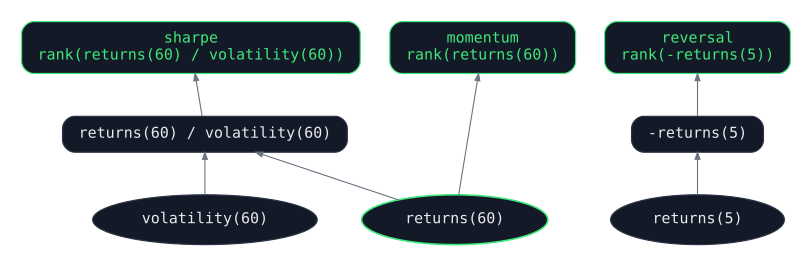
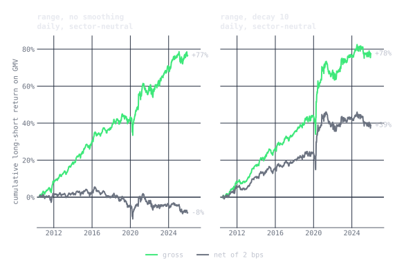
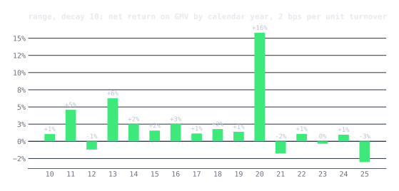

Let's talk about qex.

I have been building a small language for expressing quant alphas, the
cross-sectional forecasts a systematic investor turns into a portfolio.
It is called qex, which is short for "*q*uantitative *ex*pression" and
which I pronounce as *kecks*. The project is
[open source](https://github.com/marketneutral/alpha-parser), and there
is a dedicated [documentation
site](https://marketneutral.github.io/alpha-parser/). A simple but mighty one-line qex expression is:

```qex
rank(-returns(20) / volatility(60))
```

That says to rank stocks by risk-adjusted one-month momentum and bet
against the winners, which makes it a mean-reversion alpha, and the
equivalent pandas is fifty lines of rolling windows, axis arguments, and
NaN handling. You do not need to be a programmer to read the short
version: most portfolio managers can code, but anyone who can write an
Excel formula can read that line, and most of what follows.

That is the idea behind qex: the shortest possible distance between "I
think markets behave like this" and code that tests it. The belief goes in,
nearly word for word, and nothing else does.

<div class="note">

**Sidebar: The cross-section.** Working across a wide cross-section
of stocks at once is second nature inside institutional quant firms and
somewhat obscure outside them. The motivation is Grinold's Fundamental Law
of Active Management: the information ratio is roughly the skill of each
forecast, the information coefficient, times the square root of breadth,
the number of independent bets, or `IR = IC * sqrt(BR)`.
Institutional quants exploit small mispricings, so each forecast carries
little skill, and the way to turn that into a meaningful risk-adjusted
return is to apply it across the largest breadth of opportunities
possible. A broad universe also guards against selecting your way into a
flattering sample.

</div>

## From a belief to a line

Here is a belief about markets, built up one clause at a time, and the
expression built up alongside it.

```qex
# Stocks that fell last week bounce back.
rank(-returns(5))

# ...relative to their sector,
group_demean(rank(-returns(5)), 'sector')

# ...measured in units of how much the stock usually moves,
group_demean(rank(-returns(5) / volatility(60)), 'sector')

# ...and I do not want to trade every wiggle.
decay_linear(group_demean(rank(-returns(5) / volatility(60)), 'sector'), 10)
```

Each clause of the sentence is one operator, and the expression never says
anything the sentence does not. Other beliefs read the same way:

```qex
# Past-year winners keep winning, skipping the last month.
rank(delay(returns(231), 21))

# Quiet stocks beat noisy ones.
rank(-volatility(252))

# When price and volume move together, the move fades.
rank(-ts_corr(returns(1), volume(1), 20))

# Momentum, but only in names that trade $10M a day.
rank(returns(20)) * (adv(20) > 10000000)

# Earnings surprises keep drifting for a quarter.
rank(fill_forward(field('earnings_actual') - field('earnings_estimate'), 60))
```

What is missing is everything a pandas version would add: the loops, the
index alignment, the `axis=` arguments, the warmup, the NaN handling, the
care not to peek at tomorrow. None of it is the belief, all of it is where
the bugs live, and in qex it is the engine's job, written once. The mental
load left is the idea itself.

## Why a language

Anyone who has read Kakushadze's *101 Formulaic Alphas* will
recognize the style.
Expressions like `rank(ts_corr(returns(1), volume(1), 20))` are
indicative of one flavor of domain-specific language, or DSL, that
large quant shops could use to describe alphas.

The usual argument for the form is readability, and it is true that the
expression captures the idea where the pandas buries it. But in the age
of coding agents, "a human has to read this" gets weaker every month,
because nobody reads the fifty lines any more; a model writes them and
another model reviews them. Readability for the reviewer matters less than
it used to. Writability for the person with the idea, the short path from a
belief to a test, matters more than ever, and so does what a closed language
changes for the machines. The real case for a language is about both:

- **The expression is the hypothesis, not the implementation.** It is the
  smallest artifact that fully specifies an alpha, and everything else is
  engine, which is written once.
- **A closed vocabulary makes generated work checkable.** When an agent
  writes fifty lines of pandas, a lookahead, a misaligned index, or a
  wrong axis can hide on any line, and reviewing it costs about what
  writing it did. When an agent writes a qex expression, every well-formed
  expression is already aligned, warmup-aware, and lookahead-free, so the
  only thing it can be wrong about is the idea.
- **Terse is cheap for models.** An expression is a few dozen tokens where
  the pandas is a few thousand, which matters when you want a model to
  propose, mutate, and score thousands of candidates, or hold an entire
  alpha library in context while it works.
- **Alphas become data.** Expressions can be stored, diffed, deduplicated,
  searched, and evolved. Shared sub-expressions are visible, so a thousand
  alphas cost far less than a thousand times one. None of that is possible
  when each alpha is its own script.
- **The grammar is a search space.** Machine-generated alphas need
  somewhere to search, and "all Python programs" is not it. A closed set
  of operators and fields, composed by a grammar, is a finite and
  well-shaped space: every point in it is a valid alpha, neighbors are a
  single operator or window away, and mutation and crossover are defined.
  That is what genetic programming and reinforcement learning over alphas
  have always needed, and what a pile of scripts never gives them.
- **Review is constant time.** A portfolio manager can audit the intent of
  an expression at a glance, and that is the only kind of review that
  scales to machine-generated research.

In the [last post](/posts/hedge-fund-evolution/) I described the quant
workflow as an assembly line, with alpha research as one stage feeding
signal combination downstream. An alpha language is the interface
between those two stages, and it is what lets alpha research be done by
many people, or by many agents, and still plug into the same pipeline.

## Three axes

A dataset, e.g., pricing, is organized in qex as tickers across the columns and data increasing in time along the rows. Every operation in qex works along one of three axes, and knowing which
one is most of what you need to read an expression.

**Time series** operations run down the rows, one ticker at a time:

```qex
ts_mean(close(), 20)      # 20-day rolling mean
delta(close(), 5)         # change over 5 days
ts_corr(returns(1), volume(1), 20)
ewma(returns(1), 10)      # exponential average, 10-day half-life
```

**Cross-sectional** operations run across the columns, one day at a
time:

```qex
rank(returns(20))         # percentile rank across stocks, 0 to 1
zscore(returns(20))
winsorize(returns(20), 0.05)
```

**Group** operations are cross-sectional within a bucket, such as a
sector, an industry, or a pair:

```qex
group_demean(returns(60) / volatility(60), 'sector')   # sector-neutral momentum
group_rank(returns(20), 'industry')
```

They compose, so sector-neutral momentum restricted to liquid names is:

```qex
group_demean(rank(returns(20)) * (adv(20) > 1000000), 'sector')
```

When an expression repeats itself, `let` names the pieces:

```qex
let mom    = returns(60),
    vol    = volatility(60),
    sharpe = mom / vol
in rank(sharpe) * sign(mom)
```

## Lazy trees, no lookahead

Parsing an expression builds a tree, and nothing is computed until you
call `evaluate` with data, which is a dictionary of DataFrames, one per
field, with dates down the index and tickers across the columns.

```
Rank
 └── Returns(period=20)
      └── Field('close')
```

Because the engine owns every operator, it can enforce things that are
hard to enforce in free-form pandas. The one I care most about is that
**every operation looks backward**, so there is no way to write an
expression that peeks at tomorrow, and `delay` refuses a negative period
rather than silently producing a backtest that is too good to be true.

## Sparse data is a first-class case

Earnings arrive quarterly, so a DataFrame of earnings has a value on
announcement day and NaN everywhere else, and ordinary rolling
operations do the wrong thing on it. For that case qex has event-aware
operators that roll over the past N *observations* rather than the past
N days.

Post-earnings announcement drift, with a textbook standardized
unexpected earnings score, is three lines:

```qex
let surprise = field('earnings_actual') - field('earnings_estimate'),
    sue      = surprise / ts_std_events(surprise, 8)
in rank(fill_forward(sue, 60)) - 0.5
```

That divides this quarter's surprise by the standard deviation of the
last eight surprises, holds it for a quarter, ranks across stocks, and
centers for long-short, and the expression reads like the paper.

## Shared work is done once

A research session evaluates many signals, and they often have overlapping atomic units. For example, momentum, risk-adjusted momentum, and short-term reversal all need daily
returns. qex builds a single graph for a set of signals and computes
each unique sub-expression one time.

<figure class="wide" id="signal-graph">
  
  <figcaption>Ovals read data directly. Rounded boxes are computed from other nodes. Green marks the named outputs, and the one green oval is the node two of them share.</figcaption>
</figure>

For three toy signals the saving is one node, but a portfolio may contain thousands of signals. These signals often draw from a common vocabulary of primitives. The
same graph can be handed to Dask and evaluated across a cluster, with
the data scattered to workers once.

## Evaluation

A signal is only interesting once you know whether it predicts anything,
so the package ships with the usual tooling: a long-short backtest with
transaction costs and drawdown analysis, quantile analysis with rank IC,
and walk-forward splits.

```python
from qex import qex, Backtest, QuantileAnalysis

signal = qex("rank(returns(60)) - 0.5")

Backtest(signal, transaction_cost=0.001).run(data).summary()
QuantileAnalysis(signal, n_quantiles=5).run(data).summary()
```

There is also a multi-factor risk model whose factor definitions are
themselves qex expressions, so a factor is just another signal.

## A real run

Let's work some real data and an alpha idea motivated by an alpha well known in "the literature." The universe is every current S&P
500 member with a full price history back to mid-2009, 414 names, with
adjusted daily bars from Yahoo Finance. *Using current membership makes
the basket survivorship-biased, of course.* At worst, the names that fell
out of the index on the way down are exactly the ones a reversal alpha
would have been buying. This post is primarily about the qex machinery; your actual data should include dead stocks.

The alpha is short-term reversal, which is the family that shows up in
price-only data at a horizon of days to weeks, and the economic story
behind it is old and well documented. Jegadeesh (1990) and Lehmann
(1990) showed that last week's losers beat last week's winners, and the
standard explanation is liquidity provision: when someone has to sell in
size, the price moves more than the news justifies, and whoever takes
the other side is paid for it as the price comes back. Nagel (2012)
makes that precise by showing that the return to reversal is
compensation for supplying liquidity and spikes exactly when liquidity
evaporates. It is also the alpha style in Khandani and Lo's
[*What Happened to the Quants in August 2007?*](https://web.mit.edu/~alo/www/Papers/august07.html),
which uses Lehmann's contrarian rule, long recent losers and short recent
winners in proportion to their move, as the canonical statistical
arbitrage strategy. Demeaning within sector rather than against the
market is a modern refinement. This is a "poor man's residual reversal": what you want to fade is the stock-specific move and not the industry's.

In this post we capture the reversal idea as a function of where the stock closed within its own five-day
high-low range (inverted so that a close near the low is a buy). It is
reversal scaled by the stock's own recent volatility. Technical analysis is often derided, rightly so in most cases, because technicians don't think cross-sectionally. Here, though, they are vindicated. Technicians
have called this alpha *Williams %R* or *a stochastic oscillator* for fifty years.
We enhance it with the basics of the modern stat arb toolkit: rank it across stocks, demean within sector so the book is sector-neutral
and dollar-neutral by construction, and smooth it with a linear decay:

```qex
let lo   = ts_min(low(), 5),
    hi   = ts_max(high(), 5),
    pos  = (close() - lo) / (hi - lo),
    book = group_demean(rank(-pos), 'sector')
in decay_linear(book, 10)
```

`pos` is where the close sits in the stock's five-day range, 0 at the low and
1 at the high, so ranking `-pos` buys the stocks that closed near their lows
and sells the ones that closed near their highs.

The decay is a denoiser. `decay_linear` is a weighted moving average whose
weights fall off linearly with age, the linear cousin of an
exponentially weighted average: over a ten-day window today carries 18%
of the weight, yesterday 16%, and the tenth day back under 2%, so the
signal is smoothed without being lagged the way an equal-weight ten-day
mean would lag it. In my experience, the decay operator is extremely powerful!

The first check, before any backtest, is whether the alpha sorts returns
at all. `QuantileAnalysis` cuts the universe into quintiles of the alpha
each day and holds each quintile as an equal-weight portfolio for a day.
The chart shows each quintile's return relative to the equal-weight
universe. The quintiles are monotonic, and the top-minus-bottom spread
is 8.3% a year at a Sharpe of 0.84 before costs, which is about 4% on
GMV and in line with the backtest below.


The book is rebalanced every day to the alpha's weights, and turnover is
quoted per day. The run is July 2010 to December 2025. Costs are charged
per unit of turnover at 2 basis points, which is an aspirational but reasonable level for
an institution (I'm assuming a lot here!). All returns are on gross market value, GMV, unlevered,
meaning a dollar long against a dollar short with no financing and no
leverage.

One more disclosure: this is a *delay-0* alpha. The signal is computed
from the close and the book is traded at that same close, so the run
assumes you can measure the day's range and execute on it in the same
print. That is possible, with the trade computed from the closing
auction's imbalance or in the last minutes before the bell, but it is
not the usual setup for a high-capacity book, which computes the signal
at the close and trades the next day, a *delay-1* alpha. Short-horizon
reversal is exactly the kind of alpha that gives something up to a day
of delay, so treat these numbers as the delay-0 upper end.

The table shows the same alpha unsmoothed and with a ten-day decay.

| Range, daily | Turnover / day | Gross on GMV | Gross Sharpe | Net on GMV at 2 bps | Net Sharpe | Max drawdown |
|---|---:|---:|---:|---:|---:|---:|
| no smoothing | 84% | +3.8% | 0.98 | -0.5% | -0.13 | -21% |
| **decay 10** | **32%** | **+3.8%** | **0.90** | **+2.2%** | **0.52** | **-15%** |

Returns are annual and on GMV. Max drawdown is on the book net of 2 basis
points.

<figure class="wide" id="gross-vs-net">
  
</figure>

The alpha looks "ok". Gross Sharpe is 0.90 to 0.98 over the run, and
the same held on a mid-cap universe and in the sub-periods I checked
along the way. Just under four percent a year on the gross book is good
for a single price-based alpha, since a real quant book runs at four to
six times leverage, where it is mid-teens to twenty percent before
financing, and no quant book trades a single alpha anyway; this one
would be one input among many.

Something surprising: **smoothing is close to a free lunch here.** The ten-day decay cuts turnover from 84% to 32%, cuts the drawdown from 21% to 15%, takes the net Sharpe
at 2 basis points from negative to about 0.5, and gives up nothing in
gross return. The only cost is a tenth of a point of gross Sharpe.
Diversification is supposed to be the only free lunch in finance, and
smoothing a fast alpha is a close second. The reason it is nearly free
is the horizon of the alpha. The chart shows the rank IC of each
signal against the cumulative return over the next k days. Against the
next day's return the unsmoothed signal's IC is about 0.010 and the
smoothed signal's is half that, but by a week out the two curves have
met, and against the next ten days they are the same, 0.011 and 0.010.


The signal predicts a move that plays out over about two weeks, so
averaging the last ten days of ranks keeps the forecast and discards the
daily noise that was driving the turnover; the smoothed ranks have a
day-to-day autocorrelation of 0.95 against 0.57 unsmoothed. The lunch
stops being free when the alpha's horizon is shorter than the smoothing
window, which is the thing to check before turning the decay up. In the
language, the check is one `decay_linear` around the expression and a
rerun. Turnover around thirty percent a day
is the classic mid-frequency statistical arbitrage space, ten days is a
common default for this kind of smoothing.

The gross column is not wasted on whoever does not pay the cost. A
high-frequency firm is (at best) paid the spread rather than charged it, and to a
market maker a signal with a gross Sharpe near one and 84% daily
turnover is something it could use to lean its quotes, not a book it cannot afford to
trade. The move of high-frequency firms into statistical arbitrage,
such as Hudson River Trading holding positions for days and weeks in
Bloomberg's December 2025 [story on the
firm](https://news.bloomberglaw.com/securities-law/more-risk-less-speed-hudson-river-mints-billions-slowing-down),
is this picture from the other side: the signal is the same and the
cost is the only difference. The same holds for a sell-side desk that
can cross client flow internally, or a large buy-side manager that can
cross its own flow, since either one trades at a big cost advantage and earns something closer to the gross line in expectation.



The smoothed book is positive in twelve of the sixteen full calendar
years, and the standout is 2020, when reversal made in one year what it
normally makes in five, which is Nagel's point exactly: dislocation is
when liquidity providers get paid. The last few years are thinner, and
the plain reading is that an alpha this simple decays as more capital
trades it. This post is not meant to hand you a new alpha source; if it
were still a secret I would not be writing it up 😉. A fun thought
experiment, though, is that **this approach was just as well known before
2020**, and it still made five years of return in one when liquidity
disappeared. Being crowded did not stop it from paying when the
paying mattered.

## Limitations

The data model is a single value per cell, so qex is not point-in-time on its own.
If a company reports a dollar of earnings in January and restates it to
three dollars in March, qex only knows one of those numbers, and the run
above uses today's adjusted prices and today's index membership, which
is why it is survivorship-biased. Bi-temporal data, where every value
carries both the date it describes and the date it became known,
could come in a future release. qex is meant in its current form as an
exploration tool, not production ready for an institution.

## Future directions

qex is a natural fit for a language model that writes alphas. A
model that writes pandas can introduce lookahead without seeing it, and
the result is fifty lines nobody wants to audit. A model that writes qex
cannot look ahead, because the operators do not allow it, and the search
space is constrained to a closed vocabulary of operators and fields,
which makes a candidate alpha cheap to generate, cheap to check, and
cheap to compare against the library. Using qex, you can ensure the agent doesn't have read access to the data directly. The package already lets a dataset
describe its own fields, so an agent can discover what is available
before it proposes an expression.

qex is at version 0.3, Apache licensed, and installs from the repo.
Issues and pull requests are welcome.

## References

- Doherty, K. "More Risk, Less Speed: Hudson River Mints Billions Slowing
  Down." *Bloomberg*, December 2025.
  [news.bloomberglaw.com](https://news.bloomberglaw.com/securities-law/more-risk-less-speed-hudson-river-mints-billions-slowing-down)
- Grinold, R. C. "The Fundamental Law of Active Management." *Journal of
  Portfolio Management* 15(3), 1989.
- Grinold, R. C. and Kahn, R. N. *Active Portfolio Management: A
  Quantitative Approach for Producing Superior Returns and Controlling
  Risk*, 2nd ed. McGraw-Hill, 2000.
- Jegadeesh, N. "Evidence of Predictable Behavior of Security Returns."
  *Journal of Finance* 45(3), 1990.
- Kakushadze, Z. "101 Formulaic Alphas." *Wilmott* 2016(84), 2016.
  [arxiv.org/abs/1601.00991](https://arxiv.org/abs/1601.00991)
- Khandani, A. E. and Lo, A. W. "What Happened to the Quants in August
  2007?" *Journal of Investment Management* 5(4), 2007.
  [web.mit.edu/~alo](https://web.mit.edu/~alo/www/Papers/august07.html)
- Larkin, J. *qex: a domain-specific language for quant alphas.*
  [github.com/marketneutral/alpha-parser](https://github.com/marketneutral/alpha-parser)
- Lehmann, B. N. "Fads, Martingales, and Market Efficiency." *Quarterly
  Journal of Economics* 105(1), 1990.
- Nagel, S. "Evaporating Liquidity." *Review of Financial Studies* 25(7),
  2012.
- Tulchinsky, I. et al. *Finding Alphas: A Quantitative Approach to
  Building Trading Strategies*, 2nd ed. Wiley, 2019.
