Allocators and multi-manager platforms are shown a lot of track
records. Some are audited returns from a fund that has been running for
years, and those are fine. The hard ones come from the quant with a
signal and no fund yet, who wants capital to run it. They can show a backtest, which proves nothing,
because anyone can fit a backtest. They can show a paper track record,
which nobody can verify. Or they can show the signal itself, at which
point they have given it away, and they know it. So they don't, and the
conversation ends where it started: trust me.

The quant's problem is the mirror image. They have something that might
be real, no way to prove it without disclosing it, and good reason to
believe that anything they put on someone else's server will be logged,
inspected, or quietly traded. Both sides would be better off with a
neutral third party that could say "this signal has made money, out of
sample, for eighteen months" while being unable to say what the signal
is. That utility does not exist. This post is a thought experiment about
how to build it.

It builds on qex, the small language for alphas from
[an earlier post](/posts/qex/). qex matters here for one reason: it
turned an alpha into a single string. A string can be encrypted. A
deterministic evaluator can run it. And a string is also exactly the
thing that needs protecting, because handing it over is handing over the
whole idea. A toy alpha is one line. A real one is longer, and it is
still one string, and everything that took months to find is in it: the
signal, the conditioning, the crowding adjustment, the risk control,
the trading rule. Every term in it is a decision somebody made, usually
after trying the alternatives. Why five days and not ten. Why demean by
sector. Why halve the position when volatility is above its own average
rather than cut it to zero. Why bet less where volume is already
crowding in, and how much less. Why average the signal over twenty days
and not ten. None of that is in a textbook. It is a working
quant's intellectual property in the plainest sense: months of
hypotheses, most of them discarded, compressed into the few that
survived. Which is also why it is so easy to steal. The expression
carries no trace of the work that produced it; whoever reads it gets the
conclusions for free. Here is one.

```python
let r5     = returns(5),
    vol20  = volatility(20),
    rev    = group_demean(-r5 / vol20, 'sector'),
    crowd  = ts_rank(volume(5) / volume(60), 120),
    stress = vol20 > ewma(vol20, 60),
    raw    = where(stress, 0.5 * rev, rev) * (1 - 0.5 * crowd)
in decay_linear(demean(max(min(zscore(raw), 3), -3)), 20)
```

And it is not "try things and see". Every term is a claim about how
markets behave, and the string is the claim written down. Read back
into English, it says this:

<div class="callout">
I believe stocks that fell this week, relative to their sector, will
bounce, because somebody had to be paid to take the other side of a
rushed trade. I believe the bounce is proportional to how unusual the
move was for that stock, not how large it was in dollars. I believe a
move is more likely to be news than noise when the whole market is
repricing, so I bet half as much. I believe the same when a crowd
arrived with the move, so I bet less again. No name gets more than
three units of conviction, however loud the signal. I hold no net
position, so the market itself is not a bet I am making. And I average
the signal over the last four weeks, counting recent days most, so a
single day's reading moves the book a little rather than all at once,
and I trade less.
</div>

That is a theory of who is on the other side and why they will pay
you. The parameters are how strongly the author holds each belief. Both
are the secret.

That string is a program. qex parses it into a graph of operators, finds
the pieces that are used more than once, and evaluates the whole thing in
one pass with no lookahead anywhere. Here is the graph for the expression
above, with the inputs in green and the output at the top.

<figure class="diagram" id="signal-dag">
  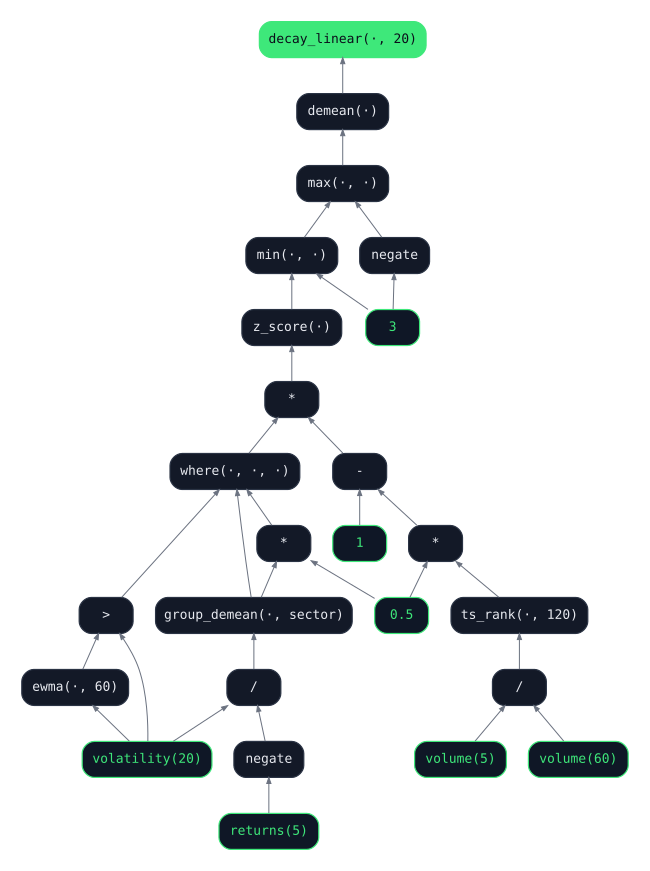
  <figcaption>The example alpha as qex sees it. Twenty-five nodes, seven inputs, four sub-expressions shared, one output.</figcaption>
</figure>

And because a string that cannot run is not an alpha, here it is run, on
the same universe as the qex post: the current S&P 500 with a full
history back to 2009, rebalanced daily. Nothing is done to the
expression's output except scaling it to unit gross. The book is exactly
what the string says.

<figure class="wide" id="example-alpha">
  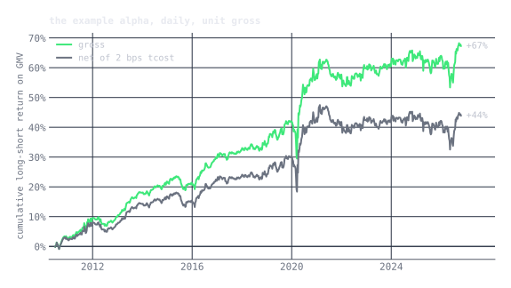
</figure>

It is an OK alpha. Up and to the right for its first eleven years and
flat since, through the day this post went up, with a gross Sharpe of
0.67, a net Sharpe of 0.47 after a 2 bps transaction cost, no net
market exposure, and a fifth of the book turning over each day after
the twenty-day decay. Not great; nobody raises a fund on it. The point of the example is not
the number. It is that something this specific fits in one string, and
that the string is the whole secret.

It also did not arrive in this form, and how it got here is the other
half of the point. The first draft had ten lines: a term that leaned
against moves volume was chasing, a liquidity floor, and positions
scaled by each name's volatility. It ran at a gross Sharpe of 0.47 and
barely above zero net. So I did what the quant in this story does.
Wrote the hypotheses down, tested each one on 2010 through 2018 only,
and looked at 2019 onward exactly once, at the end. Thirty-seven
trials. The search removed things rather than added them. The volume
term was noise with a trading cost attached; dropping it alone took the
in-sample net Sharpe from 0.3 to 0.9. Scaling by volatility
concentrated the book in the quietest names, which are the ones with
the least to reverse. The liquidity floor did nothing in the S&P 500.
And stretching the decay from ten days to twenty cut trading by a
third at no cost in net return, which is about as close to a free lunch as
this business offers. Out of sample the improvement survived at roughly
a third of its in-sample size, which is the usual exchange rate, and a
single year, 2020, accounts for much of it.

Every sentence in that paragraph is a claim about the author's process,
and none of it is checkable. That is the whole problem. A backtest
slide cannot distinguish thirty-seven honest trials from thirty-seven
thousand dishonest ones; only data the author never touched can.

## Four tools

Before the design, four ideas. They come from cryptography and from
chip design, and all four are already in your phone. Nothing about
finance appears in this section.

**A hash is a fingerprint.** Feed a hash function anything, a word or a
whole library, and it gives back a short string of fixed length. The
same input always gives the same string. Change one character and the
string changes completely. And the string cannot be run backwards to
recover the input. So a fingerprint lets you prove you had a document
on a certain date without showing it: publish the fingerprint, keep the
document, and produce it whenever you like.

<figure class="diagram narrow tight" id="tool-hash">
  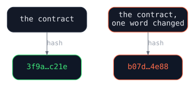
</figure>

**Encryption is a lock anyone can close and one key opens.** A keypair
is two numbers, generated together, with the property that what one
locks only the other opens. You give the public one to the world and
keep the private one. Anyone can now seal a letter to you, and only you
can read it. The post office that carries the letter cannot.

<figure class="diagram tight" id="tool-encrypt">
  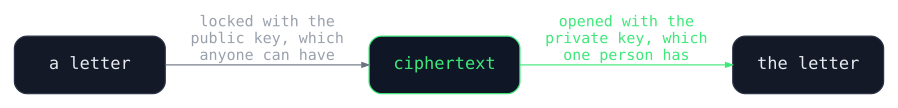
</figure>

**A signature is the same lock run in reverse.** Lock something with the
private key instead, and anyone with the public key can open it, which
proves it came from you and was not changed on the way. Nobody without
the private key can produce a signature that checks out. It is a
handwritten signature that cannot be traced.

<figure class="diagram tight" id="tool-sign">
  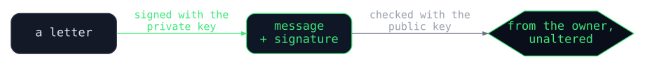
</figure>

**Attestation is a chip vouching for what it is running.** Some
processors can take a fingerprint of the program they just loaded and
sign it with a key burned into the silicon, producing a statement that
says "this exact program is running on this chip right now". Anyone who
knows what the program's fingerprint should be can check. It is the one
of the four that lets you trust a computer you do not control, because
it tells you what the computer is doing rather than who owns it.

<figure class="diagram tight" id="tool-attest">
  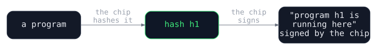
</figure>

That is the whole kit. One more thing, and it is not cryptography:
locks protect a letter while it sits in a drawer or travels in the
post, but to read it, someone has to open it, and while it is open it is
readable. The rest of this post is about building a room where the
letter can be opened and read by a program, with nobody else in the
room, and the chip at the door swearing to who is inside.

## The idea in one picture

Evaluation and visibility are separable. A trusted execution
environment, or TEE, is an isolated piece of compute that keeps code and
data confidential from everything outside it, including the machine's
own administrators, and can prove what it is running. It can compute on
data that nobody outside it can read and return only the result. So the
quant encrypts the alpha to a key that exists only inside such an
environment, the platform evaluates it there, and the public sees the
score.

<figure class="diagram" id="idea">
  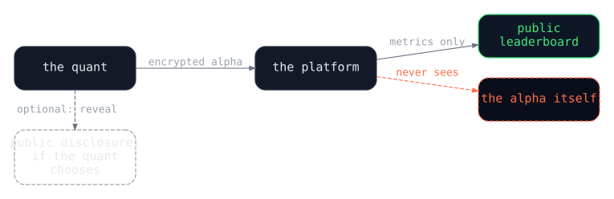
  <figcaption>The whole design in four boxes. The platform runs everything and sees nothing.</figcaption>
</figure>

The platform operates the infrastructure. The platform cannot read the
signals. Both statements are true at once, and the rest of this post is
about why.

## How the pieces connect

<figure class="diagram" id="data-flow">
  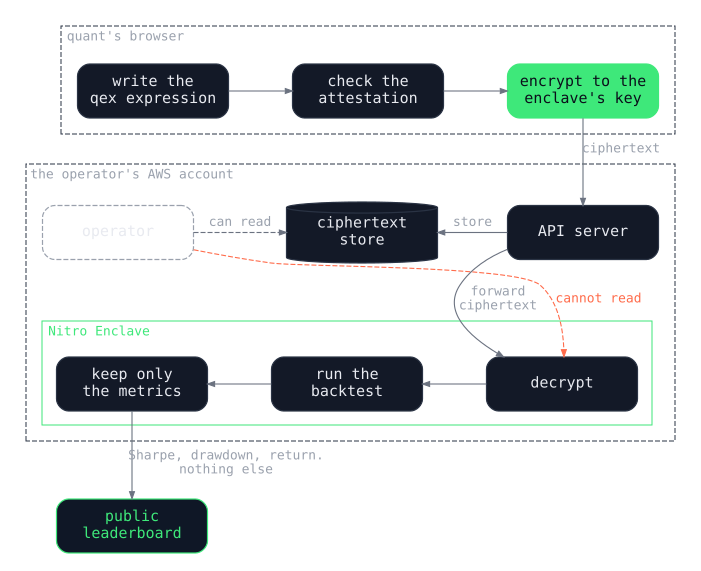
  <figcaption>Only ciphertext crosses into the platform. Only metrics come out of the enclave. The red arrow is the one thing the operator cannot do.</figcaption>
</figure>

The quant's browser encrypts locally. The API server stores ciphertext
it cannot open and forwards it. The enclave decrypts, evaluates, and
emits a handful of aggregate statistics. The alpha exists in plain text
for a fraction of a second, inside isolated hardware, and then it is
gone.

## One submission, step by step

<figure class="diagram" id="sequence">
  
  <figcaption>Eight messages. The server touches ciphertext and metrics, never a key and never the alpha.</figcaption>
</figure>

The browser asks for the enclave's public key (1, 2) and gets it back
wrapped in an attestation (3, 4), which is the chip's signed statement
that a specific, published program is running and owns that key. The
browser checks the statement before it does anything else. Then it
encrypts the alpha, locally, and sends the ciphertext along with a hash
of the plain text (5). The server stores the ciphertext, which it cannot
read, and forwards it (6). The enclave decrypts, runs the backtest,
erases the plain text, and returns four numbers (7), which the server
records and shows the quant (8).

The server is a pass-through. It handles accounts, storage, and routing.
It never holds a key.

## What an enclave is

An AWS Nitro Enclave is a small virtual machine carved out of an ordinary
EC2 instance by the Nitro hypervisor, the thin layer of software that
sits between the hardware and every virtual machine on the box. The
hypervisor gives the enclave its own CPU cores and its own region of
memory, then refuses to let anything else touch them, including the
parent instance it was carved from. The enclave has no persistent disk,
no network interface, and no SSH. Its only connection to the world is a
narrow local socket back to the parent.

<figure class="diagram" id="tee-isolation">
  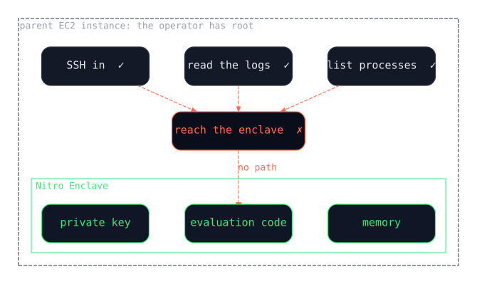
  <figcaption>Root on the parent instance gets you the parent instance. The enclave is on the same machine and out of reach.</figcaption>
</figure>

The parent instance is the operator's machine. The operator has root on
it. Root does not help, because the wall is not in the operating system.
It is one layer down.

<figure class="diagram" id="hypervisor">
  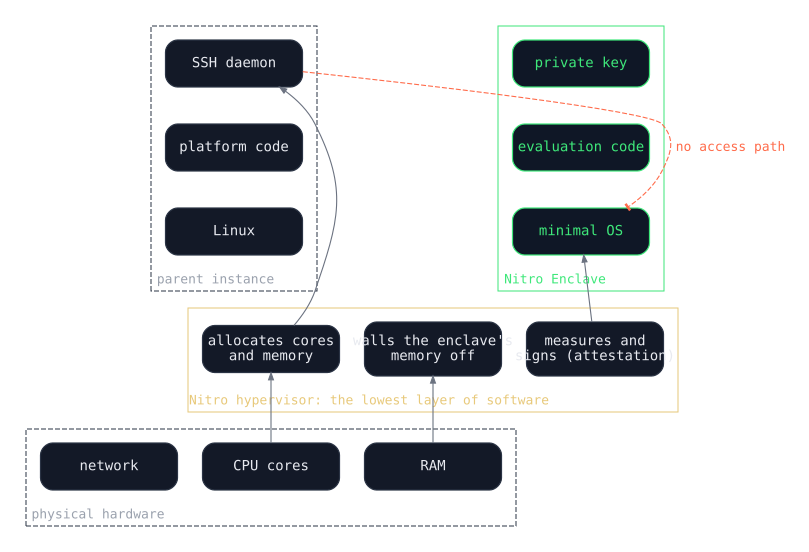
  <figcaption>The hypervisor hands out memory and then enforces who may read it. The operating system above it, and anyone with root on it, cannot override that.</figcaption>
</figure>

A hypervisor is the lowest layer of software in a virtualized machine.
It decides which virtual machine gets which cores, which memory, which
devices, and when it says a region of memory belongs to the enclave and
nothing else may read it, that is enforced at the memory controller.
Nitro is Amazon's own hypervisor, built for its cloud and running on
dedicated hardware rather than as a modified Linux. The enclave it
creates has its own cores, its own memory, no network card, and talks to
the parent only through a local socket.

A note on where the trust sits, for readers who know the other TEEs.
Intel's SGX and AMD's SEV-SNP enforce isolation inside the processor,
with memory encrypted by the CPU, so even the hypervisor is outside the
trust boundary. Nitro enforces it in the hypervisor and the dedicated
hardware it runs on, so the trust boundary includes AWS's hypervisor. A
purist would call Nitro a hypervisor-based TEE rather than a
hardware-rooted one. For this design it is the right tradeoff: strong
isolation, cheap attestation, a shorter side-channel history than SGX,
and all of it in production. It is also why "AWS" is the first item in
the list of things this design does not protect against.

How battle-tested is it? Enclaves of this kind have been in production
for years. Signal's private contact discovery has run inside SGX since
2017. Nitro Enclaves have been available since 2020 and are used for
key custody, for crypto-asset custody, and for handling regulated health
data, all of which are higher stakes than a leaderboard. No public break
of Nitro isolation has been reported. That is not a proof, and the
honest claim is "the best practical security available", not
"impossible to break". The realistic threat model is also worth saying
out loud: anyone holding a hypervisor exploit has far more valuable
things to point it at than a list of alphas.

## The key is bound to the code

There is a loophole in everything so far. The operator owns the AWS
account and can deploy any enclave they like, including one that
decrypts every submission and exports it. Attestation, below, would
catch that for new submissions. What about the ones already stored?

The answer is to bind the private key to the code. The enclave does not
keep a key of its own across restarts; it asks AWS Key Management
Service for one, and KMS is configured to release it only to an enclave
whose attested hash matches the published one.

<figure class="diagram" id="key-binding">
  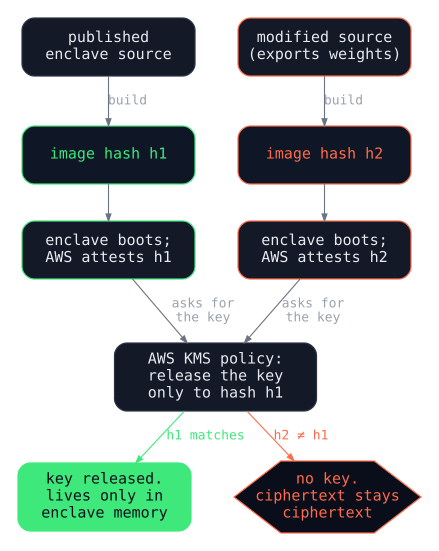
  <figcaption>Change a byte of the enclave and its hash changes. KMS will not release the key to the new hash, so every submission ever made stays encrypted.</figcaption>
</figure>

So the modified enclave boots, asks for the key, and is refused. Every
expression ever submitted was encrypted to a key that only the published
code can obtain. Here is the full list of ways the operator might try to
get at a submission, and why each one fails.

| What the operator might try | Why it fails |
|:---|:---|
| SSH into the enclave | No SSH daemon, no network interface |
| Read enclave memory from the parent | The hypervisor enforces isolation below the operating system |
| Attach a debugger | Production enclaves expose no debug interface |
| Dump the enclave to disk | There is no disk |
| Ask AWS for the key | AWS never holds it; it is released into enclave memory and nowhere else |
| Modify the enclave to export the key | The hash changes; KMS refuses; the browser refuses to submit |
| Compromise KMS | KMS releases only to an attested enclave with the published hash |
| Side channels | Possible in principle; not the cheap path to a quant leaderboard |

The private key is cryptographically out of the operator's reach. Not
"we promise not to look". Not "it is against our policy". The operator
has, deliberately and verifiably, engineered themselves out of their own
threat model, and that is the sentence I would want on the front page:
"we cannot look, and here is how you check".

## Attestation, or how you know what is running

Isolation protects a running enclave. It does not, by itself, tell the
quant that the enclave is running the code it claims to run. That is
attestation, the fourth tool.

When an enclave boots, the hypervisor measures the image it loaded and
produces a signed document containing that measurement, together with
the public key the enclave generated for itself:

```json
{
  "pcr0":          "4f1c…9ae2",
  "pcr1":          "…",
  "pcr2":          "…",
  "public_key":    "…",
  "timestamp":     "2026-10-22T14:03:11Z",
  "aws_signature": "…"
}
```

`pcr0` is the hash of the enclave image. Change a single byte of the
code and it changes. The enclave's source is public, so anyone can build
it, compute the hash, and compare. The quant's browser does exactly that
before it encrypts anything.

<figure class="diagram" id="attestation-chain">
  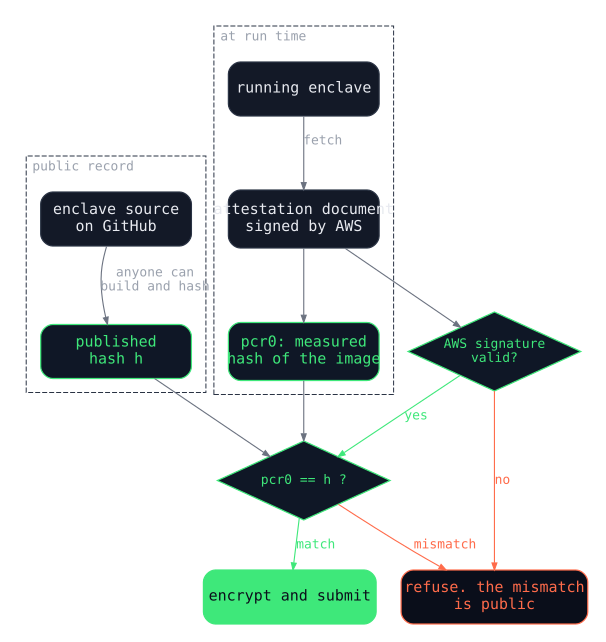
  <figcaption>Two checks before a single byte is encrypted: is the statement really from AWS, and is the program it describes the published one?</figcaption>
</figure>

If the operator deploys modified code, the hash changes, the check
fails, the browser refuses to submit, and the mismatch is visible to
everyone. Because the code is open, anyone can also read it and confirm
the one thing that matters most: that it returns metrics and never
weights. Trust is not required. Verification is possible.

## What comes out

The enclave code decides what leaves it, and the code is public, so this
part is auditable:

```python
def evaluate(ciphertext, private_key, prices):
    expression = decrypt(ciphertext, private_key)  # only possible in here
    signal = qex(expression)
    result = Backtest(signal).run(prices)
    return {
        "sharpe":       result.sharpe,
        "total_return": result.total_return,
        "max_drawdown":  result.max_drawdown,
        "volatility":   result.volatility,
    }
    # never: weights, positions, per-name signals, the expression
```

| Output | Returned | Why |
|:---|:---|:---|
| Sharpe ratio | yes | A single scalar; infinitely many portfolios share it |
| Total return | yes | A single scalar |
| Max drawdown | yes | A single scalar |
| Volatility | yes | A single scalar |
| Portfolio weights | no | Directly tradeable |
| Per-name signals | no | The weights follow from them |
| Daily positions | no | The sequence is the strategy |

Four numbers. A Sharpe ratio cannot be inverted into trades. The
information loss is the product.

## The same data for everyone

Privacy is the reason a quant would submit. Central evaluation is the
reason the result is worth anything, and for quants this part matters as
much as the enclave.

A backtest run on the quant's own machine is unverifiable even when it
is honest. Nobody else knows which price series were used, whether
delisted names were in the universe or quietly dropped, whether the
fundamentals were the numbers known on the day or the restated ones that
arrived a quarter later, or whether a rolling window somewhere reached
one day into the future. Every one of those is a way to manufacture a
Sharpe ratio without meaning to, and the person reading the record
cannot tell the difference from the outside.

On the platform none of that is up to the submitter. The data is one
curated set, point in time, with the universe as it stood on each date,
and its provenance is published. The language cannot look ahead, because
no qex operator can see tomorrow; that was the design argument in the
earlier post, and it is the reason a closed vocabulary is the right
thing to evaluate inside an enclave. A record on the board therefore
means the same thing for every signal on it: this expression, on this
data, from this date. That is a sentence no self-reported backtest can
say.

One caveat, from the qex post's own limitations section: qex today holds
one value per cell and is not bi-temporal, so true point-in-time
fundamentals, where every value carries both the date it describes and
the date it became known, are something the platform's data layer would
have to add. Prices and volumes are already fine.

## Out of sample by construction

Every submission is timestamped, and the leaderboard shows only what
happened after the timestamp.

<figure class="wide" id="oos-timeline">
  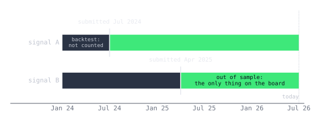
</figure>

The backtest over history runs so the quant gets feedback, but it does
not count. That makes the oldest problem in quant evaluation, overfitting
to the past, irrelevant to the ranking: you cannot overfit the future. It
also means a record only gets more credible with time, which is the right
incentive. A signal submitted today is worth nothing on the board today,
something in six months, and a lot in two years.

Alongside the ciphertext the browser sends a hash of the plain-text
expression. The platform cannot invert it, but the quant now holds a
timestamped commitment. If they ever choose to reveal the expression,
anyone can check that it is the one that earned the record, and when it
was submitted.

## Ranking records of different lengths

Signal A has 180 days out of sample and a Sharpe of 1.8. Signal B has 30
days and a Sharpe of 2.4. Raw Sharpe says B. Common sense says you know
almost nothing about B. The ranking has to handle records of every
length, arriving all the time, and it should grow more confident as they
grow.

The design borrows from chess. Each signal starts with an ELO rating of
1500. Every month each signal plays a handful of matches against others.
A match is decided on the overlapping window only, and the winner's
rating goes up by an amount that depends on how surprising the win was.

<figure class="diagram narrow" id="elo-match">
  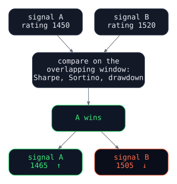
  <figcaption>One match. A lower-rated signal beating a higher-rated one moves both ratings more than the reverse would.</figcaption>
</figure>

**Matching.** Each signal gets about five matches a month. Only signals
with overlapping out-of-sample windows can play each other. Pairings are
weighted toward similar ratings, because a close match is more
informative, and a longer overlap makes a match count for more.

**Scoring.** The winner is decided by majority across three metrics on
the overlap, with small thresholds so that near-ties are draws:

```python
def match_winner(a, b, eval_date):
    """1 if A wins, 0 if B wins, 0.5 for a draw."""
    start = max(a.oos_start, b.oos_start)
    if start >= eval_date:
        return None                      # no overlap, no match
    ma, mb = metrics(a, start, eval_date), metrics(b, start, eval_date)
    a_pts = b_pts = 0
    if ma.sharpe > mb.sharpe + 0.1:   a_pts += 1
    elif mb.sharpe > ma.sharpe + 0.1: b_pts += 1
    if ma.sortino > mb.sortino + 0.1:   a_pts += 1
    elif mb.sortino > ma.sortino + 0.1: b_pts += 1
    if ma.max_dd > mb.max_dd + 0.02:    b_pts += 1   # lower is better
    elif mb.max_dd > ma.max_dd + 0.02:  a_pts += 1
    return 1.0 if a_pts > b_pts else 0.0 if b_pts > a_pts else 0.5
```

**Updating.** Standard ELO, with the step scaled down for short overlaps:

```python
def update_elo(elo_a, elo_b, outcome, overlap_days, k_base=32):
    k = k_base * min(overlap_days / 90, 1.0)
    expected_a = 1 / (1 + 10 ** ((elo_b - elo_a) / 400))
    elo_a += k * (outcome - expected_a)
    elo_b -= k * (outcome - expected_a)
    return elo_a, elo_b
```

A lucky month moves a rating a little. A year of winning moves it a lot.
The board itself would look something like this:

| Rank | Handle | Rating | Matches | Win rate | Days out of sample |
|:---|:---|---:|---:|---:|---:|
| 1 | `quant_42` | 1847 | 89 | 71% | 380 |
| 2 | `alpha_hunt` | 1792 | 64 | 68% | 220 |
| 3 | `sig_sage` | 1756 | 127 | 62% | 540 |
| 4 | `new_signal` | 1583 | 12 | 58% | 45 |

Rating is the ranking. Matches and win rate show how much to trust it.
Days out of sample shows how long the record is. Three further rules
keep it honest:

- **Provisional until twenty matches.** You cannot submit a hundred
  signals and keep the one that got lucky; the lucky one is not on the
  board until it has been tested.
- **No deletion after the first match.** You can withdraw a signal from
  future matches, but its record stands. There is no survivorship on the
  board.
- **Decay for the inactive.** Ratings of signals whose authors go quiet
  drift down slowly, so the top of the board is current.

| Problem | How the tournament handles it |
|:---|:---|
| Records of different lengths | Compare only on the overlap, and weight by its length |
| A lucky short run | Many matches over time; a short run cannot climb far |
| Regime changes | Matches continue, so the rating follows current conditions |
| A new submission | Starts at 1500, provisional, and has to earn its way up |
| A stale signal | Keeps losing matches, and its rating falls |

What is visible is tested, forward performance. What is hidden is how it
was achieved. I have not simulated the tournament, and I should: whether
ELO beats a length-adjusted Sharpe at recovering true skill is an
empirical question with a clean setup, and it is a post of its own.

## Upgrading without a back door

The design so far has a problem that only shows up on the second
deployment. Fixing a bug in the enclave changes its hash. The new hash
does not get the old key. So the new enclave cannot read any existing
submission, which is the security property working exactly as intended,
and also means the platform can never ship a fix.

The answer is immutable versions with explicit migration. Each enclave
version is frozen at deployment, with its own hash and its own key.
Expressions stay on the version they were submitted to.

<figure class="diagram" id="versions">
  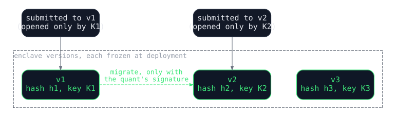
  <figcaption>Each version is a separate lock. Moving an alpha between them is the only operation that crosses a version boundary, and it needs the quant.</figcaption>
</figure>

To move an expression to version two, version one must re-encrypt it to
version two's public key, inside the enclave, after verifying version
two's attestation, and only with the quant's permission. The permission
is the part worth getting right, because the operator controls the
database where an "opted in" flag would live, and a flag in the
operator's database is a promise, not a guarantee. The design I was
working from solved that with a smart contract the enclave could query
independently. I think a signature is enough, and simpler. When a quant
submits, their browser generates a keypair and seals the public half
inside the ciphertext next to the expression. Migration then requires a
short message, signed by that key, naming the expression hash and the
destination version's hash, and the old enclave checks it.

<figure class="diagram" id="migration">
  
  <figcaption>No signature, no migration. The default is that nothing moves.</figcaption>
</figure>

```python
def migrate(ciphertext, authorization, v2_attestation):
    v2_key = verify_attestation(v2_attestation)
    expression, owner_key = decrypt(ciphertext, PRIVATE_KEY)
    assert authorization.expr_hash == sha256(expression)
    assert authorization.target == v2_attestation.pcr0
    assert verify_signature(authorization, owner_key)
    return encrypt((expression, owner_key), v2_key)
```

| What the operator might try | Why it fails |
|:---|:---|
| Migrate without asking | The old enclave requires a signature it cannot produce |
| Forge the quant's authorization | Only the quant's private key can sign; the public half is sealed in the ciphertext |
| Point v1 at a fake v2 | v1 verifies v2's attestation before re-encrypting |
| Modify v1 to skip the check | Different code, different hash, no key |

Old versions keep running until a sunset announced well ahead. A quant
who does nothing keeps their expression where it is.

## Reveal, if you want

Nothing here stops a quant from publishing their expression.

<figure class="diagram" id="reveal">
  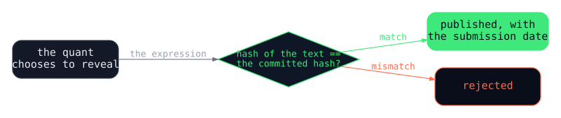
</figure>

The platform checks the text against the committed hash and posts it
next to the record, with the date it was first submitted. Reasons to do
that: to establish priority, to open-source a retired strategy, to
teach. Reasons not to: all the usual ones. The record stands either way.

## What this does not protect against

A design document that only lists what works is an advertisement. Here
is the other list.

- **AWS.** Everything rests on the Nitro hypervisor enforcing isolation
  and on AWS's attestation signatures being unforgeable. If AWS is
  compromised or malicious, every guarantee above fails. For most people
  that is an acceptable assumption, and it is the same one their bank
  makes. For anyone who cannot accept it, zero-knowledge proofs or
  multi-party computation remove the trusted hardware, at the cost of
  minutes to hours per evaluation instead of under a second.
- **Side channels.** Timing and cache attacks on enclaves exist in the
  literature. A leaderboard is not the target that justifies one, but
  "unlikely" is not "impossible".
- **Metadata.** The operator still sees who submitted, when, how often,
  and how each submission scored. That is far less than the alpha and it
  is not nothing. A pattern of resubmissions says something about what
  the quant is working on.
- **The oracle.** A quant can use the evaluator to search: submit a
  thousand variants and keep the one that backtests best. That is
  overfitting with extra steps, and the out-of-sample rule means it will
  not survive on the board, but rate limits and the provisional period
  exist because people will try.
- **Leakage through the metrics.** One Sharpe ratio is not invertible.
  Many Sharpe ratios over many overlapping windows for many close
  variants of a signal leak more than one does. The enclave should
  report coarse numbers, on a fixed schedule, and never for windows the
  submitter chooses.
- **Collusion among submitters.** Match outcomes depend on who you play.
  Sock-puppet signals that throw matches to a chosen one are a known
  problem in every rating system. Random pairing weighted by rating makes
  it expensive, not impossible.

## Questions people ask

**How can the platform evaluate a signal it cannot see?** Because the
part of the platform that evaluates is not the part the operator can
see into. The browser encrypts to the enclave's key. The servers route
and store ciphertext. Decryption happens only inside the enclave, the
evaluation runs there, four numbers come out, and the plain text is
never written anywhere.

**What stops the operator from changing the enclave's code?** Nothing
stops them deploying it. Attestation stops it from working: the new
code has a new hash, the browser sees the mismatch and refuses to
submit, and KMS refuses to give the new code the key to anything
already submitted.

**It runs in their AWS account. Can't they just get in?** No. The
parent instance cannot read enclave memory, attach a debugger, or reach
its filesystem, because there is none. The operator can start and stop
the enclave. That is the extent of it.

**What is the trust assumption?** AWS: that the Nitro hypervisor
enforces isolation and that attestation signatures cannot be forged. If
that fails, everything fails. For most threat models, AWS staking its
cloud business on it is enough. For the rest, see the limitations.

**Could the platform trade the signals without seeing them?** No. It
receives four aggregate numbers per evaluation and nothing per name.
Unlimited queries give it unlimited summary statistics, which is not
enough to reconstruct a position.

**What if the enclave's key is lost?** The key comes from a KMS-backed
secret and is re-derived on every restart, so the public key is stable.
If KMS itself were catastrophically lost, stored submissions would become
unrecoverable. Records and metrics are plain text in the database and
would survive; quants would resubmit.

**What stops someone submitting ten thousand random expressions?** Rate
limits, a minimum out-of-sample period before a signal appears, the
provisional rule, and the fact that random signals regress out of
sample. The board rewards sustained performance, not lottery wins.

**Can anyone verify the enclave code?** Yes. The source is public.
Build it, hash it, compare the hash to `pcr0` in the attestation. If they
match, what is running is what is published.

**Why not zero-knowledge proofs?** They would remove the AWS assumption
entirely. They also cost minutes to hours per evaluation for arbitrary
code and a great deal of engineering. Enclaves give strong guarantees in
under a second. ZK could be added later for people who need it.

**What if the platform disappears?** The quant still has their
expression. The metrics are ordinary records, exportable and auditable.
The hash commitment is timestamped proof of priority whether or not the
platform exists. Any compatible evaluator could take a resubmission.

**Are you running a hedge fund on these signals?** The point of the
design is that nobody can, including whoever runs it. Not "we would
not". "We cannot, and you can check".

## Summary

| Layer | What happens | Who can see it | Enforced by |
|:---|:---|:---|:---|
| Browser | The expression is encrypted | The quant only | Client-side cryptography |
| Network | Ciphertext travels | Nobody | HTTPS |
| Server | Ciphertext is stored | Nobody | No key exists outside the enclave |
| Enclave | Decrypt, evaluate, erase | The enclave only | Hypervisor isolation and attestation |
| Database | Metrics are stored | Everyone | Nothing to hide |
| Upgrades | Versions are frozen; migration needs a signature | The quant controls it | Key bound to code; signature checked in the enclave |
| Reveal | The expression is published | The quant's choice | Voluntary, checked against the commitment |

## Why anyone should build this

From the allocator's seat the case is simple. The world is full of
people who might have real skill and no way to prove it, and the people
with capital have no way to find them except through the funds that
already have it. A verifiable, forward-looking, privacy-preserving track
record is the credential that is missing. It is a public good in the
plain sense: worth more the more people use it, and nobody has to trust
whoever runs it.

From the quant's seat it is the first place to put a signal where the
operator cannot take it, by construction rather than by promise. That is
the only condition under which anyone would submit something real.

The components all exist. qex makes the signal a string. Enclaves and
attestation make the evaluator trustworthy without being trusted.
Timestamps make it out of sample. ELO makes the records comparable. What
is left is the building, which is a lot of work and, I suspect, worth
it.

<div class="callout">
No trust required. Verify everything.
</div>

## References

- Larkin, J. "qex: a small language for alpha." *Speculative Decoding*,
  February 2026. [/posts/qex/](/posts/qex/). Source:
  [github.com/marketneutral/alpha-parser](https://github.com/marketneutral/alpha-parser)
- Amazon Web Services. *AWS Nitro Enclaves User Guide.*
  [docs.aws.amazon.com/enclaves](https://docs.aws.amazon.com/enclaves/latest/user/nitro-enclave.html)
- Amazon Web Services. "Cryptographic attestation" and "Using
  cryptographic attestation with AWS KMS." *AWS Nitro Enclaves User
  Guide.*
  [docs.aws.amazon.com/enclaves/latest/user/kms.html](https://docs.aws.amazon.com/enclaves/latest/user/kms.html)
- Amazon Web Services. *The Security Design of the AWS Nitro System.*
  AWS Whitepaper, 2022.
  [docs.aws.amazon.com/whitepapers](https://docs.aws.amazon.com/whitepapers/latest/security-design-of-aws-nitro-system/security-design-of-aws-nitro-system.html)
- Marlinspike, M. "Technology preview: Private contact discovery for
  Signal." *Signal blog*, September 2017.
  [signal.org/blog/private-contact-discovery](https://signal.org/blog/private-contact-discovery/)
- Elo, A. E. *The Rating of Chessplayers, Past and Present.* Arco, 1978.
